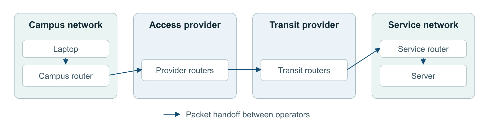
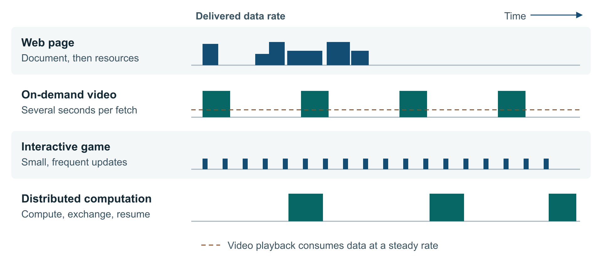
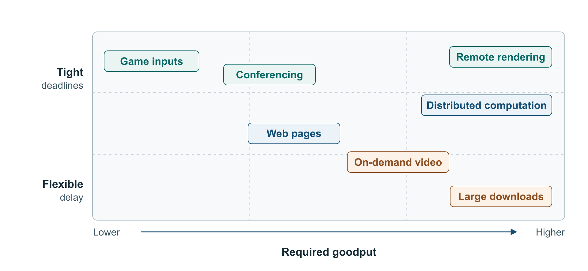
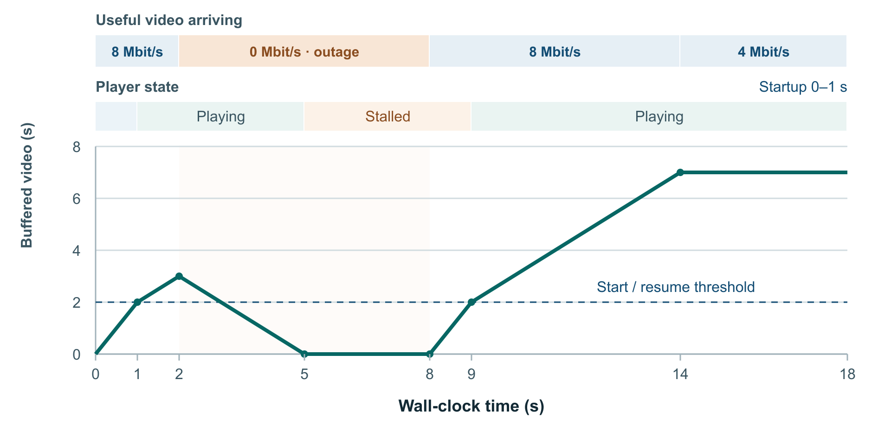

# 1. What Should a Network Do?

One of the pleasures of having the Internet around is that you can be sitting in a campus library, hear about a wonderful cat video made by someone across the planet, and be watching it a minute later. You need to know remarkably little about the person that recorded the video. You don't need an account with its Internet provider, and the people who put the recording online didn't need to know that someone at your campus would eventually want to see it. How did all those people, most of whom have never met, manage to build something together that works this well?

It helps to follow the request your laptop makes when you click on the recording. The campus runs the Wi-Fi equipment that first receives the request, but its network extends only so far. Somewhere along the way, the campus hands your data to a provider that has agreed to carry it farther. That provider may hand it to another, until eventually the request reaches the network that houses the recording. The **Internet** is the worldwide system that these independently operated networks form by connecting to one another. The arrangement is wonderfully accommodating. When somebody comes up with a new use for it, whether that happens to be a video lecture or a game in which forty people chase one another around a castle, the campus needn't run a new wire to the castle.

*Figure 1.1. One possible journey from the library to the recording. Each boundary marks a handoff between organizations. Two networks that connect directly can make the journey with fewer handoffs.*

This independence also makes the Internet an interesting system to study. Suppose you've clicked on the lecture, the little wheel is spinning, and after a few seconds you begin to wonder whom you ought to tell. The campus networking staff can see whether data is piling up at the campus exit. The people running the video service can find out how long their equipment spent preparing the recording. You, meanwhile, have an excellent view of the one thing neither of them can see directly, which is how long you sat there before the lecturer appeared. Each of you knows something worth knowing, and each of you is missing a piece of the story.

Over the course of this book we'll work our way up to systems like this one. We'll figure out how a computer can reach another computer it has never heard of, how the two can have a useful conversation even when some of what they send goes missing, and what they ought to do when a great many other people want to use the same equipment at the same time. Along the way, you'll get to propose rules of your own, work out what you expect them to do, and try them under conditions that give them some trouble. We'll begin with systems small enough that you can follow everything that happens. Later, when parts of a system belong to somebody else, or when the system you own has simply grown too large to watch in its entirety, you'll have some experience deciding which little piece is worth looking at.

Here's a first taste of the kind of decision we'll make. Imagine that you help run the campus network and have enough money this year to buy one new connection to the outside world. Students have brought you two perfectly reasonable complaints. The students who play an online game in the evenings say that their characters are sluggish, while the people who maintain the computer labs say that downloading a software update takes forever. One provider offers you **Link A**, which carries a billion bits per second, although any particular bit takes half a second to get across. Another offers **Link B**, which carries only ten million bits per second, but gets a bit to the other end in ten milliseconds. Both providers can make a good case that theirs is the faster link. Which one would you like the campus to buy?

## What is someone waiting for when they say the network feels slow?

Let's spend a moment with one of the students who plays the game, because it isn't immediately obvious what buying a campus connection has to do with the feeling of steering a character around a castle. Imagine a game in which a server keeps track of where everybody is, so that when two players reach the same door, their computers can agree about who got there first. When our student tries to go through the door, the game on her laptop sends a small message describing her move. The server needs to hear about that move before it can settle what happened. Eventually, of course, the student would like to see the result on her screen. For the campus purchase, we can start with one manageable piece of that story: how long does her message spend getting across the particular link we have a chance to change?

Suppose the message, once the game has packaged it up, occupies one kilobyte, or 8,000 bits. We'll give it an empty link, let every bit get through, and keep the rest of the journey the same under either purchase. Now consider Link B. The sender can begin putting the message onto the wire straight away, but it has to put the bits on in succession. At ten million bits per second, it takes 8,000 divided by ten million seconds, or **0.8 milliseconds**, to put the whole message on the wire. During those 0.8 milliseconds, something rather helpful has been happening: the beginning of the message has already been traveling toward the other end.

If you could stand at the receiving end with a clock that started when the sender began, you would see the beginning of the message arrive at 10 milliseconds, the time the signal needs to cross the link. You would then spend another 0.8 milliseconds receiving the rest of it. You can get the same answer by standing at the sending end in your imagination and following the very last bit. By the time the sender has put that bit on the wire, 0.8 milliseconds have gone by, and the end of the message still has its 10-millisecond journey ahead of it. Either way, **the complete message has crossed the link after 10.8 milliseconds**. It can now continue on its way to the game server.

Those two intervals turn up so often that it pays to give them names. The time the signal spends traveling from one end to the other is the **propagation delay**. The time the sender spends putting all the bits onto the link is the **transmission delay**, also called serialization delay. Once you've pictured the last bit making the trip, you already understand the equation. If the message contains *S* bits and the link can send *C* bits per second, it takes *S/C* seconds to put the message onto the wire. Allow another *d* seconds for propagation, and you have the time at which the far end has received the whole thing.

> **Time until the last bit arrives = S/C + d.**

What makes the campus purchase interesting is that an update for the lab computers has a very different size, and the installer may need the whole file before it can verify it and get to work. Here's what happens if we run our calculation again, first for the student's move and then for a ten-megabyte update. We'll use decimal units throughout, so a kilobyte contains 1,000 bytes and a megabyte contains one million.

| What needs to cross the link? | Link A · 1 Gbit/s, 500 ms | Link B · 10 Mbit/s, 10 ms |
| --- | ---: | ---: |
| A 1 kB message about a move | 500.008 ms | 10.8 ms |
| A 10 MB software update | 580 ms | 8.010 s |

There's some satisfaction in being able to walk back to both groups of students and explain why their experiences differ. Link A takes half a second to deliver so much as the beginning of the game message. For the update, though, its sender puts the entire file on the wire in just 80 milliseconds, while the sender on Link B is occupied for eight full seconds. Somewhere between a keypress and a software update the preferred purchase changes. If you're curious where, set the two completion times equal using the same size *S* on both sides. You'll find that a message of about **619 kB** finishes at the same time on either link.

There are already good reasons to revisit our little model. The student wants to see the door open, which may require a reply from the server, some computation, and time for the laptop to draw the next frame. The lab computer may first have to ask whether an update is available. Equipment along the way spends time examining data (**processing delay**), and data can spend time waiting for a busy outgoing link (**queueing delay**). So when someone reports a measurement of **latency**, ask what started the clock and what stopped it. Sending a message to a server and getting a reply gives you a **round-trip time**, or RTT. Starting the clock when the student's finger moves and stopping it when the screen changes would tell you something else she'd be delighted to know.

There's a similar distinction hiding in the provider's advertised rate. The **capacity** of a link tells you how many bits it can carry per second, while **throughput** tells you how many actually arrived per second over the interval you measured. A long download has to pass through every link on its path, so even on an otherwise quiet network its sustained rate is limited by the slowest of those links. Other people's transfers can reduce your share further. And if you're the person writing the video player, you'll want to know how much of what arrived was usable video, once you've set aside the information needed to carry it and any bytes that were sent twice. That last rate is called **goodput**. It's the one that tells you whether you have enough new footage to keep the lecturer talking.

**Something to try.** Suppose the game sends a hundred of those little 1 kB messages. If all hundred are ready together, the sender can put them on the wire one after another while the earlier ones are still traveling. When will the last one reach the far end on each link? Now imagine a game in which the next move depends on the answer to the previous one, so the sender must wait for a tiny reply each time. Assume the reply takes the same time to travel back as a bit took to travel out. Before you reach for a calculator, which part of the wait do you expect the players to notice this time?

## How did those two students end up sharing a wire?

We've been talking as though the campus could give each student a private connection to the place they wanted to reach. It's worth entertaining that idea for a moment, because it brings out what the campus network actually buys us. If a thousand computers each needed a private wire to every other one, the first computer would need 999 connections, the next would need another 998 beyond the connection we've already counted, and by the time we'd finished there would be 499,500 wires. Then somebody would arrive with a new laptop, as people on campuses have a habit of doing, and we'd owe them another thousand.

What makes a single campus connection so useful is that a computer nearby can take delivery of some data and pass it farther along. The sender divides its data into pieces called **packets**, each of which carries an address saying where it needs to go. A machine called a **router** reads that address and chooses an outgoing link for the packet. In Figure 1.1 the campus router can hand a packet to the provider, whose router can hand it to the next network, until one of the routers can deliver it to its destination. The sequence of links a packet follows is its **path**. When a new laptop joins the library Wi-Fi, it immediately has a way to reach all sorts of places for which nobody in the library has ever had to install a dedicated wire.

Sharing gives us a new design question almost as soon as it solves the wiring problem. Suppose the library and a residence hall have separate links into the campus router, and each sends it a packet that needs the same outgoing link. Both packets can arrive together, but the router can only put their bits onto that link at the rate the provider sold us. It can keep a waiting packet in memory, in a **queue**, until the link is free. Most of the time this is a happy arrangement, since the library can use the whole link when the residence hall is quiet and return the favor later. When their combined traffic arrives faster than the link can carry it away, though, the outgoing link becomes a **bottleneck**. A packet can spend its entire useful lifetime waiting in the queue, and if the burst lasts long enough, the router can run out of room even to hold it.

Imagine that you run that router and someone asks, quite reasonably, “If I hand you this packet, can you promise it will be there in eight milliseconds?” In the little experiment below, you know how many packets are already waiting, how quickly the link sends them, and how long they take to travel. You could use that knowledge to turn a packet away as soon as you see that you can't meet its deadline, leaving its sender a chance to try something else. You could also offer to take any packet for which there's room and send it as soon as its turn comes, leaving the receiver to decide whether a late packet is still useful. A student downloading a file might welcome such a packet; a game that has already moved on to the next turn might have little use for it.

<figure id="shared-link-lab" class="chapter-lab" aria-label="Shared-link service rules" hidden></figure>

*Figure 1.2. Two senders each offer four packets at once, with A first in the tie, an eight-millisecond deadline, and room for seven packets. Follow B's third packet. The deadline rule declines it while the sender can still do something else. Best effort takes it, occupies space and transmission time carrying it, and delivers it late. What happens to B's fourth packet under each rule?*

Try easing the deadline while leaving the traffic alone, and then increasing the traffic while leaving the deadline alone. The distinction is easiest to see if you keep an eye on a particular packet and ask what information the operator had at the moment it arrived. Both rules in this experiment serve admitted packets in order, and we've given the operator the luxury of a single working link whose future rate is known. A campus promising a deadline all the way to another university would have to arrange for the packet to receive suitable service at every intervening network, and somebody would have to explain what the promise covers if a link fails halfway there.

The common service offered by the public Internet is **best-effort packet delivery**. Networks undertake to forward packets toward their destinations, while the possibility of loss, reordering, or delay remains something the computers at the ends must handle. Those computers have a substantial advantage when it comes to deciding what to do next: they know what the data was for. The lab installer can ask for missing bytes again and wait until it has a verifiably complete update. A call can skip a missing bit of speech once its moment in the conversation has passed. Happily, the same campus router can carry both.

By now we've occupied several seats in the purchasing meeting. As a **user**, you have a door you'd like to open or a lecture you'd like to watch. As an **application developer**, you get to decide what the program does while it waits, which bytes deserve another try, and what you can show the user in the meantime. As a **network operator**, you could buy enough capacity for the busiest hour of the week, but you'll be paying for that capacity on Sunday morning too. It's quite possible for all three people to agree on what the equipment does and still have a lively discussion about what to buy.

## What would you measure while the campus was busy?

If we were going to spend real money on the campus connection, a pleasant next step would be to sit down with the people who use it and find out what their programs actually do. Figure 1.3 sketches what we'd see if we counted the data delivered to each of four applications over successive slices of time. Each has periods of activity and periods of relative quiet, yet the quiet stretches have quite different meanings. A video player might already have everything it needs for the next few seconds, whereas a browser might be quite unable to proceed until a reply comes back.

*Figure 1.3. Each row has its own rate scale. As you read from left to right, consider what the application can get done during a gap between deliveries.*

Take the **web page** on which you found the lecture. A browser might first fetch a small document and discover, only after reading it, which image belongs at the top of the page and which script makes the play button work. If one discovery has to wait for the last, each trip to the server can add to the time you spend looking at a partly assembled page. A bigger link certainly helps when there is a large image to carry. If you were arranging the page yourself, you might also see an opportunity to let the browser discover that play button a little sooner.

Once the lecture starts, **on-demand video** makes a rather different claim on the network. Ten seconds of footage encoded at 4 Mbit/s amounts to 40 megabits, or 5 MB of compressed media. That's ten times as much data as a 500 kB page, even if you spent a whole minute reading the page and only ten seconds watching the video. This helps explain how video can account for so much traffic. It also gives the player an opportunity the page didn't have. If the lecturer is halfway through a sentence and the next ten seconds of footage are already on your laptop, the network can go quiet for a little while and you'll still hear how the sentence ends.

Now suppose the lecturer has invited you to join a **video call** and ask a question. The courteous little pause you leave to see whether someone else is about to speak depends on hearing the conversation reasonably promptly. Packets carrying speech can experience different delays from one another, a variation called **jitter**, and holding a little audio at the receiver allows it to play the sounds at a steady pace despite that variation. Holding ten seconds would give it a splendid reserve, but you can imagine how the conversation would go. A game that exchanges short messages about player moves faces a similar constraint whenever one person's next action depends on seeing another's.

**Cloud gaming and remotely rendered augmented reality** can combine both kinds of demand. Imagine that turning your head causes a distant server to draw the view you should now see. The account of your movement may fit comfortably in a small message, but a whole rendered image has to come back, and the device still has to decode and display it. At thirty frames per second, even a one-percent chance of missing a frame's deadline amounts, on average, to a late frame about once every three and a third seconds. If those late frames come in clusters, you'd probably like to know that before deciding the experience is good enough.

Finally, consider **distributed computation**, where the thing doing the waiting may be an expensive room full of computers. Workers training a model can spend some time computing independently and then need to exchange results before any of them can begin the next step. One worker whose transfer finishes late can leave all its companions waiting. A measurement of the duration of the whole step would help the person paying for those computers decide whether a faster link is worth buying.

*Figure 1.4. A rough map of application requirements. The game sending short moves and the game receiving rendered images both care about prompt feedback, but they ask the network to carry very different amounts of data.*

Experiences like the jerky headset and the roomful of waiting computers give us a reason to look at **tail latency**, the unusually slow end of the collection of times we measured. Suppose we time a hundred requests, of which 98 finish in ten milliseconds apiece and two take an entire second. We could truthfully report a mean of 29.8 milliseconds, which sounds quite pleasant until you happen to be the person making one of those two requests. Another way to describe the measurements is to line them up from quickest to slowest and look at the 99th one. By this nearest-rank definition, the **99th percentile** is one second. Both numbers belong in our notebook, along with what we timed and how busy the network was when we timed it.

It's worth giving **reliability** the same care. If a missing packet is recovered a second later, the lab may end up with a completely reliable copy of the update, while the person on the call has already had to say, “Would you mind repeating that?” Before assigning a percentage to success, it helps to finish the sentence “We'll count this as a success if …” from the point of view of the person who'll actually use the result.

## How much of the lecture should the player collect before it begins?

Let's give ourselves the enjoyable job of designing the video player. Someone has just clicked on the lecture and would naturally like it to begin, but as soon as it does begin, they'll have an equally reasonable wish for it to keep going. We can spend a little time at the beginning collecting footage for a rainy day. How much of their time should we spend?

A handy way to keep the accounts is to measure our reserve in seconds of video. The **playhead** is where the viewer has got to in the recording, and the **forward playback buffer** contains the footage immediately ahead of that point that's ready to play. If two seconds of footage arrive in one second of ordinary time, then while the lecture is playing we've earned two seconds and spent one, which leaves us one second better off than we were. During a network outage the picture can still move and the lecturer can still talk, but every second they do so uses up a second of our reserve.

For the experiment in Figure 1.5, let's give the player a 4 Mbit/s recording and a particularly obliging network whose next eighteen seconds we can foretell. For the first two seconds it will deliver 8 Mbit/s of usable video, twice the rate at which the recording plays. Then we'll lose delivery altogether until time 8 s, get 8 Mbit/s again until time 14 s, and receive exactly the playback rate for the remaining four seconds. We'll assume that footage arrives in order, that arriving data is immediately usable, and that we have plenty of room to keep it. Our first player will begin as soon as it has two seconds in reserve, and if it ever runs dry, it will wait to build up that same reserve before resuming. When would you expect the viewer to see the lecturer for the first time, and how far into the outage do you think they'll get before the picture freezes?

<figure id="playback-lab" class="chapter-lab" aria-label="Video playback buffer" hidden></figure>

*Figure 1.5. The two clocks worth following are the clock on your wall and the position in the lecture. Between wall times 5 s and 9 s, four seconds go by in the room while the lecturer gets no further with the sentence.*

With the starting settings, the first second of delivery buys two seconds of footage, so we begin playing at time 1 s. By time 2 s we've received four seconds of lecture and shown one, which leaves three seconds in hand just as the network goes quiet. That carries us to time 5 s. Delivery returns at time 8 s, and it takes one more second to collect the reserve our rule calls for, so the picture starts moving again at time 9 s. Over the whole eighteen seconds, the player received 80 megabits, averaging about 4.44 Mbit/s for a video that needs only 4. The viewer who sat through the four-second pause could tell us precisely what that average left out: the extra footage turned up after they needed it.

**Predict, simulate, and explain.** Perhaps you'd like to give the player a more generous reserve, say four seconds at startup and again after a stall. Before changing the controls, see whether you think the viewer will spend less time looking at a frozen picture. With four-second thresholds the picture starts at time 2 s, freezes at 6 s, and resumes at 10 s. Our prudence bought us an extra second during the outage, and our determination to be equally prudent before restarting cost us an extra second afterward. There's another change worth trying. Restore the two-second thresholds and offer the viewer a lower-quality version encoded at 2 Mbit/s. Every megabit that arrives now buys twice as much viewing time. The lecture begins at time 0.5 s and makes it all the way through the outage with half a second of footage to spare.

You can work through any setting on paper by jumping from one interesting event to the next: a change in the arrival rate, the moment a reserve becomes large enough to start, or the moment it runs out. At each event, jot down the wall time, the position in the lecture, and how much playable footage remains. Then try a shorter outage or one that begins a little later. If you were offering the service to a friend, which combination of picture quality, startup wait, and interruptions would you choose, and what would you want to know about their connection before choosing for them?

## Network detective: Why did the player download something I'd already watched?

During the course discussion about video, a student raised a question that gives our player design a lovely complication. Think of a moment when the lecturer says something surprising and you drag the playhead back ten seconds to hear it again. Those ten seconds of footage must have reached your computer. You've just seen them! Why, then, does the player sometimes pause and appear to fetch them all over again? Another student had noticed a tantalizing detail: going straight back could work perfectly well, while pausing for a bit before going back could bring on the reload.

From time to time in this book we'll play **network detective**, taking an observation like this and asking what evidence we could collect to tell plausible explanations apart. Our earlier experiment tracked the footage ahead of the playhead, because that was what would keep the lecture going. Now we have a reason to consider a **backward cache**, a store of footage we've already shown and might want again. At our familiar 4 Mbit/s, keeping the last ten seconds would cost about 5 MB of compressed data. Keeping half an hour would cost about 900 MB. We can already see why a designer might choose a limit, though we still have plenty of work to do before we can say who chose the limit on a particular student's computer.

Imagine that we can ask the player which stretches of the recording are ready to play, and ask the browser which pieces of video it requested and how many bytes actually crossed the network. The following are invented observations for three runs using the same browser, recording, and quality setting. In each run we're sitting at the seventy-second mark and want to hear the passage beginning at sixty seconds. As you read the table, see how far you can get toward an explanation using just those two witnesses.

| What the viewer did | Range ready to play just before the seek | Browser request for the target | Bytes transferred for that request |
| --- | --- | --- | ---: |
| Went back immediately | 56–84 s | None covering 60 s | 0 |
| Paused for 30 seconds, then went back | 68–84 s | Same encoding of the 60–62 s segment | 1 MB |
| Repeated the pause with the segment already in the browser's HTTP cache | 68–84 s | Same encoding, served from cache | 0 on the network |

In the first run, the passage we want is still among the stretches the player says it can play, so it's easy to account for the instant replay. In the second it's gone, and we see the bytes for those very seconds come across the network again. The third run offers a useful twist. A browser can keep a copy of an earlier response in its **HTTP cache**, where the player can request the compressed bytes again even after the corresponding footage has gone from its playable range. That accounts for a fresh request accompanied by zero bytes on the wire. It's a good reason to look at the transfer column before concluding that a request in a log cost somebody another download.

We still have at least two candidates for who removed the footage. The application could have a rule that discards old material, or the browser's playback subsystem could reclaim space on its own. To take the investigation further, you could use a short segmented recording in a player you control and log every time your application asks to append or remove a range. Repeat the immediate and delayed seeks at the same position and quality, first allowing application removal and then disabling it, while recording the playable ranges and the actual transfers. In a separate trial you could append more footage and see whether that changes which ranges survive. A recorded removal of the very passage that disappeared gives you a promising line of inquiry. If it disappears with removal disabled, you'll want to check that your instrumentation really sees all the calls and then investigate what the browser does on its own. You might even enlist an LLM to think up another explanation, with the friendly stipulation that it tell you what you'd expect to observe if its explanation were right. The class left the commercial player's behavior open, which gives the next person with a good measurement a genuine chance to teach us something. [Lecture 2, lines 2181–2211](../../assets/f26-subtitles.txt#L2181-L2211) · [Lecture 3, lines 4110–4264 and 4288–4338](../../assets/f26-subtitles.txt#L4110-L4338)

## A few designs to try for yourself

1. **What should the router do when the fourth packet arrives?** Suppose a game and a file transfer share a link whose router has room for three waiting packets. The game sends short updates that lose their value after a deadline, while the file transfer will eventually need every byte. When a fourth packet arrives, which three would you like the router to keep, and what should the computers at the ends do about the one it gives up? Once you have a rule you like, consider what the router would need to know to carry it out. How would you change it if the router couldn't tell which packets belonged to the game?

2. **Who would like a shorter trip over a smaller link?** Imagine that a low-Earth-orbit satellite network can get a message between users and a centralized site with less end-to-end network delay than the users experience reaching nearby terrestrial sites, although the satellite connection offers considerably less usable throughput. Both the users and the centralized site can connect to the satellite network directly. Would you move software updates, on-demand video, remotely rendered augmented reality, time-sensitive messages between trading sites, or a game that exchanges small moves and state updates? For each choice, give one measurement that might persuade you to change your mind. For the augmented-reality service, allow time for a whole rendered frame to make the return trip to its viewer. [Adapted from Quiz 3 (2025), Q1, p. 1](../../assets/quiz3-2025.pdf#page=1)

3. **Where would you put the servers?** You've been given a fixed amount of computing power, storage, and memory, together with a choice between concentrating it at a few large sites and distributing it among smaller sites close to users. Think through that choice for a group training a large model, a cloud-gaming service, a popular broadcast, and a recorded lecture that fewer than fifty people worldwide will see in the next five years. Where could a local copy do useful work for many viewers, and where would separating machines make them spend more time waiting for one another? Pick your favorite of the four cases and see if you can change one assumption that makes the other placement look attractive. [Adapted from Final Exam (2024), Q1, p. 1](../../assets/cs356-final-2024.pdf#page=1)

When we first walked into the campus purchasing meeting, all we had were two offers and two complaints about speed. By now we could ask the game developer what has to cross the network before a player can see a move, ask the lab staff how much of an update they need before installation can begin, and ask the people watching the lecture how long they're willing to wait for a smoother picture. Those conversations might still leave the campus with a difficult choice, but it would be a choice we could explain to the people paying for it and, just as importantly, to the people sitting in the library waiting to see what happens next.
