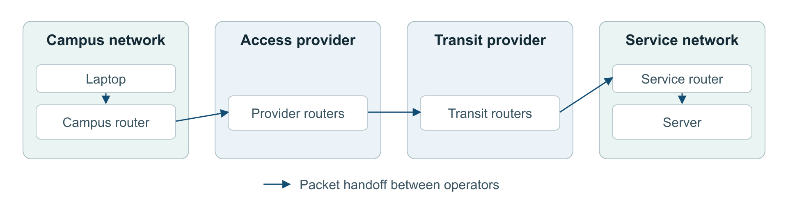
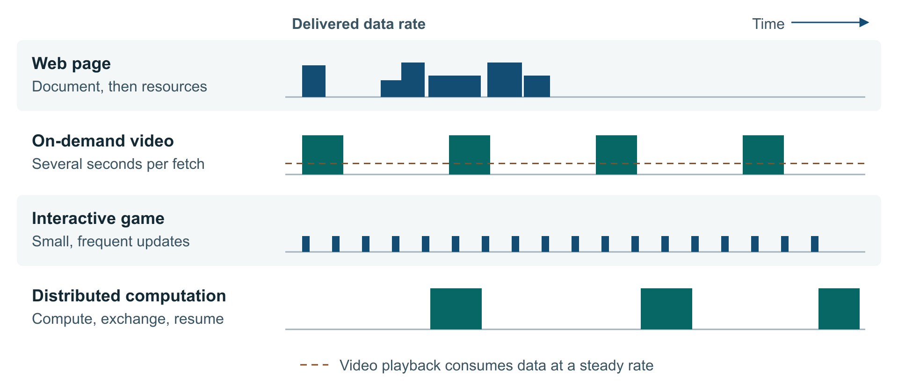

# 1. What Should a Network Do?

Open a web page on a laptop connected to campus Wi-Fi. Your request might cross equipment run by the university, an Internet provider, and the organization that hosts the page. At each boundary, one network hands the data to another. The **Internet** is the worldwide system formed by connecting these independently operated networks. A campus can replace its equipment, a provider can add a route, and someone can build a service no one anticipated when the networks first connected. The same basic arrangement that carried email and file transfers also carries video calls and games.

*Figure 1.1. One possible path from a campus laptop to a service. Each organization runs its own equipment. Some networks connect directly and others hand the data through a transit provider.*

How do you build a system like this when each participant controls only part of it? In this book, you'll work out how networks decide where to send data, how applications recover when data goes missing, and how senders share a busy link. For each design, ask what it assumes and when those assumptions stop holding. Propose a different rule, work through an example, and look for an input or a failure that changes your answer. As systems grow, these small models and targeted experiments help you reason about parts you can measure even when you cannot see the whole system.

Start with one decision an operator might face. Suppose the campus can reach a service over either of two links. **Link A** can send a billion bits per second, and each bit takes half a second to cross. **Link B** can send ten million bits per second, and each bit takes ten milliseconds to cross. Which would you choose for a game sending a small input message? What about a software update sending a large file, or a video that can start playing while it downloads? Before choosing, name the event the user is waiting for. That event tells you what to measure.

## How long does the user wait?

For the game message and the software update, assume the data is ready to send and the receiver needs it all before it can act. Isolate the link decision by assuming no competing traffic or packet loss. Use decimal units such as 1 MB = 1,000,000 bytes. If the object contains *S* bits, the link sends at rate *C* bits per second, and a bit takes *d* seconds to travel, the last bit arrives at

> **Completion time = d + S/C.**

The first term is **propagation delay**. It is the time a bit spends traveling once it leaves the sender. The second is **transmission delay**, sometimes called serialization delay. It is the time the sender spends putting all the bits onto the link. The stated 500 ms and 10 ms in this problem are one-way propagation delays.

| Data ready to send | Link A · 1 Gbit/s, 500 ms | Link B · 10 Mbit/s, 10 ms |
| --- | ---: | ---: |
| 1 kB | 500.008 ms | 10.8 ms |
| 10 MB | 580 ms | 8.010 s |

For the small message, you can hardly see Link A's transmission time next to its propagation delay. For the file, Link B spends eight seconds putting the bits onto the wire. Setting the two completion times equal gives a crossover near **619 kB**. Above it, Link A finishes first in this model. Below it, Link B finishes first. If the file first has to be requested, account for the request's travel too. Every round of communication in which one side must wait for a reply creates another opportunity for delay to dominate.

A real path also has **processing delay** at devices and **queueing delay** when data is ready but an outgoing link is busy. Measure latency between specified events. One-way network latency might run from a packet leaving a client to arriving at a server. Round-trip time (RTT) includes a trip in each direction. An application's response time can also include server work and client rendering. When someone claims to have made the network faster, ask them which of these clocks they stopped.

Link **capacity** is how many bits a link can carry per second. **Throughput** is how many bits actually arrive per second over a given interval. The slowest link on a path bounds the rate at which a long transfer can proceed even when the path is otherwise idle. Competing traffic, losses, and the sender's behavior can lower the measured rate further. **Goodput** measures only useful application data, excluding overhead and duplicate deliveries. A player planning a download needs the rate at which it receives usable video. The number on the access-link bill describes a different measurement.

**Break this.** A service sends 100 messages of 1 kB each over Link A or Link B. If the messages are ready together and sent back-to-back, calculate when the last one arrives. Now assume the receiver must reply to each message before the sender knows what to send next. Take the replies to be tiny and the paths symmetric. Which cost did the application's design multiply?

## How do independently run networks cooperate?

The two-link comparison gave one sender the entire link. On the path in Figure 1.1, the campus and the service have to share equipment with other transfers. Imagine trying to avoid sharing by giving every pair of computers a private wire. With 1,000 computers, you'd need 499,500 pairwise links. Adding one computer takes another 1,000 links. A nearby device that can pass data onward lets many endpoints reach the same destinations using shared links. At Internet scale, that arrangement makes it possible to add new computers and new networks without wiring them to every existing one.

How much should these organizations promise each other? Try two designs. In the first, each network accepts any traffic and promises to deliver it by a deadline. In the second, each network forwards what it can, and senders cope with traffic that arrives late or goes missing. In the first design, what happens when two senders together exceed the capacity of a shared link? To make a credible deadline promise, the operators would at least need to limit what they admit, provision capacity end to end, and specify which failures the promise covers. In the second, they can share an idle link as demand changes, but they leave the senders and receivers with more work.

The public Internet uses **best-effort packet delivery** as its common service. An endpoint breaks data into units called packets and supplies a destination address. Routers forward the packets toward that address. The common service offers no end-to-end guarantee of delivery, ordering, or delay. A link can be busy, a queue can fill and drop a packet, or a failure can interrupt the path. Endpoints can add mechanisms suited to what they are sending. A file transfer can recover missing bytes before declaring the file complete. A call might skip a missing chunk of audio once the time to play it has passed. Both can use the same routers.

The arrangement serves people with different jobs. A **user** wants a call to sound natural, a game to respond, or a file to finish. An **application developer** wants a common way to move data along with enough control to meet the application's deadlines. A **network operator** needs equipment, capacity, and policies that can be paid for, monitored, and repaired. Reserving more capacity could improve a service during peak hours and leave expensive equipment idle the rest of the day. Placing servers near users could shorten trips and increase the number of sites that someone has to operate.

## Match the measurement to the job

Imagine drawing how much data an application delivers in each slice of time. A web page may retrieve one document and then discover it needs scripts, images, and other resources. A video player may download several seconds of footage in a burst, continue playing from its buffer, then ask for more. A game might send small updates at frequent intervals. Workers training a model might compute independently for a while, exchange a large amount of data, and wait for the exchange to finish before proceeding. These workloads put different kinds of pressure on the same link.

*Figure 1.2. Four possible traffic traces, each drawn on its own rate scale. A dip in video delivery can be harmless while the player has footage ready. A gap between dependent web requests or at a synchronization point can directly extend the user's wait.*

Consider the event that ends the wait in each application.

- **Web page.** The visible part of the page must become usable. A fast link helps with large objects. When the browser discovers each required resource only after receiving another, the delay on that sequence of dependencies adds up. What would you send first if the user could only see the top of the page?
- **On-demand video.** The player must collect enough footage to start, then have each part available when it is due. Sustained goodput sets the quality it can keep up, and dips in delivery determine how much footage it should collect ahead of time. Ten seconds of video encoded at 4 Mbit/s contains 5 MB of compressed media. A page that transfers 500 kB once is an order of magnitude smaller, even if someone spends a minute reading it. Human attention and bytes transferred have different units.
- **Conferencing and interactive games.** Conversation and remote controls depend on prompt feedback. Delayed audio can cause people to talk over one another. In a game that sends input and state updates, packets might be small yet time-sensitive. **Jitter** is variation in packet delay. A call can buffer some arriving audio to smooth it out. Each extra millisecond of waiting spends part of the conversation's delay budget.
- **Remotely rendered AR or cloud gaming.** The user moves, a server computes the next view, the result travels back, and the device displays it. Both high downstream goodput and a tight end-to-end deadline matter. A fast network leaves more of the budget for rendering and decoding. At 30 frames per second, a 1% deadline miss rate means one late frame roughly every 3.3 seconds on average. Clusters of late frames could feel worse than the same number spread across a session.
- **Distributed computation.** When workers synchronize, the slowest required exchange can delay the whole group. High throughput shortens large exchanges. Low delay helps when workers have to repeat small exchanges before continuing. The meaningful clock is often the duration of the whole computation step.

*Figure 1.3. The goodput and delay pressures for these examples are qualitative. A file download can have a completion deadline even when individual packets have no separate deadlines. Distributed computation here represents frequent, synchronized exchanges.*

**Tail latency** describes the unusually slow end of a latency distribution. A report of 40 ms at the 99th percentile means about 99% of measured events took at most 40 ms. For example, if 98 requests take 10 ms each and two take 1 second, the mean is 29.8 ms. The 99th percentile by the nearest-rank convention is 1 second. Users could still hit a full-second pause on an otherwise quick service. **Reliability** needs a similarly explicit outcome. Was every byte of the file delivered? Did the message arrive before its deadline? Was the service reachable throughout the session? A retransmission might improve the first measure while failing the second. Once the event is defined, compare measurements at similar loads and count how often the system misses the target.

## Design a player that can survive a dry spell

An on-demand player can accept a longer wait at startup in exchange for fewer interruptions later. How much should it wait? Model the **forward playback buffer** as seconds of already delivered video immediately ahead of the playhead. A played second consumes one buffered second. If two seconds of usable video arrive each second, the buffer grows by one second per second during playback. If delivery stops, it drains at one second per second. The player stalls when it runs out and can wait to rebuild a reserve before resuming.

Take a video encoded at 4 Mbit/s. It receives 8 Mbit/s of usable video from wall-clock time 0 to 2 s, none from 2 to 8 s, 8 Mbit/s from 8 to 14 s, then 4 Mbit/s through 18 s. Assume everything arrives in order, the player can use arriving data continuously, and there is no limit on how much it can buffer. Start or resume when there are two seconds of video ready. Before looking at the trace, mark when the player first shows a frame, when it runs out, and when it resumes.

*Figure 1.4. A two-second startup and restart threshold, with an outage from wall-clock time 2 s to 8 s. Playback begins at 1 s. The three seconds buffered at the start of the outage carry playback until 5 s. Delivery resumes at 8 s, and playback resumes at 9 s.*

The player received 80 Mbit over 18 seconds, an average of about 4.44 Mbit/s. That exceeds the 4 Mbit/s encoding rate, yet there was a four-second stall. A late surplus cannot fill a buffer at an earlier time. This is one reason to measure startup time and stall time alongside average goodput.

**Predict–simulate–explain.** Use Figure 1.4 as the baseline. Predict the startup time, the number of stalls, and the total stall time if you change both thresholds to four seconds. Then restore the two-second thresholds and try a fresh session at 2 Mbit/s over the same delivery schedule. To simulate by hand, advance to the next rate change, threshold crossing, or buffer exhaustion, whichever comes first. Add arriving video seconds (delivered megabits divided by encoding megabits per video second) and subtract elapsed seconds only while playing. Log wall time, playhead, buffer, and player state after every event.

With four-second thresholds, playback starts at 2 s, stalls at 6 s, and restarts at 10 s. The pause is still four seconds. The bigger reserve drains a second later, but the player also waits a second longer after delivery returns. At 2 Mbit/s, playback starts at 0.5 s and reaches the end of the outage with 0.5 seconds still buffered. That setting survives this outage at the cost of lower fidelity. Try moving the outage later and shortening it. Which change helps now? Choose a policy based on several delivery traces, and report startup delay, stall time, and encoding rate together.

## Network detective · Why did seeking backward reload the video?

A student noticed that a player sometimes paused to reload after a short backward seek. Another reported that an immediate return to an earlier part could work, while a return after pausing could require a reload. Consider two kinds of data the player could keep. A **forward buffer** helps playback through the next interruption. A **backward cache** can make a replay fast. Keeping ten seconds at 4 Mbit/s costs about 5 MB of compressed data. Keeping thirty minutes costs about 900 MB. Those estimates make short and long retention very different proposals. They give no information about who decided what to retain in a specific run.

Start with alternative hypotheses. The player might remove played footage when it becomes old. The playback subsystem might evict it when it hits a storage limit. Or the player might keep the footage and still request a different quality or set of tracks on the seek. Where would the traces differ? The table shows invented observations for paired runs of the same video with the same browser and quality setting. The network column tracks the fetch covering the seek target, excluding unrelated requests.

| Trial | Playback ranges just before seeking to 60 s | Media request after seeking | Transferred bytes for that request |
| --- | --- | --- | ---: |
| Seek immediately from 70 s | 56–84 s | None covering 60 s | 0 |
| Pause at 70 s for 30 seconds, then seek | 68–84 s | Same encoding of the 60–62 s segment | 1 MB |
| Repeat the pause-and-seek trial with a warm HTTP cache | 68–84 s | Same encoding, served from cache | 0 on the network |

Playback ranges describe media currently usable by the player. The HTTP cache, when it holds a reusable response, can supply the compressed bytes again. In the second trial the target had left the playback range by the time of the seek, and the client fetched that segment again. The third trial shows how a segment can be missing from the playback range yet cost zero network bytes to recover. The observations alone leave both player removal and browser eviction plausible.

To separate those explanations, build or instrument a small player using your own segmented video. Hold the playback position and encoding fixed. Record playable ranges, application calls that append or remove media, request identifiers, transferred bytes, and the time spent waiting after the seek. Compare immediate seeks and delayed seeks, first with application removal enabled, then disabled. Vary the amount of other video appended in a separate trial. If a logged removal covers the exact range that disappears, investigate the application's retention rule. If a range disappears without a recorded removal in a controlled player, investigate the playback subsystem and validate that the instrumentation captured all application calls. Ask an LLM for competing hypotheses if it helps, then require each proposed cause to predict a different observable event. The original classroom discussion left the behavior of the commercial player open. [Lecture 2, lines 2181–2211](../../assets/f26-subtitles.txt#L2181-L2211) · [Lecture 3, lines 4110–4264 and 4288–4338](../../assets/f26-subtitles.txt#L4110-L4338)

## Design exercises

1. **Design this · An overload rule.** Two senders share a link. A game sends short input updates with deadlines, and a file transfer wants every byte. You can queue only three packets. Choose which packets to retain when a fourth arrives and describe what the endpoints should do after loss. Which information does the router need? What changes if it cannot tell which application sent a packet?
2. **What if? · A faster path with less capacity.** Suppose a low-Earth-orbit satellite network gives a centralized site a shorter end-to-end network delay but much lower usable throughput than users get from nearby terrestrial sites. Assume both the central site and the users have direct access to the satellite network. Decide which workloads are candidates to move: large software updates, on-demand video, remotely rendered AR, small time-sensitive messages between trading sites, and games that exchange only input and state updates. For each, identify one measurement that could reverse your decision. For AR, write a response-time budget that includes the return of an entire rendered frame. [Adapted from Quiz 3 (2025), Q1, p. 1](../../assets/quiz3-2025.pdf#page=1)
3. **Defend your design · Where should the servers go?** With the same total compute, storage, and memory budget, choose between placing servers near users and concentrating them in a few large sites. Make a choice for large-model training, cloud-rendered gaming, a widely watched broadcast, and a lecture that fewer than 50 people worldwide will watch over five years. Explain which workloads benefit from shared local copies or tight communication between workers. Then pick one workload and change an assumption so that the opposite choice becomes attractive. [Adapted from Final Exam (2024), Q1, p. 1](../../assets/cs356-final-2024.pdf#page=1)

As you design the network for a new application, write down what must reach whom, how much data they exchange, when the data stops being useful, and how frequently the system can miss that target. Those choices determine which delays to measure, what to put in the network, and what the endpoints can handle themselves.
