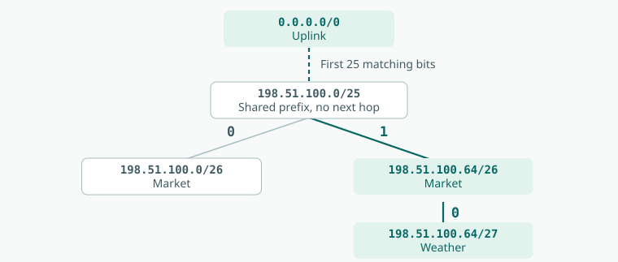
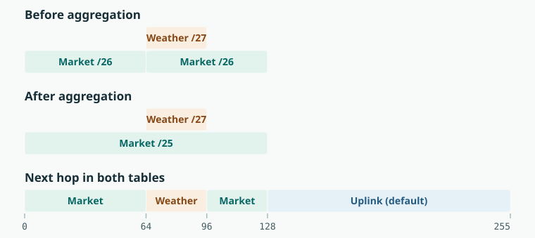
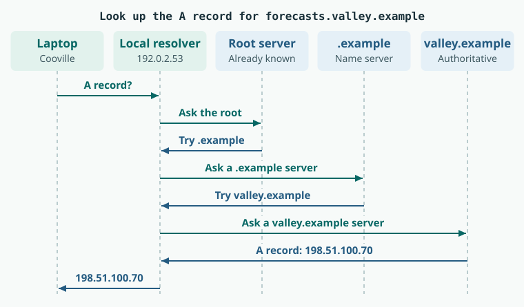
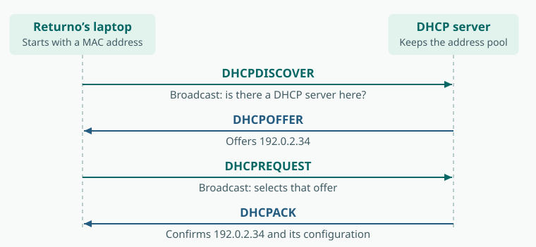

# 3. Naming, Addressing, and Finding Things

Suppose I want to send you a copy of this lecture. If yours is the only laptop plugged into mine, I can start sending bits and leave your name out of it altogether. Now plug both of us into the classroom network. I still have exactly the same lecture to send, but there are thirty people who could receive it, and I'd prefer not to interrupt twenty-nine of them. What can I put at the front of my message that will let your laptop recognize that it's meant for you?

In the previous chapter we put a destination address on a packet and let the routers take it from there. That's a considerable favor we did ourselves. Whoever designed that address had to decide what it would name, who could give one out, and what a router could hope to learn by reading it. Let's see how far we can get by designing the simplest name we'd be willing to use in this room. We can worry about the rest of the Internet when somebody takes their laptop home.

## How would you give every interface a different name?

For the moment, an Ethernet interface is just the part of a computer that sends and receives on the local network. If your interface and mine have different names, I can put yours on the Ethernet frame carrying the lecture. Everybody who happens to hear the transmission can examine the destination, and your interface can recognize its own name. We haven't asked for a particularly clever name. For this purpose a number will do beautifully.

One proposal in class was to keep a counter. Whenever somebody makes an interface, they ask for a number, and whoever keeps the counter gives them the next one. This solves the uniqueness problem rather neatly, provided everybody agrees on who has the counter. Before we engineer an elaborate service to keep up with all these requests, what rate does it actually have to sustain? You need a number when you *make the interface*. You can send a great many packets before you need to manufacture another laptop.

Even so, it would be convenient if a factory could keep making interfaces on a day when it couldn't reach the keeper of the counter. Suppose we give one manufacturer all the 48-bit numbers beginning with a particular 24 bits. That manufacturer can now assign the remaining 24 bits locally, without asking anyone else's permission, and a second manufacturer with a different prefix can do the same. This is one way manufacturers allocate Ethernet **MAC addresses**. Notice what the common beginning tells us about two such interfaces. They may have come from the same factory. One could be in this classroom and the other in Brazil.

There was a second proposal in class worth trying before we leave the factory. Let each interface pick a number at random. Two independently chosen, uniformly random 48-bit numbers agree with probability one in 2⁴⁸, which sounds like quite a bargain for doing away with the counter. But whose collision are we worried about? If *any* two interfaces among a million pick the same number, there are nearly half a trillion pairs that could be responsible. This is the birthday problem from the lecture: in a room full of people, finding two who share a birthday is much easier than finding someone who shares *yours*. With random names, both the length of the name and the number of interfaces that need to coexist matter. The manufacturer scheme buys a different property: if everyone follows the allocation rules, the assigned ranges cannot overlap.

## What happens when you take the laptop home?

Imagine we succeed beyond our wildest expectations and give every interface in the world a distinct number. Tomorrow I send you another lecture, using the same number as before, only this time you're at home. My packet gets as far as a router with sixteen outgoing links. It can read all forty-eight bits of your impeccably unique name. Which link should it use?

It could keep an entry for you. If you move, somebody has to update that entry wherever the old information would send packets the wrong way. We might instead put your whereabouts in a directory and have the router consult it. That's a promising idea, but look at what we've just had to invent to make our names useful: a way to describe *where to send something* once we know whom it's for. As the lecturer asked, “Why is uniqueness not enough? What more do you want out of your names?” [Lecture 4](../../assets/f26-subtitles.txt#L5053-L5112)

Consider the view from Brazil of a packet headed to the University of Texas. The router making the decision in Brazil has very little use for your classroom number. If all the campus destinations it can reach via a particular neighbor share the same first few bits, it can keep one instruction for the lot. Closer to campus, where the paths to two buildings diverge, a router can examine a few more bits. The point of the hierarchy is that each router can stop making distinctions once it knows which link to use.

An **IP address** is allocated in a way that makes this grouping possible. When you take your laptop home, you can use an address from your home network's block, while the rest of the Internet keeps its existing directions to campus and to your home provider. In contrast, the manufacturer prefix in a MAC address rarely saves a distant router any work. We call MAC addresses **flat** for forwarding, even though we just went to some trouble to give them a hierarchy for *allocation*. Whether a hierarchy is useful depends rather strongly on what you're trying to do with it.

### How many bits does a router need to read?

Let's try allocating addresses to a network we helped build. In Chapter 2, Returno connected his village, Cooville, to the Internet through a neighbor named Homer in Buffering Heights. Their link, FeatherNet, carried each load across the valley by homing pigeon, but the computers within Cooville used an ordinary local network. Suppose the village has been assigned the IPv4 block `192.0.2.0/26`. We'll use addresses reserved for examples throughout this trip.

An IPv4 address is a 32-bit number, usually written a byte at a time, with dots between the four numbers. The slash tells us that the first 26 bits are fixed in every address in this block. Twenty-four of those bits get us as far as `192.0.2`. The next two are both zero, so the last byte can range from binary `00000000` through `00111111`, or from 0 through 63. Returno can give a laptop `192.0.2.34` and his router `192.0.2.1`. From across the valley Homer can reach either with the same instruction: send anything matching those 26 bits to Returno. Once the packet arrives in the village, Returno has to pay attention to the bits Homer was able to ignore.

This arrangement also gives Homer a useful way to record exceptions. Imagine that most of the services on his side of the valley can be reached through a router at the market, but the weather station has its own link. Homer has a packet for the station's server at `198.51.100.70`. Here is the table he has to work with. The uplink is his way out to the rest of the Internet.

| Destination prefix | Next hop |
| --- | --- |
| `0.0.0.0/0` | Uplink |
| `198.51.100.0/26` | Market router |
| `198.51.100.64/26` | Market router |
| `198.51.100.64/27` | Weather router |

Before reading on, decide where Homer should send a packet for `198.51.100.70`. It matches `/0` because there are zero bits to compare. It matches `198.51.100.64/26`, which covers last octets 64 through 127. It also matches `198.51.100.64/27`, which covers 64 through 95. Giving the default route priority would make the other two matches useless. Giving priority to the longest match lets a router use a broad rule for most addresses and make an exception for a smaller group. With **longest-prefix matching**, the `/27` wins here, so Homer forwards the packet to the Weather router.

Imagine storing these routes in a binary tree whose branches are marked 0 and 1. Start at the root and follow the bits of the destination from left to right. Whenever you pass a node with a next hop, remember it. If the required branch is missing, use the most recent next hop you found. Because each step reads one more bit, that last recorded next hop belongs to the longest matching prefix. This tree is called a **prefix trie**. Figure 3.1 sketches it, abbreviating the long stretch where the village services' routes share the same initial bits. Try the walk again for `198.51.100.100`. Its bit 26 is 1, as it was for the forecast server, but its bit 27 is also 1. Since that last branch is missing, the most recent next hop is Market.

*Figure 3.1. The last octet of 198.51.100.70 is 01000110. After the first 25 matching bits, bit 26 is 1 and bit 27 is 0. The walk reaches the Weather entry after passing the Market entry.*

The two Market routes are siblings in the trie. Together they cover last octets 0 through 127, which have the first bit of that octet in common. You can therefore replace both with `198.51.100.0/25` through Market and keep the `/27` via Weather. Test the change using `.63`, `.64`, `.95`, `.96`, `.127`, and `.128`. The addresses at the boundaries are where reading a prefix one bit too short or too long tends to show up.

*Figure 3.2. The two Market prefixes join into a single /25. In both tables the more specific Weather route wins for .64 through .95. The horizontal scale shows the last octet of 198.51.100.x.*

If you also delete the Weather entry, `198.51.100.64` is the first address whose next hop changes. With the exception gone, the router falls back to the Market route for all of `.64` through `.95`. That identifies what the valid merge has to preserve between the test cases as well as at the boundaries. The new Market prefix covers exactly the same range as the two old ones put together, and the Weather prefix still takes priority wherever it matches.

## What name would you give a reader of the forecast?

Suppose the weather station prints `198.51.100.70` in the village newsletter. Returno can use that address to fetch the forecast, and we've just worked out where Homer will send his packets. Six months later the station moves its server to another provider. Giving the server an address from the new provider's block makes perfect sense to the routers. Unfortunately the old address is still on Returno's refrigerator.

What Returno wants to keep is a name for the forecast service. He'd probably also appreciate one he can remember on the walk from the refrigerator. Suppose the station publishes `forecasts.valley.example` and undertakes to keep the corresponding IP address up to date. Returno can keep using that name through a move. In exchange for that freedom, his laptop now has a small piece of work to do before it sends the first packet to the server. It has to ask somebody what address goes with the name today.

Who gets to answer? Here the lecture made a useful distinction between the two hierarchies we've encountered. In an IP address the common beginning lets routers group destinations that lie in the same direction. In a **domain name**, the common ending tells us who has the authority to give out names. An organization that controls `google.com`, for instance, can give its mail service the name `mail.google.com` without going back to the people responsible for `.com` to ask whether *mail* is taken. Another organization can call its own service *mail* as well. This works for much the same reason two manufacturers can both make an interface numbered 17. Each has been given a piece of the naming space in which it can make its own decisions.

The **Domain Name System** (DNS) puts this delegation to work answering questions. Returno's laptop asks a machine called a *resolver* to find the IPv4 address for the forecast site. To see how the resolver could possibly know, suppose the name is new to it. In the illustrative hierarchy below it begins with the address of a root server, which can direct it to servers responsible for `.example`. One of those in turn directs it to the servers for `valley.example`, where the weather station's IPv4 address is recorded in what DNS calls an **A record**. The earlier answers are useful even though neither contains the address Returno asked for. Each comes from someone entitled to say who should answer the next question.

*Figure 3.3. The laptop asks one resolver. The resolver follows two referrals and gives the laptop the A record it receives from the authoritative server.*

When a second laptop visits the site while that answer remains in the resolver's **cache**, the same local question gets the same address without another trip through the hierarchy. How long should the resolver be allowed to keep the answer? If the weather service moves tomorrow, the people running it might want clients to learn the new address quickly. On the other hand, a short cache lifetime sends more questions to the name servers, which in our example can mean more trips across the valley. DNS records carry a **time to live** (TTL) that bounds how long a cached copy can ordinarily be reused. A resolver may also cache referrals, so a future lookup can sometimes start farther down the hierarchy even after the address record expires.

Suppose the Cooville resolver goes down between those two visits. Would the first laptop have to stop receiving the forecast? If its connection is still open and the path is working, the village router can keep forwarding its addressed packets. The second laptop, if it still needs an answer, may fail before sending any traffic to the website. To test the difference, give the client the server's known IP address while keeping the original hostname in use. A web service can still need that name to set up a secure connection or choose the site to serve.

## How does a newcomer get into the conversation?

We've given Returno the luxury of a laptop that already knows where to send its DNS question. Let's unplug it, bring a new laptop into the village, and see what it would take to repeat the visit. Its Ethernet interface brings along a MAC address, but the manufacturer had no idea which village the laptop would end up in. Who can lend it an IP address beginning with the village's 26 bits? And how is it supposed to ask that person for an address when it hasn't got one to put on the request?

On the village Ethernet there's one destination the newcomer can use without learning anybody's individual name. A **broadcast** frame goes to every interface on the local network. Most of the recipients have no business assigning addresses and can ignore the request. For this example Returno runs a server on the same network that manages a pool of addresses and keeps track of which ones it has lent out. One copy of the broadcast will reach it. (On a larger network a local relay can pass the request to a server elsewhere.)

The exchange is called the **Dynamic Host Configuration Protocol** (DHCP). If you watch a newly connected laptop as the class did with Wireshark, there's a peculiar-looking first packet: its source is `0.0.0.0`, because the sender has no IPv4 address yet, and its destination is `255.255.255.255`, the local IPv4 broadcast address. Inside is a request from UDP port 68 to port 67, where the server listens. The laptop can quite literally ask for its own address. It may have to ask more than once, as it did in the classroom capture.

*Figure 3.4. The first message reaches a DHCP server by local broadcast. The offer proposes an address from the server's pool, and the final acknowledgment confirms the lease.*

Since the discovery can reach several DHCP servers, the laptop may hear more than one offer. It broadcasts a DHCPREQUEST identifying the offer it has selected, and the selected server sends a DHCPACK to confirm the lease. The address in this lease is `192.0.2.34`. If the laptop leaves without releasing it, the server can lend the address to someone else after the lease expires. Along with the address, the server can supply the settings it needs to reach the forecast service.

| What the laptop learns | Value in Cooville | What it needs it for |
| --- | --- | --- |
| Its IPv4 address | `192.0.2.34` | Supplies a source address and tells peers where to address replies. |
| Its subnet mask | `255.255.255.192` (also written `/26`) | Identifies the part of the address shared by hosts on the village subnet. |
| Its default gateway | `192.0.2.1` | Gives the laptop a next hop for destinations it has no more specific route to. |
| Its DNS resolver | `192.0.2.53` | Gives the laptop a machine to ask about the forecast site's name. |

If Returno saw repeated Discovers in a capture on the laptop, a second capture at the DHCP server would tell him whether the requests were getting there. He could do that whole investigation with the pigeons asleep: both ends of this exchange are in Cooville. [Lecture 22, lines 33962–34082](../../assets/f26-subtitles.txt#L33962-L34082)

We can now put the names in the order the laptop actually uses them. To look up the forecast, it first sends to the resolver at `192.0.2.53`. Comparing that address with its own using the supplied subnet mask tells it the resolver is right here on the village Ethernet. Once the answer comes back, the destination of its next conversation is `198.51.100.70`. That address lies outside the village block, so the first machine that needs to receive the packet is the default gateway at `192.0.2.1`. In each case, choosing a route has told the laptop which neighbor should receive the next frame. To send on Ethernet it still needs the name that neighbor's interface will recognize.

Having chosen the gateway, the laptop still needs a destination for the Ethernet frame, which means learning the gateway's MAC address. If the mapping is missing from its cache, it uses **Address Resolution Protocol** (ARP) to broadcast a question on the village network. The question is roughly, “Who has `192.0.2.1`? Tell `192.0.2.34`.” The gateway can reply directly because the request gives it the laptop's MAC address. With that reply, the laptop can send a frame addressed to the gateway carrying an IP datagram addressed to the weather server. Had the laptop needed to resolve the local DNS resolver's MAC address, the question would have been for `192.0.2.53` instead.

*Figure 3.5. Each router uses the datagram's destination IP address to choose a next hop and prepares a new link wrapper for that hop. In this example the source and destination IP addresses stay the same.*

Follow the first frame in the figure from Returno's laptop to the gateway. The gateway recognizes its own MAC address, opens the frame, and finds a packet addressed to the forecast server. That's exactly what we wanted: the gateway was supposed to receive the frame without mistaking the forecast request for a request addressed to itself. It can put the packet on FeatherNet using whatever local instructions a pigeon requires. Neither the weather station nor the people who assigned its domain name need to know that a bird was involved. We'll give the programs in this example time to wait for the birds.

## When the packet reaches the server, who gets the message?

When the last router delivers the datagram to `198.51.100.70`, the server still has to work out which service Returno wants. In this example the browser uses TCP for HTTPS and takes the destination port, 443, from the `https` scheme because Returno supplied no port of his own. The operating system chooses an available client port, say 51000, so the **SYN** that requests the connection can carry both. When the server receives it, the IP protocol field selects TCP and TCP uses the destination port to find the listener for the web service. The server can answer with a **SYN-ACK**, after which the client sends an **ACK** to finish the usual three-way handshake. The browser and server can then establish the secure session and exchange their web messages.

Suppose another program on the laptop starts a separate TCP connection to the same web service while the first one is still open. It could use source port 51001. This gives the operating systems two connections to distinguish even though the IP addresses and the server's port are identical. For TCP, the two IP addresses and the two ports identify a connection. With the protocol included, these fields are often called a **five-tuple**.

| Packet | Source IP and TCP port | Destination IP and TCP port |
| --- | --- | --- |
| First SYN | `192.0.2.34:51000` | `198.51.100.70:443` |
| Second SYN | `192.0.2.34:51001` | `198.51.100.70:443` |
| Reply to the second SYN | `198.51.100.70:443` | `192.0.2.34:51001` |

For that reply to get as far as either socket, there must also be a route back to Cooville. The Weather router sends the reply toward Buffering Heights in this example. Homer needs a route for `192.0.2.0/26` across FeatherNet, and Returno's village router needs a way to send to `192.0.2.34` on its local Ethernet. Once the final frame arrives, the laptop can use the IP addresses and ports to associate the reply with the second connection.

Now imagine adding a second local network in Cooville. If the first village subnet is `192.0.2.0/26`, Returno could take `192.0.2.64/26` from an allocated `192.0.2.0/25` block for the new one. His router would still need two local entries and each network would have its own gateway address and DHCP pool. Since both subnets are reachable through the same router across the valley, Homer can use one entry for `192.0.2.0/25`. Address allocation gave him a range he could describe in one line, and the topology made that line accurate. If the new subnet gained a separate connection and Homer needed to send it a different way, the more specific route would matter again.

## Try the decisions yourself

**Choose a next hop and make the table smaller.** The following is the forwarding table from [Quiz 1 (2025), Q9–Q10, pages 5–6](../../assets/quiz1-2025.pdf#page=5). Assume unmatched destinations are dropped.

| Subnet | Next hop |
| --- | --- |
| `128.83.0.0/24` | R1 |
| `128.83.1.0/24` | R2 |
| `128.83.2.0/24` | R3 |
| `128.83.3.0/24` | R3 |

> The router receives a packet with a destination of 128.83.2.154. Which action would it take?

The quiz then gives the router limited memory and asks for an “alternative 3-entry forwarding table” that “makes the same forwarding decisions as the given table.” Write the three entries and find the smallest address above the displayed range that your replacement should still drop. As a check on your rule, replace the `128.83.3.0/24` entry with `128.83.4.0/24` via R3. Can you still combine those two R3 entries into one prefix without affecting delivery?

**Follow the ports.** In [Quiz 1 (2024), Q1–Q4, pages 1–4](../../assets/cs356-quiz1-2024.pdf#page=1), the server listens at `19.16.1.1:80` and the client sends a SYN from `100.12.0.5:50000`. Write the source and destination IP addresses and ports in the server's SYN-ACK. Explain how the client knew which destination port to put in the SYN and what would happen if it tried another port where the server had no listener. The last question asks:

> Can the client create another connection to the same server? If yes, what source/destination IP/port should it use on its packet? If no, why not?

**Design this.** In [Quiz 1 (2025), Q4, page 4](../../assets/quiz1-2025.pdf#page=4), the computers in Cooville have power and are already connected by an ordinary local network. The quiz asks:

> How would you allocate IP addresses within Cooville? Do you need to do anything special? How will routing work?

Extend your answer to two local networks with 40 and 20 laptops, respectively. How much space does each subnet need once you give its router interface an address, and what single prefix could Homer use to get to both? Draw the routes needed for an outgoing request and for its reply. Explain which part of your plan would need to change if one router interface were moved to another path.

**Network detective.** Returno's laptop gets the lease in Figure 3.4 and can reach the gateway. The forecast loads when he supplies the site's name and the known server address together, but a normal visit by name times out. His capture shows several unanswered queries to `192.0.2.53`. Where would you capture next to distinguish a resolver that never receives the query from a resolver that receives the query and waits for an upstream answer? Now change the evidence. The DNS answer arrives, the laptop sends a SYN, and no SYN-ACK reaches the laptop. Give two explanations consistent with that trace and describe an observation that would distinguish them.

[Chapter 3 source notes and worked checks](notes.md)
