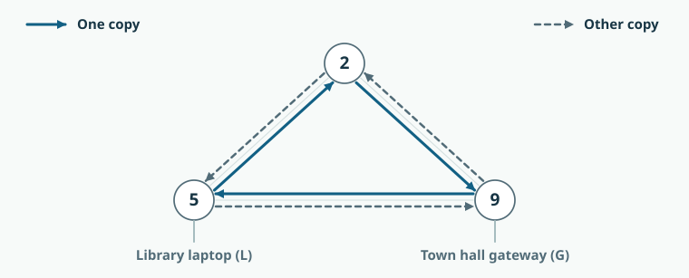
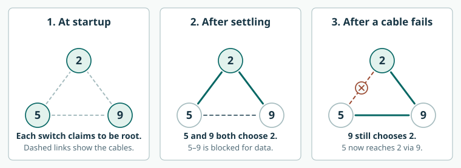

# 4. Switching and Forwarding

Last chapter we left Returno in the village library with a packet for the weather station. He'd even found the address of the gateway at the town hall, the machine that would take the packet on its next hop. His laptop could therefore put the gateway's MAC address on an Ethernet frame and hand it to the library network. Let's stay in the library a little longer. What in the building knows which way the town hall is?

## What can a switch learn from one frame?

With an early Ethernet, the answer could quite reasonably have been *nothing*. You could attach every computer to one long piece of copper. The signal would reach them all, and the town-hall gateway would recognize its address and accept the frame. You can see the appeal of this arrangement if you're the person who otherwise has to give directions. It's somewhat less appealing if you're in the library trying to print a page while two machines at the town hall are exchanging a large file. Even a conversation whose participants are both at the town hall occupies the library's wire.

Suppose we cut the network into two **segments**, one serving each building, and put a small machine between them. This machine, called a **bridge**, can listen to one segment and repeat a frame onto the other. If it repeats everything it hears, we've gone to some expense to put the copper back together. What we'd like it to do is let the printer and laptop carry on locally while the town hall gets on with its transfer. Offsetting that considerable virtue is the prospect of someone having to tell the bridge where every printer in the village lives.

See if you can spare that person the job. Give the bridge three ports, or connections: port 1 for the library, 2 for the town hall, and 3 for a clinic. A bridge with several ports is usually called a **switch**. The very first thing this switch hears on port 1 is a frame from the library laptop, L, addressed to the gateway, G. Which of those two addresses has the switch just learned something about?

It has no idea where G is. It does, however, have excellent evidence that a frame intended for L ought to go back out through port 1. It can remember that fact and deal with its immediate ignorance about G by sending a copy out through both of the other ports, an operation called **flooding**. When the gateway replies, the switch finally discovers where G is, and the reply is already addressed to the one machine it knows how to reach. You can watch its education in Figure 4.1.

*Figure 4.1. The bridge learns from the source and looks up the destination. Once it has heard from both L and G, neither direction needs a copy on the clinic port.*

If the laptop sends to a printer the bridge has already seen on port 1, the bridge leaves the frame on that segment. The printer can hear the original transmission, and a second copy would only spend capacity. A frame with a broadcast destination is still meant for every segment in the local network, so the bridge floods it even when its table of individual MAC addresses is full. Returno's first ARP request from Chapter 3 was such a frame. If it reaches the gateway, the bridge can learn from the request and the gateway's reply in exactly the same way.

The two operations have different jobs. **Forwarding** uses the destination to decide what to do with the current frame. **Learning** uses the source to build the state that later forwarding decisions consult. An arriving frame can refresh or replace the entry for its source. An entry the bridge has seen no evidence for recently can expire, so a computer that moves and stays silent can eventually receive frames via flooding on its new segment.

In class, someone argued for fewer ports because an unknown destination would require fewer copies. Another student turned the argument around. Once addresses are learned, putting fewer hosts on each port means fewer machines have to share a segment. Then a third student pointed out that two neighbors that used to communicate directly on their shared segment would have to go through the switch if they each got a separate port. Could the switch itself become the bottleneck? Count the copies during the first few frames, then compare two long transfers between disjoint pairs. The answer depends on how much traffic the bridge can handle, how often it has to flood, and which machines actually talk to each other. One port per host with a sufficiently fast switch can avoid the shared-medium contention that started the discussion.

## What happens if Returno adds one cable too many?

That was one switch, and it could learn a good deal by sitting quietly between the buildings. Now suppose we give the library, school, and town hall a switch apiece. We'll use their numbers, 5, 2, and 9, so you can follow them in the drawings. Returno cables the library to the school and the school to the town hall. This works until somebody digs through the first cable and a perfectly healthy library laptop loses its path to a perfectly healthy gateway. Running a direct cable from the library to the town hall looks like a prudent investment. Before handing Returno the bill, though, try his network on a good day when all three cables work. The laptop wants to find the gateway and broadcasts one ARP request. How many requests will the gateway receive?

*Figure 4.2. Switch 5 sends a copy in each direction. The solid arrows trace one copy around the loop. The dashed arrows trace the other. The laptop and gateway are on the two lower switches.*

Follow the copy that first goes from 5 to 2. Switch 2 floods it out the port toward 9, and 9 floods it out the port toward 5. Switch 5 now gets a frame whose source is the library laptop but whose ingress is the town-hall cable. As far as the learning rule can tell, the laptop has moved. Switch 5 records the new evidence and floods another copy toward 2. No switch reflected the frame back through the port it arrived on. The loop brought the copy back on a different port each time. The other copy can do the same in the opposite direction. The gateway can see repeated requests, and the switches can repeatedly change their entries for a machine that never moved.

One proposal in class was to have the recipient announce that it had received the message so the switches could stop forwarding it. Someone asked what would happen to that announcement. “Oh, the broadcast now itself creates a cycle. Oh, I didn't think of that.” Even if delivery notices had a separate rule, the switches would need a way to match each notice to the frame it was intended to stop, and a notice cannot help if the destination never gets the frame. Another proposal was to give every frame an ID and remember which ones had already passed. That can work with enough memory and a suitable rule for retiring IDs, but the switch would be keeping track of recent *frames* as well as the much smaller set of addresses. On the board, where our switch runs something suspiciously like Python, it's easy enough to add another table. In the device that has to consult that table for every arriving frame, we'd like to know how big it needs to be. A third proposal was to shut down quiet links. Once the broadcast is looping, which links will look quiet?

IP routers have a way to bound the damage from their own loops. Each IPv4 router decrements the datagram's Time to Live (TTL) when it forwards, and drops a datagram that has run out of TTL. Think of a climbing harness. You're glad it's there if you fall, although it would be a curious choice of equipment for finding the way up. The Ethernet switches in our triangle forward the frame at the link layer and leave any enclosed IP datagram alone. An ordinary Ethernet frame has no corresponding hop counter. Even if we added one, it would eventually kill the copy in Figure 4.2 without telling the switches which way the next copy ought to go.

## Which links should carry frames?

A student proposed keeping the smallest number of links that still connected all the switches. For a network of *n* switches that would be *n − 1* links. The instructor drew a four-switch network with five links and cut two in the wrong places. The result left three links and an isolated switch. A second student supplied the missing condition. Pick one switch and make sure every other switch can still reach it. The two conditions together characterize a **spanning tree**, a connected set of links with no cycles that includes every switch.

Why does flooding work on that tree? Between any two switches there is exactly one simple path. On receiving a flooded frame, each switch sends copies out its other ports. A second way for a copy to reach the same switch would require a cycle. The same unique paths give source learning its meaning. If a switch receives a frame from L, the port it arrived on really does lead back to L. Returno gets both properties by keeping the triangle's cables installed and allowing ordinary frames to use only two of them at a time.

Someone in class suggested Prim's algorithm. Given a map, an administrator could compute a tree and configure the switches. Switches could also report their neighbors to a controller that computes a tree, but first they need a way to reach that controller, and somebody has to handle changes when that connection is unavailable. A student proposed something the switches could do with only their own ports. Pick a **root**, have it send a message to its neighbors, and let each switch keep the link by which it can reach the root. Then each switch needs just one parent, and the root needs none.

The first version of the proposal was to take the first message that arrived. One student reasoned that if everybody passed it along promptly, a shorter path should have delivered it already. Another asked whether the aim was the shortest path or the fastest one. Suppose 2's direct advertisement to 9 is delayed and the copy that goes from 2 to 5 to 9 arrives first. Asking everyone to pause before relaying could work under an appropriate bound on delays, but a message can carry the hop count itself. The switch can compare two routes without coordinating clocks or interpreting the order in which the messages arrived.

## How can neighbors agree on a tree?

We can ask a switch to choose a parent, but we've rather casually assumed that everybody knows which switch deserves to be the root. From the library, the school looks much like the town hall. The switches do have distinct numbers, so let's agree that the smallest number wins. That leaves a little difficulty on the first morning: before it hears from its neighbors, the library switch knows precisely one switch number. Let it nominate itself. What could a neighbor say to change its mind?

Suppose each switch periodically tells its neighbors, “Here's the smallest root I've heard of, and here's how many links away it is.” The sender includes its own ID, so the receiver knows whose offer it's considering. Hearing about a smaller root is always grounds for changing your mind, even if it's a long way away. Once two neighbors agree on the root, it makes sense to compare the distances they offer, adding one hop for the link to the neighbor. If they're equally good, we can prefer the neighbor with the smaller ID. With that agreement in place, every switch can keep advertising its current choice, including switches that have rather recently discovered they aren't the root after all.

In Cooville, switch 9 might hear switch 5 claim to be root before it hears from switch 2. It has a reason to switch from 9 to 5 and later from 5 to 2. Even among messages naming 2, it can first hear of a two-hop path via 5 and then improve to the one-hop path. When the messages have settled, 5 and 9 both choose 2 as parent. The cable between 5 and 9 still carries control messages. To carry ordinary frames, one endpoint must choose the other as a parent. Neither does here, so the switches block the cable for data. On a point-to-point link, blocking data at either end suffices to remove it from the forwarding tree.

*Figure 4.3. Only switch 2, the smallest ID, remains a root once the advertisements have propagated. The middle and right panels show the active data links before and after the library-to-school cable fails.*

For an example with a tie, put a fourth switch numbered 3 at a new clinic, with links to 5 and 9 and no direct link to 2. Both neighbors can offer a two-hop trip to root 2. Which link should 3 keep? Our rule chooses 5. Choosing 9 instead would also work if 3 kept only that one. The ID rule gives the same tree regardless of which of the advertisements arrived first.

Here is why the settled tree works. In a fixed, connected network where advertisements eventually arrive, the smallest ID propagates from neighbor to neighbor and wins wherever it is heard. Each switch other than that root has chosen one parent. Its parent is one hop closer to the root. Follow parent links and watch the hop count decrease at every step until it reaches zero. This gives every switch a path to the root, and the parent choices have supplied exactly one edge per non-root switch. Those are the two conditions the students asked for. Ethernet's **Spanning Tree Protocol** (STP) uses this general idea. Its actual rules include bridge priorities, path costs that need not equal hop counts, and port states that govern when forwarding can begin. [Spanning Tree Protocol configuration guide](https://www.cisco.com/c/en/us/td/docs/switches/lan/c9000/lyr2-fwd/stp/stp-configuration-guide/m-stp.html)

What became of the student's suggestion to take the first message that arrives? In class I tried to draw a network on which that rule would produce a cycle. I went away without an example, and by the next lecture there was a good reason for that. For a fixed, connected network, consider the flood that announces the eventual root. Commit to the port where you first hear about that root, then relay the announcement. Each new switch to hear about the root attaches to a switch that had already heard about it. Trace the parents backward and every parent joined strictly earlier than its child. The chain must reach the root, so the resulting links are a tree even if messages take arbitrary amounts of time to arrive. In the delayed-advertisement example, 9 can join through 5, and the tree can still carry frames. It just used two hops where one was available. A new round in which everyone chooses the first arrival again could select different parents even if nobody moved a cable. So the student gets a tree. What the hop count buys us, beyond that, is a short path to the root even when the first message took the scenic route.

## What changes when a link or switch fails?

Pull the cable between 2 and 5. The library's switch can still hear from the town-hall switch on the cable that was blocked for data. Switch 9 still has its direct path to 2, so 5 chooses 9 as its parent and reports a distance of two. The active tree now runs from 5 through 9 to 2. If the school switch itself loses power, there is no surviving route to 2. Once information from that root expires, 5 has the smallest surviving ID, and 9 can choose it across the direct cable. Both the laptop and gateway are still connected. Devices attached only to the school switch have lost their connection.

A switch can detect some failures locally, for example when a port loses its signal. To detect a vanished root beyond its immediate neighbors, it needs fresh evidence that the root is still there. In the lecture's design the root periodically sends a new announcement. Information that stops being renewed expires using elapsed time on each switch's local clock. Ask what would happen if 5 and 9 could keep each other's old claim about 2 alive just by repeating it. A timer that restarts for any message about 2 would never run out. The protocol needs a way for root information to get older as it is relayed and to expire unless it is refreshed from the root.

Settling on a tree and moving traffic onto it are two parts of the job. On recovery, for example, if the library-to-school link starts forwarding before the library-to-town-hall path stops forwarding, the whole original cycle briefly returns. If the old path is blocked first, some frames may have to wait or be dropped before the new one opens. The proof for a settled tree says nothing about the order in which different switches change their ports. Actual spanning-tree protocols govern when each port can start forwarding, so it does not open immediately on incomplete information. [Spanning-tree interface states](https://www.cisco.com/c/en/us/td/docs/switches/lan/c9000/lyr2-fwd/stp/stp-configuration-guide/m-stp.html)

Finally, look at the library's entry for the gateway. Before the cable failed, switch 5 learned G on its port toward school switch 2. The new path starts on the port toward 9. Even after the control messages settle, that old MAC entry describes the previous tree. Discarding entries learned on a lost or blocked port and refreshing entries from new traffic both help. A simple design could clear dynamic entries after a topology change and pay for a burst of flooding while it learns again. With aging alone, an obsolete entry on a port that is still forwarding can keep sending traffic the wrong way until it expires. Returno needs both a working set of links and forwarding tables that reflect it.

## When is the tree the wrong path?

With all the cables working and switch 2 as root, every switch has a shortest path to 2. Look again at a frame going from the library to the town hall. A direct cable joins 5 to 9, but the frame has to go through 2. It might have to share those active links with traffic to or from the school, while the nearby cable has data capacity sitting idle. The tree made it safe to forward with very little information about the network. It did so by making every pair of computers share the same choice of active links. Could the switches instead choose paths that depend on where a packet is going and use more of the physical network? That requires a different way to learn where to send traffic.

## Try the decisions yourself

**Break this.** [Quiz 1 (2025), Q16, page 8](../../assets/quiz1-2025.pdf#page=8) asks what happens when a cycle persists in an Ethernet network. In Figure 4.2, inject one broadcast at switch 5 with empty tables. Write the next three inter-switch transmissions of the copy that starts toward 9 and track where 5 learns L when that copy comes back. Now replace the broadcast with a unicast to a machine that remains silent, so none of the switches has learned its address. Which parts of your trace change?

**What if the path is supposed to be shortest?** [Quiz 1 (2025), Q21, page 10](../../assets/quiz1-2025.pdf#page=10) asks which algorithms guarantee shortest paths between every pair after convergence. Answer for a spanning tree, using the three Cooville switches as your example. Could you fix all three pairs' paths by picking a different root?

**Check the clock.** In [Final (2024), Q12, page 7](../../assets/cs356-final-2024.pdf#page=7), an NTP client adds half the measured round-trip time to the server's reported time. Assume each link has the same latency in both directions. Does a converged spanning tree make the path symmetric? Explain what happens to the conclusion if a link fails while the request is in flight and the reply takes the replacement path.

**Network detective.** The direct cable begins forwarding after a failure. Switch 5's capture shows control traffic reaching it on the direct cable, but laptop frames for G still leave toward 2. Assume the cable toward 2 is up and still eligible to carry data, and the failure occurred farther along that old path. What entry would you inspect? Now suppose the old entry has expired and a broadcast from the library comes back on a different port. Which property of the active topology would you check first?

[Chapter 4 source notes and worked checks](notes.md)
