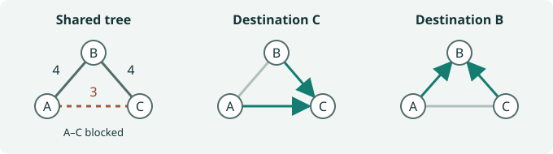
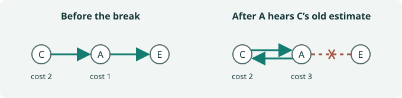
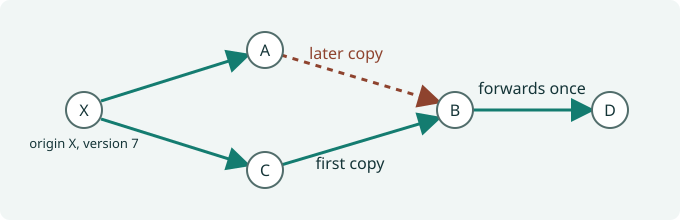
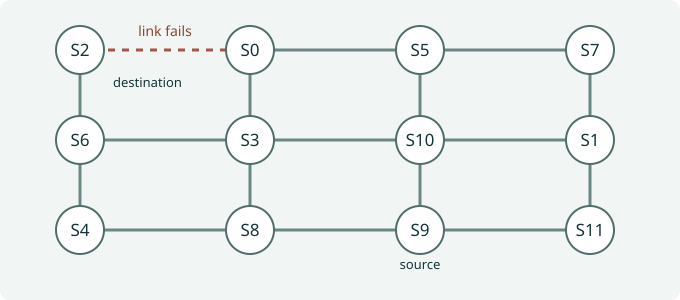

# 5. Learning the Network

In Cooville we went to the trouble of running a cable straight from the library to the town hall, then arranged for the switches at its ends to decline to carry anybody's frames across it. Given our forwarding rule, that was a perfectly sensible thing to do. A switch had to be free to flood a frame whose destination it hadn't learned. If even one copy could make its way back to the switch, the whole village might have the pleasure of receiving that frame indefinitely.

Yet consider a packet whose destination *is* known. Why should it go the long way around? Let's give the three buildings IP routers and call them A, B, and C, with B at the school. This changes what we can ask the equipment to do. Instead of asking where it last heard from a particular machine, we can give each router directions for packets traveling *toward* a destination. The interesting part will be figuring out how the routers can work out those directions for themselves.

Try giving directions to C in the network above. A should take its direct link to C, which costs 3, and B should take its direct link to C, which costs 4. Now give directions to B. This time both A and C can go straight to B. If you draw just the arrows for a single destination, they lead inward to that destination along a tree. Draw the arrows for another destination and you may get a *different tree on the same cables*. This is what the shared Ethernet tree cost us. It made one choice for the entire village before anybody had said where they wanted to go.

## What should a path cost?

I've assigned the links costs of 3 and 4, which made adding them up look like an entirely respectable thing to do. It depends a bit on what those numbers mean. If each link costs one, the sum counts the number of hops. If it takes a signal four milliseconds to travel along each of two successive links, those two pieces of the trip really do account for eight milliseconds. But suppose the label on each link is 5 Mbit/s. We've learned to add five and five. Can anybody here get 10 Mbit/s down that path?

Whatever goes in at one end has to pass through *both* links. Even with the links all to ourselves, the slowest one limits the sustained transfer rate. That's why the lecture paused over a question that arithmetic classes tend to leave to their customers: when does it make physical sense to add the numbers? A shortest-path calculation adds the weights on successive links, so the person choosing the weights owes us an answer.

There is a second difficulty even if we agree to count hops. Suppose, as in the lecture, that B has a great deal to send to A and C has a great deal to send to F. B has a direct link to A and would like to send some extra traffic along B–E–A. C, meanwhile, has two routes of equal length: C–B–E–F and C–D–E–F. Both look equally good to someone counting hops on C's behalf. To B there's quite a difference. Sending C's traffic through D leaves B–E available for the extra traffic. The cables didn't change while we were thinking this through. What changed was whose traffic we took into account.

Let's settle for a problem we now know how to state precisely. Within one organization's network we'll give each working link a fixed, positive cost, the same in both directions, and try to minimize the sum for each destination. If the distances are correct, each forwarding step on a cheapest path brings a packet strictly closer to its destination in this measure. It couldn't possibly come back to where it started. For a network small enough to fit on the board, we could work out the distances ourselves and type in the tables, provided somebody would kindly come in and redo the calculation the next time a cable breaks. What would the routers have to tell each other to save us that trip?

## What can you learn from your neighbors?

Put yourself at router A in a larger network. Its cables lead to B, C, E, and F, each one hop away. A has never heard of D or G. If you were standing at A you could hardly draw the whole map, but you could ask each of your four neighbors how far *they* think D is. Suppose C says one hop and F says two. You know the part of the journey each of them left out: it costs you a hop to get to either volunteer. That gives you a two-hop route through C and a three-hop route through F. If F is also the only neighbor who has heard of G and says G is one hop away, what would you tell your neighbors about G the next time they ask?

Notice how little had to pass between you. Each neighbor sent a list with a distance beside each destination it knew about. Nobody had to send you a map, and you can now put together a list of your own. That list is the *vector* in **distance-vector routing**. The conversation that produces the table belongs to the **control plane**. When a packet for D arrives, the **data plane** need only look up the entry and send it toward C. Just as in Chapter 3, the destination in such an entry can be a whole prefix.

For every destination other than itself, a router tries each working neighbor as a possible first hop. Add the cost of the first hop to the neighbor’s most recent advertised cost for the rest of the journey. Take the smallest candidate, and record the neighbor that supplied it as the next hop. The router’s distance to itself is zero. An unavailable or unknown candidate has infinite cost. This is the distributed Bellman–Ford update. In particular, recalculate from current candidates when a route gets worse. If you only install improvements, a route can survive the link that once made it possible.

Imagine that routers begin with only their own distances and exchange vectors in rounds. After one round, they learn paths of one hop. After two, they know the cheapest paths among those using up to two hops. Actual messages can arrive at different times, so the round boundaries are a way to reason about what information is available. A real design can send vectors periodically or trigger a message when its estimate changes.

## Bad news travels slowly

First consider the failure of F–G. If C has a genuine two-hop route to G elsewhere in the graph, A can replace its route through F with a three-hop route through C once it learns that F–G is down. F can then learn the detour through A. This is the behavior we hoped for.

A second failure in the lecture looked so similar that you might expect much the same result. This time the cable from A to E breaks, and it was E's only connection. Keep just C, A, and E on the board; they're quite enough to get us into trouble. Before the break, A could reach E in one hop and C could reach E in two, through A. After the break, A hears its good neighbor C still offering a two-hop route. What exactly has C told A about where those two hops go?

Nothing at all. A puts in a route of cost three through C and advertises the revised figure. C duly corrects its estimate to four through A. You can almost hear how helpful each router thinks it's being. Meanwhile, the first packet A sends along its new route comes straight back.

| Event | A’s entry for E | C’s entry for E |
| --- | --- | --- |
| Before the break | 1 via E | 2 via A |
| A detects the break, then uses C’s old estimate | 3 via C | 2 via A |
| C hears A’s new estimate | 3 via C | 4 via A |
| A hears C’s new estimate | 5 via C | 4 via A |

This is **count-to-infinity**. One practical limit is to treat a cost of 16 or greater as unreachable in a hop-count scheme. That ends the counting, at the price of ruling out real paths of 16 or more hops. The packet’s own hop limit is a different safeguard. It bounds how long one packet can circulate while the bad route persists.

Can C warn A that its route depends on A? With **split horizon**, C omits that route from advertisements sent to A. With **poison reverse**, C explicitly advertises infinity for that destination to A. Either rule blocks the two-router example when the advertisements reflect the current dependency. Can you build a loop with three routers? Suppose C has learned its route to E through B, and B has learned it through A. C can advertise it to A because A is not C’s immediate next hop. If A accepts that route just after losing E, the three routers now point A → C → B → A. Tracking only the first hop lets each router see one dependency. What information would expose all three?

## Advertise the links

Consider what A actually knows when its cable to E breaks. It has quite good information about *that cable*, and remarkably poor information about whether C has another way to E. We let A ask C for a conclusion and got back A's own news in disguise. Suppose instead that A tells the others exactly what it observed. A router that hears “A has lost its link to E” can cross the link off its own map. If there really is another route, the remaining links will tell the story.

This gives us a different division of the work, called **link-state routing**. Each router reports its own working links and their costs; each recipient assembles the reports into a map and chooses its own routes. Before celebrating, try delivering the first report. We wanted the map so we could compute forwarding directions. How is a report supposed to cross the network while those directions are still being worked out? Flooding would get it there, but we went to considerable trouble in Chapter 4 to keep a flood from circulating forever.

Have each origin label its own updates with a counter. X’s update 7 has the same label whether X sends it through A or C. A receiving router keeps the highest sequence number it has accepted **for each origin**. It installs and floods a newer advertisement over its other adjacencies. It discards a version equal to or older than the one it already has. So if B hears X’s update 7 from C first, B forwards that copy to D. When the copy through A arrives, B leaves D alone. The same rule stops a late update 6 from replacing 7. X and A can issue their own updates without agreeing on a clock or a common counter.

Now suppose the only copy on the way to D is lost. Duplicate suppression does nothing for D. The protocol needs a way to deliver the information eventually, such as acknowledgments and retransmission or periodic refreshed advertisements. And if X reboots and starts counting at one, receivers that remember version 7 still have a reason to reject the new message. **Design this.** How could X rejoin without letting an old advertisement regain authority?

Once the reports are in, try using the map at A in our original triangle. Its first estimates are 3 to C and 4 to B, the costs of the direct links. Which of those numbers can A ink in? Any detour has to begin by going to C or B, and every further link costs something, so nobody is going to beat 3 to C. Having settled C, A checks whether going *through* C improves the estimate for B. That would cost 3 + 4, so the direct route at 4 survives. On a larger map, an improvement would stay penciled in until it, too, was the least expensive unsettled destination. This is **Dijkstra's algorithm**. Each router does the calculation with itself at the center of the map and remembers the first hop of each path for its forwarding table. OSPF is a routing protocol that works this way.

Consider how differently the two designs spend their effort after the loss of A–E. With distance vectors, C needs little information to offer a route through A, but that very economy hides where C got its offer. With link state, C can examine the evidence for itself. The bill arrives in the form of a map at every router, messages to keep all those maps up to date, and a fresh calculation when a link changes. On a stable network a single new report need cross each link at most once in each direction under our flooding rule, ignoring losses and retries. Getting an entire network started takes a report from every origin. If your little network has three routers, you could reasonably wonder whether you want to pay for all that machinery. Conversely, if your network is large and a single report can invalidate many routes, being able to say exactly which link failed is rather valuable.

## A quiet topology can still produce changing routes

Assume every link remains up. Will a link-state protocol eventually settle on a fixed set of routes under every topology if each link’s cost is one of the following? Assume the same tie-breaking rule is used each time the same router processes the same map.

1. Interpret the two router IP addresses as unsigned integers X and Y. Use (X + Y) mod 5 + 1.
2. Use the number of bytes currently queued on the link.
3. Use the reciprocal of the traffic rate currently going over the link, with some defined behavior for a rate of zero.
4. Use the light propagation time along the fiber.

The first and fourth costs are fixed if addresses and fiber lengths hold steady. With stable connectivity and eventual delivery, each component can settle on consistent link information. Queue length and traffic rate can vary even in a graph with every edge intact. For instance, suppose two parallel routes have empty queues when idle. A persistent flow can fill the queue on the route it uses. The next measurement then makes the idle route look cheaper. If the whole flow moves and the old queue drains, the following measurement can send the flow right back. For the reciprocal metric, imagine two alternate paths whose background traffic rates trade places at each measurement. A small additional flow can keep switching to whichever route currently has the higher measured rate and hence the lower cost. Which feedback does your choice of metric introduce? [Adapted from Quiz 1, 2025, Q5–Q8.](../../assets/quiz1-2025.pdf#page=4)

Even with fixed positive link costs, route updates can arrive at different routers at different times. A packet can encounter an old table at one router and a new table at the next. A path that is loop-free on either complete map can loop while mixed tables are installed. The question is what a packet sees during the transition.

## When does a failed link become a changed route?

Both algorithms have enjoyed a small luxury throughout our discussion: when I rubbed a link off the board, you knew immediately that it had failed. A router has to decide what counts as evidence. Imagine you operate an Internet service provider whose logs report links going down around eight or nine every evening, just when traffic peaks. Before ordering replacement cables, how would you find out what the log entry actually measured? A student in the lecture proposed that the links might be healthy while the router’s periodic **HELLO** packets get delayed or dropped in a full queue. If both endpoints miss enough HELLOs, they infer a failure and remove the link from routing. That can move load onto other links.

**Network detective.** What would distinguish a physically failed link from a timeout caused by congestion? Look for whether data still crossed the link around the declaration and whether the physical interface reported a fault. Try changing the threshold from three missed HELLOs to six on an affected adjacency and measuring both failure declarations and carried traffic. Fewer declarations would be consistent with the queue hypothesis. Test what happens on an actual cut too. Extra patience has a cost when the link really has failed.

| Stage | Evidence |
| --- | --- |
| Link stops carrying packets | The simulator’s failure event or a physical measurement |
| Endpoint decides the link is down | A local notification or a HELLO timeout |
| First forwarding entry changes | An installed next hop differs from the previous one |
| A particular sender reaches its destination again | A packet from that sender makes it through |
| Routing converges | Knowledge of the failure has propagated and the relevant routes are stable |

The 2026 quiz asked teams to predict two things for **their own** programs. Which switches would end with a different forwarding next hop? How long after the cut would the first visible change occur anywhere? An identical rewrite did not count. The assignment used a grid of switches and no direct notification of the cable failure. The physical graph and old forwarding table give you the starting point. To predict the change, you also need the program’s timers, advertisement handling, route computation, and tie-breaking.

### Predict, simulate, explain

In the [offline failure lab](failure-lab.html), S9 sends toward a host attached to S2. The S0–S2 link fails at 3,000 ms. The model begins with the quiz’s forwarding choices. Every link costs one, ties go to the lowest-numbered next hop, and each copy of a link-state advertisement takes 10 ms per hop. Both endpoints check for a missed HELLO every 50 ms, phased from the last HELLO received. The cut itself sends them no signal. [Adapted from Quiz 1, 2026, Q1–Q2.](../../assets/quiz1-2026.pdf#page=2)

Before running the lab, choose three missed HELLOs and a last HELLO 20 ms before the cut. Write down your predictions.

- When will a forwarding entry first change? Which switch changes it?
- Which next hops will differ at the end? Follow S9’s path before and after. Which switches on that path can keep the same next hop?
- Can S9’s packets still fail after S0 has installed its new entry? Compare the forwarding path at detection with the path ten milliseconds later.
- Sweep the time of the last HELLO. What pattern should appear if you plot cut time within the timer cycle against detection delay? Compare your prediction to the quiz that swept the start of a traffic burst and measured the delay until traffic took a detour. A periodic check can produce a sawtooth response even when its code and the topology stay the same. [Quiz 2, 2026, Q6.](../../assets/quiz2-2026.pdf#page=10)

Then try changing the update policy. For instance, can you prevent the observed forwarding loop by holding an update, without unnecessarily extending a drop? Use the events to check the promise you made. The lab includes the editable model and a link to the full course simulator for an implementation that runs on arbitrary topologies.

We've been generous about one thing here. Every router was willing to tell its neighbors what it knew, and everybody agreed on what made a route desirable. That seems a reasonable arrangement for a university running its own network. Suppose, though, that the cheapest route in your map crosses my network, and nobody has agreed to pay me to carry your traffic. You can run Dijkstra's algorithm as often as you like; it's that agreement we're missing. When we connect independently operated networks, we'll have to decide which routes each is willing to offer its neighbors in the first place.
