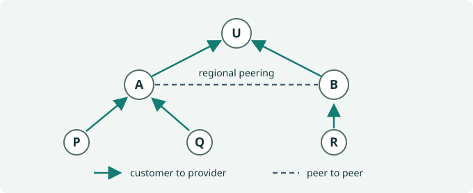
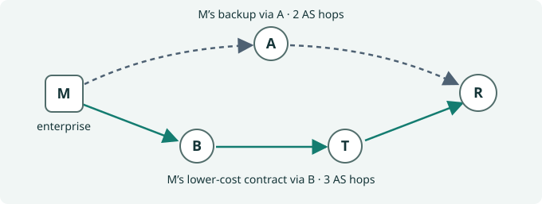
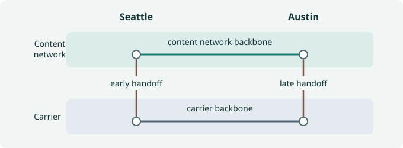
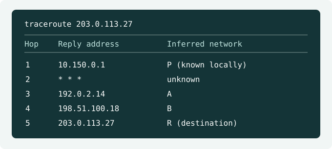

# 6. Routing Between Autonomous Systems

Suppose two Internet providers in Austin have been sending traffic to each other through a larger carrier. One of them looks at a map and asks why a packet going across town should have to go through Houston. They could run a cable between their Austin networks, or meet at an Internet exchange in the city. Now imagine that one provider also has a customer who wants to reach a third network, somewhere on the other side of the country. Can that customer send its traffic across the new link too? If you own the equipment on the far end of the link, what would make you say yes?

Last chapter, when a router learned about a working link, it could add it to the map and start using it on anyone's behalf. We had effectively put the whole map under one management. The new cable may be working perfectly, and both its owners may be happy they installed it. They still have to decide which traffic they'll carry for each other. That is the problem we take up in Part II.

## Who owns the middle?

One design would have a set of core routers that everybody pays to reach. The core would forward packets between the attached networks. In class we started drawing a design like this and immediately had to give a network a second attachment, since the failure of its only link would leave it stranded. Then came a more interesting question. Who would own the routers in the middle? Whoever does gets to set the terms on which everybody else can reach their neighbors. And if Austin's providers start making direct connections where those connections make sense, what counts as the middle anymore?

Networks do meet at shared facilities. An **Internet exchange point** (IXP) gives participating networks a shared switching infrastructure on which they can connect. That gives our two Austin providers a place to meet, and the same connection could put each of them within reach of a dozen other providers in the building. Which of those neighbors will actually carry a packet for them is another question.

It helps to draw the global map in terms of who's making those decisions. An **autonomous system** (AS) is a network, or group of networks, that presents a common routing policy to the rest of the Internet. A campus, a content company, or a transit carrier can operate one. Its **AS number** identifies it in routing exchanges. An AS can have thousands of routers and span continents, while two routers in the same building can belong to different ASes. If an AS tells you it can get a packet to Singapore, you may only need to know where to hand it over. The rest is its job. [BGP-4, §1.1.](https://www.rfc-editor.org/rfc/rfc4271.html#section-1.1) [Four-octet AS numbers.](https://www.rfc-editor.org/rfc/rfc6793.html)

## What would you put in a routing message?

Imagine you're designing the protocol for those networks in the exchange. A student suggested that a packet could carry a list of networks it wasn't allowed to cross. Another wanted some way of showing that whoever sent the packet had paid. You could give packets a language for expressing these wishes, and give routers the job of reading it. How much work would that leave for a router to do on each packet? And what happens when an organization wants to add a condition that the language didn't anticipate?

You could move the same conversation off the fast path and have the networks exchange their rules before sending traffic. This is more plausible technically. It still asks each operator to explain its internal preferences to its neighbors, who might be the very people it negotiates prices with. Consider what's involved in buying a bag of oranges. Its staff could give you an account of the bill for trucking, refrigeration, and wages. They could also say the oranges cost five dollars a bag. You can decide whether to buy them with remarkably little knowledge of how the store is run.

Try the second approach for routing. A neighbor tells you, in effect, “Send me packets for this prefix at this handoff and I'll carry them along this AS path.” You can take that offer, choose somebody else's, or use none. You can make your own offers, and you get to choose who hears them. The meetings and payments can happen elsewhere. What the protocol needs to exchange is the resulting offer of reachability.

This is the idea behind the **Border Gateway Protocol** (BGP). Two BGP speakers exchange messages over a TCP session. In our examples an advertisement names a destination prefix and carries two pieces of information we'll use repeatedly. The **AS_PATH** lists the ASes on the offered route, starting with the neighbor in a typical external advertisement and ending with the origin. The **NEXT_HOP** gives the address toward which to forward traffic. An **UPDATE** can announce reachability or explicitly withdraw a route that the neighbor previously offered. Losing a BGP session also makes the routes learned over it unavailable in our model. The BGP conversation sets up the directions that the data plane will use. [BGP-4, §§3–5.](https://www.rfc-editor.org/rfc/rfc4271.html#section-3)

## Who should hear about a route to your customer?

On the board in class, the big transit provider was AS 1. Call it U here. The smaller carriers A and B both buy transit from U. A has customers P and Q, while R buys transit from B. A and B have also put in a peering link. Pick B's side of the drawing and put yourself in charge. R tells you it can deliver traffic for `203.0.113.0/24`. Who should you tell?

R pays B to make its prefix reachable. Tell U about it, and U can offer a route to other networks that are entitled to its transit service. Tell peer A about it too, so P or Q can send to R directly via the regional providers. When B advertises each of these routes, it puts its own AS number at the front of the path. R's advertisement arrived as `[R]`, so the new offers say `[B, R]`. A can now tell paying customer P about `[A, B, R]`. P learns the route because P pays A for transit and the peering agreement covers traffic between the two carriers' customer networks.

Now try the question that produced votes on both sides in class. Should A tell **U** about the route it learned from B? Imagine that U accepts the offer. A packet coming from U could then go through A and B on its way to R. Neither B nor U is paying A for this work. U gets another path, B gets traffic for R, and A gets a bill for a bigger router when its link fills up.

![R advertises [R] to B. B advertises [B, R] to A and U. A offers [A, B, R] to P and Q and keeps that offer from U. Separately, U can send A [U, B, R].](figures/advertising-r.svg)

So A can offer the route to P and Q and withhold it from U. U already has a route from B. Before A and B agreed to peer, A could hear `[U, B, R]` from U and use that route to serve P and Q. The peering link changes which organizations do the work on each leg. Suppose A prefers the direct peering route and that link now fails. What replacement path does A offer P and Q? Trace a packet from P following the new offer. [Adapted from Quiz 1, 2024, Q11.](../../assets/cs356-quiz1-2024.pdf#page=7)

These arrangements give us a useful rule of thumb. A **transit provider** sells a customer access to other networks and advertises the customer's destinations onward. **Peers** exchange traffic for their own networks and their customers. They may do this without settling a bill per unit of traffic. Actual contracts can specify narrower terms. Under the simple commercial model we're building, an operator can use this export table for routes it has selected.

| Where you got the route | Offer it to customers | Offer it to peers | Offer it to providers |
| --- | --- | --- | --- |
| Your own network or a customer | Yes | Yes | Yes |
| A peer | Yes | No | No |
| A provider | Yes | No | No |

Each cell applies to an eligible route and a neighbor that would be entitled to use it. For example, sending a route back to its immediate source would offer no new way to reach that prefix. The table is a policy operators can implement. It would be a strange thing to build it into the format of a BGP packet, since the packet format has to work whatever the parties agree to. Notice the different arrows in the two figures. The first tells you who buys service from whom. The second tells you where the announcements go. Traffic follows the offered routes in the opposite direction to the announcements. If R's announcement travels up to U through B, a packet from U following that offer goes down through B to R.

## A path with your own name in it

Suppose A hears `[U, B, R]` from U and `[B, R]` from B. A was able to make sense of both offers without finding out how U or B wired their networks. But what if A hears a path like `[X, P, A, B, R]` from a new neighbor X? That offer says X intends to send the packet to P, and P intends to send it to A. If A took the offer, where would its packet come back?

In Chapter 5, A heard only that C was two hops from E. It couldn't tell that one of those hops was A itself. BGP carries the sequence of ASes so a receiver can spot that dependency. Ordinarily an AS excludes a route whose AS path contains its own number. When advertising to an external neighbor, it prepends its own number. The sequence is the reason BGP is described as **path-vector** routing. Sending paths for the whole Internet still takes work, but each path describes AS-level choices. A cable failure inside B can be handled inside B if reachability and the external offers stay the same. [BGP-4, §§5.1.2 and 9.1.2.](https://www.rfc-editor.org/rfc/rfc4271.html#section-5.1.2)

The same check leaves room for a curious-looking message. You might see `[B, B, B, R]` and wonder whether the packet will have to enter B three times. B is allowed to add extra copies of its own number when it advertises a route. It may do so in the hope that some other AS, on comparing otherwise similar offers, will prefer a shorter AS path. This is **AS-path prepending**. B has made one route look longer to the decision process without moving any cables. B still excludes a route containing B under the ordinary loop check, and A can accept the advertisement as far as the check for A's own number is concerned. [BGP-4, §§5.1.2 and 9.1.2.2.](https://www.rfc-editor.org/rfc/rfc4271.html#section-9.1.2.2)

## Which offer would you take?

For a small campus with a single upstream provider, the choice may be easy. Suppose a growing enterprise, M, buys connections from both A and B. Connecting to more than one provider is one form of **multihoming**. The two connections are useful if one fails and the other still has a usable path. If they leave the building in the same duct, or both providers ultimately rely on the same carrier, putting two lines on the diagram can promise rather more independence than you bought.

In this new example, M gets `[A, R]` from A and `[B, T, R]` from B. For traffic to R, M pays less under the arrangement with B. Or M might deliberately use B during the day and keep A's capacity as a backup. You could give B's routes a higher **local preference**, which tells the BGP speakers inside M which eligible route M prefers. A higher local preference can win even against a shorter AS path. Operators often implement an economic ranking in this way, giving customer routes priority, then peer routes, then provider routes. In that model the first sort of neighbor is paying you, the second typically exchanges traffic without a transit bill, and the third is somebody you pay. BGP can also use AS-path length when the relevant preferences tie. The number of ASes on the path tells you very little about how far the packet actually goes or how long it will wait in a queue. [BGP-4, §§5.1.5 and 9.1.2.2.](https://www.rfc-editor.org/rfc/rfc4271.html#section-5.1.5)

If the session with B fails, M can fall back to A's route. When both links are up, M can choose B for the outbound trip and R might choose A on the way back. As long as M advertises its own prefix to both providers, each can offer reachability to their neighbors under their export rules. M can influence R's choice by prepending its AS number on the less desirable incoming route. R could still prefer that route for its own contractual reasons. M could withdraw the route on that connection altogether, but then a neighbor using it loses a backup if the other route fails.

**What if?** An NTP client in M measures the time between its request and the reply from a server in R. In the exam's simplification, it estimates the time the reply took by dividing the round-trip time by two. Suppose every link takes exactly 5 ms in either direction. M sends via B and T while R sends directly via A. With forwarding and processing time ignored, how large is the error? Could all the routes stay fixed and that error persist? [Adapted from Final, 2024, Q13.](../../assets/cs356-final-2024.pdf#page=7)

## Which door?

Even with a single provider, you might have a choice of handoff. The lecture put a server from a large content network in Seattle and a viewer in Austin, with the content network and a carrier connected in both cities. Suppose the carrier offers the same destination prefix at both sessions with the same AS path. Should the server's operator hand off in Seattle, or carry the traffic down its own backbone and hand it over in Austin?

With both routes otherwise tied, picking the handoff that's closest by the operator's interior routing cost is what people call **hot-potato routing**. The packet leaves that network early, and the other network carries it the rest of the way. If the operator has a well-provisioned backbone and wants to carry the packet most of the distance itself, it can prefer the Austin handoff. Keeping the traffic longer is often called **cold-potato routing**. Either decision could be good for the operator. What measurements would you need to tell if it was good for the viewer? The word *closest* here refers to the interior cost to the exit. It offers very little advice about the whole trip. The carrier can also express its own preference between the two handoffs using BGP's **Multi-Exit Discriminator** (MED). A smaller MED can break a tie in favor of one of the carrier's offers. The content network's own policy can still decide the outcome. [BGP-4, §§5.1.4 and 9.1.2.2.](https://www.rfc-editor.org/rfc/rfc4271.html#section-5.1.4)

Now put yourself at an interior router in Seattle. You're holding a packet for `203.0.113.27`, and your network's choice for `203.0.113.0/24` uses the Austin handoff. Which interface should you send it out of? Knowing the exit doesn't answer that question. The **interior gateway protocol** (IGP), such as OSPF, provides the directions to reach that exit. **External BGP** (eBGP) is the exchange between ASes. **Internal BGP** (iBGP) can distribute the external routes within the AS. The router combines the external prefix choice and its internal route toward the BGP next hop to derive an actual outgoing interface. If interior routing can still reach the handoff after a local link fails, it can choose a new way to get there while retaining the same BGP route. [Adapted from Quiz 1, 2024, Q12.](../../assets/cs356-quiz1-2024.pdf#page=8) [BGP-4, §9.1.2.1.](https://www.rfc-editor.org/rfc/rfc4271.html#section-9.1.2.1)

## What's the evidence that a packet got there?

A student asked how we could tell whether a packet had crossed an AS we had deliberately chosen to avoid. In class we ran **traceroute**. The first responding address was `10.150.0.1`. Then came a pause while the program waited for the second hop. Replies started coming in again at the third. What can you make of a trace like that?

Send a probe with an IPv4 Time to Live (TTL) of one. The first router decrements the TTL and discards the probe when it reaches zero. Its ICMP Time Exceeded reply can tell you the address from which the error was sent. Send another probe with a TTL of two and the second router gets its turn. Repeating the trick gives you successive router hops, with gaps when a reply fails to come back. If you can map responding addresses to ASes, you can infer parts of the path those probes took. An interface's address registration can be misleading, especially around handoffs. Each probe is a separate packet and has its own opportunity to encounter a different path. [IPv4 router requirements, §§4.3.3.4 and 5.3.1.](https://www.rfc-editor.org/rfc/rfc1812.html#section-5.3.1)

The following example gives a trace from P to R a timeout like the one we saw in class. Can you tell whether the silent router belongs to P or to A? Can you rule out a different network?

**Network detective.** Suppose A offers B a route to prefix X. Consider three cases. A drops every packet B hands it for X, A drops only some of those packets, or A drops every packet handed to it directly by a third neighbor C, to whom A has made no offer for X. In which case can B get the strongest evidence that its route is unusable? How would you distinguish occasional drops from an overloaded link? And if a packet from C reaches A *via B*, which neighbor handed it to A? Decide what you would test before calling A. [Adapted from Quiz 1, 2025, Q11, discussed as a Lecture 7 InstaPoll.](../../assets/quiz1-2025.pdf#page=6)

The course simulator can give teams the actual hops a packet took because it owns the whole simulated network. Across independently operated networks, we generally have the advertised routes and whatever the measurements let us infer. An AS can stop offering a route when it can no longer carry the traffic, and we can check our own observations against what we'd been offered. The next question comes up even when everybody honors their offers. If taking a different route changes what you offer your neighbor, and what they offer changes your mind again, what makes the conversation stop?
