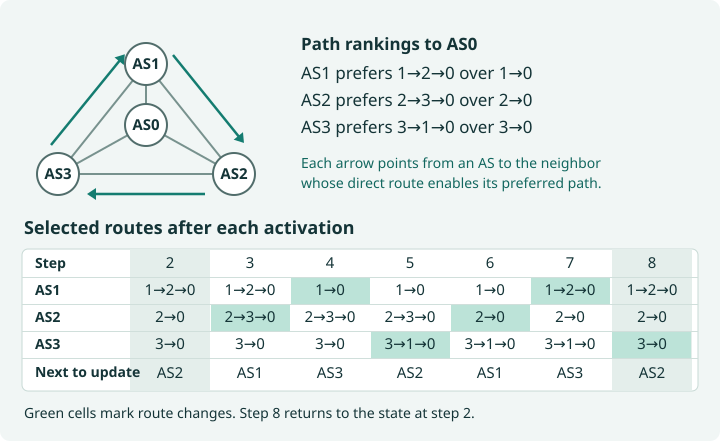
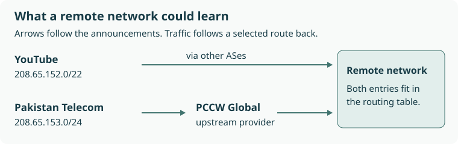
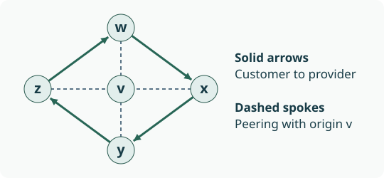

# 7. When Routing Policies Interact

Suppose you run one of the networks from Chapter 6. A neighbor offers you a route you like better than the one you're using, so you take it and tell your other neighbors how you now reach the destination. One of them changes its route in response. If word of that change eventually reaches the neighbor who made you the offer, will the offer still be good?

In class, a student pointed out that an operator could withdraw a perfectly good route every few seconds and announce it again. Fair enough. Give the network every chance to settle. Leave the cables up, have the destination announce the same prefix throughout, and hold everyone's rankings and export rules fixed. Each operator changes its decision only when the offers it sees change. When we ask whether routing **converges**, we mean that once those outside conditions stop changing, the routes themselves eventually settle. Can the operators keep one another busy forever under those rules?

## What would have to make progress?

One hunch in class was that the AS-path check ought to do the job. If you see your own AS number in an offer, turn it down. There are only so many ASes, so surely you have to run out of things to try. Think back to the role distance played for shortest paths in Chapter 5. Along a chosen path with positive link costs, the remaining distance goes down with each hop. Can we find a number here that goes down with each *change of route*?

The student's hunch gives us something worth trying to prove. If each change permanently eliminated one candidate, a finite list would be enough. But why should an AS cross an offer off its list for good just because it turned it down once?

Draw four ASes. AS 0 originates the prefix. Each of AS 1, AS 2, and AS 3 has a direct link to 0, and all three are neighbors of one another. AS 1 likes going via 2, but only if 2 sends the traffic straight to 0. Perhaps its operator measured that particular path and decided the handoff through 2 was worth it. AS 2 makes the same choice about 3, and AS 3 about 1. Here are their exact rankings.

| AS | First choice | Fallback |
| --- | --- | --- |
| 1 | `[1, 2, 0]` | `[1, 0]` |
| 2 | `[2, 3, 0]` | `[2, 0]` |
| 3 | `[3, 1, 0]` | `[3, 0]` |

An AS accepts just the two listed paths. When it selects a path, it tells its neighbors about that path. It can select an indirect route only if the listed neighbor is offering the exact suffix. For example, when 2 offers `[2, 3, 0]`, the candidate at 1 would be `[1, 2, 3, 0]`. There is no repeated AS in that path. AS 1 turns the offer down because it only wants to go through 2 when 2 offers `[2, 0]`. We model an update as one AS hearing its neighbors' current choices, choosing again, and making its new choice available for the next update. Real advertisements can spend time in flight. For the moment, all we need is that ASes can react one at a time.

Start with all three using their direct paths. Let 1 reconsider, then 3, then 2, and keep repeating that order. Predict where the choices will be after the first pass. Then give AS 1 another turn. What has it just lost?

On the first pass, 1 takes the offer through 2. AS 3 now hears `[1, 2, 0]` and stays direct. Then 2 sees 3's direct route and switches to its own first choice. On the second pass, 1 has to fall back to direct, so 3 switches to its first choice through 1, and 2 falls back to direct. Two more turns bring us to step 8 in the figure. Compare it with step 2. AS 1 is going through 2, the other two are direct, and AS 2 has the next turn in both columns. With the same choices and the same AS about to act, those six steps will play out again. Every AS gets a turn, and although every path in the table is loop-free, the offers keep changing. This is **persistent route oscillation**, one way to get the repeated routing changes often called **route flapping**.

A student asked what happens to a packet that 3 sends to 1 expecting it to go straight to 0, if 1 has switched to 2 in the meantime. In ordinary destination-based forwarding, 1 looks at the packet's destination and uses the forwarding entry installed at 1 when the packet arrives. If its entry now points to 2 and the rest of the path is usable, the packet can travel through 2. The AS path came in the routing message. The packet carries its destination address. An update or withdrawal sent to 3 can tell it about the change, but there can still be packets and updates in flight. In other examples, routers working with choices from different times can send a packet around a loop. The packet's IP TTL limits how long that can go on. You could observe the whole cycle of *routing decisions* in this example without sending a single data packet. [BGP-4, §§3.1 and 9.1.2.](https://www.rfc-editor.org/rfc/rfc4271.html#section-9.1.2)

## Is there anywhere the choices could settle?

Maybe we had the bad luck to pick a particular update order. Before trying another one, write down what it would mean for the experiment to end. Take a proposed choice at every AS and use those choices to work out who is offering what. Recompute every AS's best available path. If every AS would keep its proposed choice, we have a **stable routing assignment**. Can you write one down for our four ASes?

Try starting with AS 1 direct. AS 3 must then go through 1. That makes 3's direct route unavailable to 2, so 2 has to go direct. But when 2 goes direct, 1 has its preferred route through 2. We started by giving 1 a route it would now want to abandon. Try the other case. If 1 goes indirectly, 3 must go direct, 2 must go indirectly, and 1's indirect route is unavailable. We've exhausted the possibilities for 1 because the route from 0 stays up. In a stable assignment, going once around that circle would have to flip 1's choice three times and leave it where it started.

Read each arrow in the figure as *depends on*. AS 1 depends on AS 2's offer, which gives us the first arrow in `1 → 2 → 3 → 1`. The physical links between those ASes will be there whatever path preferences the operators write. Change just one preference and see what happens to the dependency. Let AS 1 put `[1, 0]` above `[1, 2, 0]`, leaving everybody else as they were. Which AS can now make a decision you can take off the board?

AS 1 can. When it learns the direct route, it has its first choice for good. Once 3 hears that offer, 3 has its first choice for good. When 2 hears 3's selection, 2 can settle on its direct route, since the only indirect route it would take has permanently disappeared. This argument works even if the ASes first pick some other routes. The only scheduling assumption we need is **fairness**. Every AS must eventually get to act on the updated offers. Even if AS 2 gets a dozen early turns, the choices still become permanent in the order 1, 3, 2. That was the extra step the class took after playing through the example. You can simulate a run to get the hunch. To prove convergence, find what will eventually become fixed regardless of how the run started.

**What if?** Look at just two ASes, A and B, with a link to each other and a link each to the origin. Each prefers going via the other AS when the other AS is direct. Is there a stable assignment? Are there two? Now start with both direct and have both reconsider at once, each acting on the other's previous announcement. Repeat. What do they do after the indirect routes disappear? The experiment shows why a proof that a stable assignment *exists* leaves a second question about *reaching* one under the permitted update schedules. [Griffin, Shepherd, and Wilfong, Fig. 3.](https://www.cs.bu.edu/faculty/gacs/courses/cs535/papers/BGP-ToN-Griffin.pdf)

## Can a contract tell you which decisions to make first?

Suppose you're asked to fix this without putting everyone on shortest paths. You could ask each operator to file its routing policies in a worldwide registry and have someone check for conflicts. What would the checker need to know? It would need the policies, the current links, and the links that might fail tomorrow. Some of those policies encode business arrangements operators would prefer to keep to themselves. We wanted BGP in part so that a network could say what it offers without having to publish its reasons. Can we get a convergence guarantee while keeping that property?

Look again at what A was selling its customers in Chapter 6. A was happy to tell its upstream provider and its peers about its customers. Its customers were paying to be reachable. A didn't want to offer its provider a way to send traffic through A to a peer. That would make A carry traffic between networks that weren't paying A for that trip. Put those incentives into a rule. An AS can offer its own routes and selected customer routes to any neighbor. It offers a selected peer or provider route only to customers. Then let each AS rank routes learned from customers above routes learned from peers, and peer routes above provider routes. Within each class, an operator can still have its own ranking. A customer route can win even if its AS path is longer.

Where could dependencies live under those rules? Draw an arrow from each customer to its provider. Draw peer links without arrows, then put the peer links aside for a minute. Could you follow the customer-to-provider arrows and get back to where you started? That would make an AS a provider to one neighbor and a paying customer, through a chain, of itself. As the instructor put it, “I'm paying myself.” Contracts needn't follow our sketch, but it's plausible to rule out that cycle. If the arrows form a directed acyclic graph, we can order the ASes with customers before their providers. We can also read the order in reverse. See if you can use one ordering for each part of the following argument.

1. **Settle customer routes first.** An AS can learn a route from a customer only if that customer originates it or is offering its own selected customer route. A customer with no customers of its own can only offer its own prefixes upstream. Once those permanent offers are known, the next AS up can settle what it will offer to its providers and peers. Proceed up the customer hierarchy. A customer route that wins will stay selected when other kinds of offers arrive.
2. **Read the peer offers.** Each peer may offer its own or a customer route, choices already settled in the first step. Any AS without a customer route can now determine whether it will use one of those peer routes.
3. **Settle provider routes last.** An AS still looking for a route must use an offer from a provider, if it has one. A provider higher up in the order can already have a fixed customer or peer route, or settle its provider route before the ASes below it settle theirs. Follow the order down.

This is an order in which choices *become fixed*. The ASes can keep exchanging updates throughout. The argument works by giving each AS enough time to hear the offers that will eventually stop changing. Gao and Rexford proved a convergence result for BGP policies arranged around this kind of commercial hierarchy. We've used a version of their conditions with the strict customer, peer, provider order from the lecture. The theorem gives a **sufficient condition**. If the conditions hold in the model, the routes settle. If a condition fails, see what the actual policies do. For example, even a ring of customer-to-provider arrows would be quiet if every AS in the ring had a permanent direct route to the origin and accepted only that route. The graph alone gives you no witness of flapping. [Gao and Rexford, §§IV–V.](https://courses.cs.duke.edu/fall24/compsci514/readings/stable-internet-routing.pdf)

**Break this.** Suppose the customer-to-provider arrows are acyclic. An AS now starts offering a route from one provider to another provider. In the first step of our argument, which promise about the origins of customer offers can the second provider no longer rely on? What route would you look for in its update log?

## How long should the bad news take?

The commercial rules tell us that the updates will eventually stop. They leave an operator with a practical question when a destination withdraws its prefix. How many other offers will the neighbors try first? Even under policies that eventually settle, one AS may still be offering a route it learned before the withdrawal. A neighbor's favorite route disappears, so it tries the next offer. By the time it hears that this other offer is gone too, it may have heard a third. In class we called this *path hunting*, or **path exploration**. Try to imagine writing the router's decision rule. You'd like it to search for a usable alternative before giving up on a destination. The work of trying the alternatives is exactly what can make a withdrawal travel slowly.

If you are watching a route collector and see three different paths in a minute, what do you know? Each path was reported at that vantage point. Check which withdrawals came first, what prefixes were involved, and whether the physical or administrative event is still changing. A short trace containing several paths could be the tail of one failure. A repeated state in a simulation can be decisive if it includes the pending messages and whatever controls future updates, and if those together determine what happens next. Out on the Internet, two identical-looking snapshots of your own routes leave a lot of the state unobserved.

## Suppose everybody settles on the wrong route

Imagine you're on call for a video service. Viewers have begun reporting failures, yet your network is still advertising its prefix, your links are up, and your neighbor confirms that it can see your route. What would you ask the operator of a network where the videos won't play? Ask which route its routers use for the address of an affected server. That's a more revealing question than asking whether they can see your announcement.

On February 24, 2008, YouTube was advertising `208.65.152.0/22`. Pakistan Telecom began originating `208.65.153.0/24`, a block inside it, and its upstream provider, PCCW Global, passed the announcement along. The lecture recounts the idea behind the domestic block. Traffic for the service was supposed to go somewhere it could be discarded. Once the announcement crossed the provider boundary, networks far beyond Pakistan began directing traffic there too. [RIPE NCC's observations of the incident.](https://www.ripe.net/about-us/news/youtube-hijacking-a-ripe-ncc-ris-case-study/)

Take a packet for `208.65.153.42`. Both entries match, so the forwarding rule from Chapter 4 selects the longer prefix, the /24. A router could keep a perfectly good route to YouTube's /22 the entire time. Nor would a check for repeated AS numbers find anything wrong with the /24. The failure was an unauthorized **origin** for that address block, commonly called a prefix hijack. When the class revisited this sort of failure, a student suggested trying the service from several networks. If the working and failing probes take different paths, the addresses seen along those paths can help narrow the search to a particular AS. The next call is to an operator who can check which prefix and origin its routers actually selected for the failing address. A settled routing table can be valuable evidence in that investigation.

## What if the address book loses its route?

Try taking down only the route to the authoritative DNS servers of a service. Some users' recursive resolvers still have recent answers for the service name. Other users' resolvers have to ask the authoritative servers now. Which users see failures first, and what happens as the cached answers expire? Then ask a different question. If you manage to obtain an application server's address, what would you have to test separately to see whether you could use the application? The exercise has two destinations with different jobs. The routing table can tell a different story about each.

On October 4, 2021, a maintenance command took down Facebook's backbone connections. The DNS sites were configured to withdraw their BGP announcements if they lost contact with the data centers. With the backbone down, that rule fired even at sites where the name servers themselves were still running. The withdrawal was a second failure from a user's perspective. Even the step of finding the service's address could fail, and the backbone outage had impaired access to the service itself. A cached address could bypass the DNS lookup while the cache entry lasted. The connection would still depend on the path to the application and on the service at the other end. [Facebook Engineering's outage report.](https://engineering.fb.com/2021/10/05/networking-traffic/outage-details/)

**Network detective.** Suppose you can see DNS responses for a failed service, BGP updates from two upstreams, and connection attempts from a user network. The cached DNS answers last ten more minutes. Both upstreams stop offering the authoritative DNS prefixes around the time the trouble begins. Design one test for reachability of a name server and another for reachability of an application endpoint during those ten minutes. What would each test tell you if it succeeded? What additional observation would you ask the service operator for before blaming the DNS servers themselves?

## Try the policies yourself

Choose one ranking in the four-AS example to change. Predict which route stays fixed first, then predict how the other two respond. Run several update orders in the [routing-policy lab](route-lab.html) and use the [lab instructions](lab.md) to explain one trace. If every run settles, see if you can turn your explanation into an argument that covers any fair order. If one run repeats, identify the state that makes the rest of the run repeat.

## Can you make the same ring flap or settle?

### Break this. Four policies around a ring

AS `v` originates a prefix and peers with `w`, `x`, `y`, and `z`. The outer links run from customer to provider as `w → x → y → z → w`. The exam gives each operator a little more freedom than the classroom rule did. A customer route must still beat a peer or provider route, but a provider route may now beat a peer route. It exports customer routes to every neighbor and exports routes learned from a peer or provider only to its customers. Exporting a peer route to customers is optional. AS `v` announces its own prefix to all four peers.

Can you choose full-path preferences and exports that let the selected routes change indefinitely? List the paths each AS accepts in order of preference and say where it sends its selected route. Exhibit a repeating schedule that gives every AS regular turns. Then find a stable assignment under the same policies, if one exists.

*Adapted from [Final 2024, Q5, pp. 3–4](../../assets/cs356-final-2024.pdf#page=3). The fair serial schedule and stable-assignment questions are new.*

Worked reasoning

Let each outer AS prefer the route through its provider when that provider goes directly to `v`. Keep the direct peer route as a fallback and reject all other paths.

| AS | First choice | Fallback | Advertises selected route to |
| --- | --- | --- | --- |
| `w` | `w x v` | `w v` | `z` |
| `x` | `x y v` | `x v` | `w` |
| `y` | `y z v` | `y v` | `x` |
| `z` | `z w v` | `z v` | `y` |

All accepted routes are learned from a provider or peer, and all exports in the last column go to customers. The ranking permits preferring a provider route to a peer route. Each AS picks its indirect route `I` exactly when its provider is advertising its direct route `D`.

Read each state in `w,x,y,z` order. Initially the direct announcements are available and the four ASes have yet to select a route. Activate one AS at a time in repeated `w,x,y,z` order, using its neighbors’ latest advertisements. The first four activations give `DDDI`. Continue from there.

| Activated AS | Resulting state |
| --- | --- |
| `w` | `IDDI` |
| `x` | `IIDI` |
| `y` | `IIDI` |
| `z` | `IIDD` |
| `w` | `DIDD` |
| `x` | `DIDD` |
| `y` | `DIID` |
| `z` | `DIII` |
| `w` | `DIII` |
| `x` | `DDII` |
| `y` | `DDDI` |
| `z` | `DDDI` |

Now `w` has the next turn again. The same states repeat. `IDID` and `DIDI` are both stable because every route is the opposite of its provider’s route. The existence of a stable assignment leaves open whether every fair update schedule reaches one.

### Design this. Stabilize the same ring

Keep the topology and relationship rules of the preceding exercise. Can you choose path preferences and exports that rule out indefinite route changes for this prefix after the topology and the origin advertisement stop changing? Explain why your design works under every fair update order. Try changing a single preference from your oscillating design.

*Adapted from [Final 2024, Q6, p. 4](../../assets/cs356-final-2024.pdf#page=4). The one-preference constraint is new.*

Worked reasoning

Put `w v` ahead of `w x v` and keep every other preference and export rule. The permanent origin advertisement fixes `w` at `D`. Once `z` sees that, its choice fixes at `I`. Then `y` fixes at `D`, and `x` fixes at `I`. Every fair update order eventually lets each of those decisions occur. The final assignment is `DIDI`. Alternatively, if every outer AS withholds its peer route from its customer, the indirect paths in the oscillating design are unavailable and each outer AS settles on its direct route.

## Once the routes settle

Suppose your design settles on the direct route from `w` to `v`, and `z` starts sending its traffic through `w` as well. From the point of view of the routing protocol, you're done. From the point of view of the operator at `w`, you've just acquired a new load to carry. If you have two ways across your own network to the handoff with `v`, and a queue is building on one of them, how much traffic should you move to the other?
