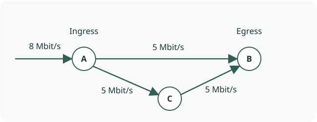
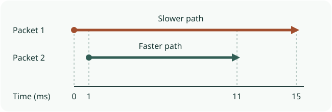
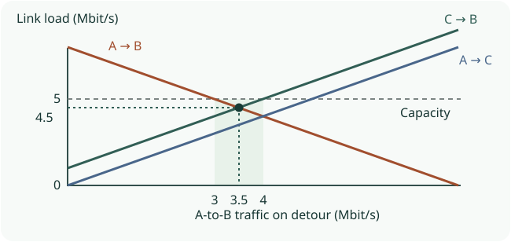

# 8. Traffic Engineering: Making the Most of a Network

The routes in Chapter 7 have settled. At `w`, the internal router that receives traffic from `z` now has eight Mbit/s to carry to the handoff with `v`. Shortest-path routing takes that traffic over a direct link that can serve five Mbit/s. A two-hop detour has room for five Mbit/s on each link, and nobody is using it. Each second, eight megabits arrive and five leave. The remaining three either join the queue or, once it fills, get dropped. How much traffic would you move, and what would you need to measure before moving it?

Moving three Mbit/s would stop the direct queue from growing. Moving four would leave one Mbit/s free on each path, which sounds better until you ask who else might need the detour. If the intermediate router starts sending two Mbit/s of its own to the egress, the second link of the detour can spare only three. The only split that carries both steady demands without growing either queue is now five on the direct route and three on the detour. Every route in both arrangements reaches the same destination. The difference shows up in how much traffic can get through. This is the problem of **traffic engineering**. Within one operator's network, how should we assign the traffic to the available paths?

## What would you ask the routers to count?

Suppose all you have is a graph of output-port utilization. The direct link reports five Mbit/s, and the detour reports zero. The same numbers would appear if customers wanted exactly five Mbit/s and there were no queue. They would also appear while demand was much higher and the queue was dropping packets. To compute a new assignment, you need the pair of endpoints *inside your network* where each demand enters and leaves. If those endpoints are A and B, you can count traffic for B as it arrives at A, before the congested output link decides what to transmit. Divide by the observation interval to estimate a rate. If a sender has already slowed down in response to congestion, even this counter measures what it offered during the interval. Estimating how much it would send after you give it more capacity requires more evidence.

Collect those rates in a table with ingress routers down the side and egress routers across the top. Each cell estimates the demand from one to the other. This **traffic matrix** needs no column for a chosen path. That is the decision you want to make. In our example, the cells for A to B and C to B contain eight and two. An egress can get several such demands at once, and each cell can include thousands of TCP connections. Keeping those two scales in mind will matter when we turn a rate split into forwarding rules.

**Network detective.** A customer reports that its traffic is slow. The link's byte counter remains flat at its five-Mbit/s service rate as you move the customer's flows off it. What would you look for in per-customer ingress counters, queue measurements, and drop counters to distinguish an unsuccessful move from a successful move that freed capacity for another customer?

## Which packets would you put on the detour?

We know how many bits per second we would like to divert. A router, though, has a packet in hand and needs to choose an interface. A student proposed using a counter. For a five-to-three split, repeat a schedule of eight packets, putting five on one path and three on the other. With equal-sized packets and steady rates, the byte split approaches the packet split over complete cycles. Unequal-sized packets can make those proportions very different. Even with equal packets, consider what happens at the receiver. Send packet 1 down a 15 ms path at time zero, then packet 2 down a 10 ms path at time 1 ms. Packet 2 arrives at 11 ms, four milliseconds before packet 1. A transport that delivers bytes in order will have to hold those later bytes. A sender that takes several out-of-order arrivals as evidence of loss might retransmit data that is still on its way. Queuing can change the speed of either path between successive packets.

Imagine implementing the choice without a counter. Hash the fields that stay the same for a transport flow, such as its source and destination IP addresses, source and destination ports, and protocol. Give five of eight hash buckets to one path and three to the other. Each flow uses one path while the mapping is fixed. This is the idea behind per-flow **equal-cost multipath** (ECMP) when the routing protocol has supplied several equal-cost next hops and the hash buckets are divided evenly among them. The five-to-three rule is a weighted variant, and a traffic-engineering controller can explicitly install paths with different costs. A bucket split tells you the probability of placing a flow on each path under a uniform hash. The number of bytes on each path depends on the flows that land there. Two large flows can hash to the same next hop while the other next hop carries almost nothing. Moving a flow while packets are still in flight can also reorder it.

The class tried another implementation using the forwarding rule we already have. Split a destination prefix into eight smaller blocks and assign five to one path and three to the other. A packet for the same address takes the same next hop under a fixed set of rules. Will five-eighths of the traffic follow those five blocks? Only the distribution of bytes across destination addresses can tell you. One popular address can defeat the split. You also have to find room for more entries in the forwarding table. Try assigning the first five blocks to the direct route and the last three to the detour. Can you express the detour using two more-specific entries and let a covering prefix handle the rest?

Both the flow hash and the prefix split can keep sending traffic to a busy link long after the operator sees a queue. A student suggested sampling two alternatives and picking the less loaded one. The class first tested the idea on servers doing identical jobs. Assign `k` jobs independently to `n` servers and there are `k(k-1)/2` pairs of jobs, each with probability `1/n` of landing together. Collisions become plausible well before there is a job for every server. Two choices give a dispatcher with current load information a chance to avoid an occupied server. Would a router have equally good information? A probe might report low delay on a path with an empty queue and a much smaller capacity. Two apparently separate paths might also use the same downstream link. The usefulness of probing depends on what you can measure and on how much the choices really differ.

## How would you choose the target split?

Start with the same three routers. Call the amount of the A-to-B demand on the detour `x`. The direct link carries `8-x`, the first detour link carries `x`, and the second detour link carries `x+2`. All three have capacity five Mbit/s. With `x=3`, the busiest two links are both full. Here is a quick proof that no split does better. Ten Mbit/s in total must enter B, and its two incoming links can carry only ten between them. To give B two Mbit/s of spare capacity, you would have to add capacity at that boundary or reduce the offered rates. Moving the through traffic again cannot help.

Now change the second demand to one Mbit/s. Put four Mbit/s of through traffic on each path and the detour still has a full link. Can you do better? Make `8-x=x+1`. At `x=3.5`, both incoming links are at 90 percent, which reaches the lower bound of nine Mbit/s across the two links. Ask yourself what each router would need to know to find this split from local queue readings alone.

On a larger graph you might have dozens of such decisions. You can express them as a **multicommodity flow** problem. Each commodity is a demand `k`, specified by its source `s_k`, destination `t_k`, and rate `d_k`. For each directed link `e`, introduce a nonnegative variable `f_{k,e}` for the rate of that demand on that link. For full-duplex links with independent capacity in either direction, give each direction its own variable and capacity. This keeps opposite directions from canceling one another on paper.

At each router `v`, subtract the total incoming rate of commodity `k` from its total outgoing rate. The result must be `d_k` at `s_k`, `-d_k` at `t_k`, and zero everywhere else. These are **flow-conservation constraints**. Router C in our example sends out exactly as much A-to-B traffic as it gets from A. It can also send its own C-to-B traffic because that is a different demand. At each link add up the rates from *all* commodities. The sum is where the commodities compete.

If the sum on link `e` is `L_e=Σ_k f_{k,e}`, the utilization is `L_e/C_e`, with `C_e` its capacity. You could ask a solver to make the highest of those ratios as small as possible. Here is the lecture's way to write the request. Introduce one additional variable `u`. Require `L_e ≤ u C_e` on every link, then minimize `u`. Think of turning one dial that scales all the link capacities together. How far down can you turn it and still satisfy every demand? If the solver finds `u=0.9`, each link uses at most 90 percent of its capacity in the computed assignment. At least one link reaches that bound in a nonzero optimum, or you could turn the dial down farther. The link's capacity is a constant, so multiplying it by `u` keeps the model linear. If you constrain `u ≤ 1`, overload can make the problem infeasible. Letting `u` exceed one gives a diagnostic measure of how far away you are from carrying the full demand under this model.

**What if?** Take a solution with spare capacity on a directed cycle and add the same small amount of a single commodity to every link on that cycle. Do the flow-conservation equations still hold? Could the objective stay the same? When you translate the solution into paths, subtract the minimum cyclic rate from every link in that cycle. This removes that circulation without changing delivery and without increasing any link's load.

These equations let the solver move fractional rates. Installing them on a network with indivisible flows or limited forwarding entries may require rounding or a different formulation. One practical simplification from class is to choose a small set of candidate paths first, then solve for the rates on those paths. Capacity constraints still count every path that uses a link. If you pick just the two shortest paths for each demand, can you construct a network where they both share a bottleneck and an omitted third path has room? Candidate paths can save computation and forwarding state at the cost of giving up useful choices.

## How old are the numbers when the new rules take effect?

The central controller has to collect measurements, solve the problem, and install the answer. During all three steps people keep sending traffic. Imagine that a short new demand moves from one path to the other just as the controller deploys a plan designed to avoid it. The plan can steer traffic toward the queue that is now growing. Compare two controllers under that workload. One finds the best split for an older estimate. The other chooses from fewer routes and deploys while its measurements still describe the workload. How would you tell which one did better? For each deployment, record the interval the measurements describe, the time the final switch installed the rule, and the actual link loads and queue delays that followed. An objective value for the old matrix cannot answer the question by itself.

A student in Lecture 10 asked what happens if a machine sends a burst just once. If it lasts much less than a measurement interval, the average hardly moves, even though the burst can build a queue. A plan for the peak might reserve capacity idle for most of the interval. The lecture compared the problem to an airport. A checkpoint might handle everyone's trips over an entire day and still have a line when a flight's passengers arrive together. Reserve headroom for short bursts and for traffic transferred off a failed link. Let delay-tolerant work such as replication use the headroom it can yield when needed. Then test what happens to traffic you promised to carry when each important link fails. In our example, even the best split cannot carry eight Mbit/s across one surviving five-Mbit/s path. Name which traffic loses service or where extra capacity comes from.

Consider a failure with all cables still up. The controller installs forwarding rules that cut the switches off from the controller itself. Which rules would it use to get back in and fix them? The class proposed setting aside addresses for a separate control network that runs ordinary distributed shortest-path routing. Running that network on shared wires can protect it against a bad forwarding policy if the tables and forwarding resources are isolated. Separate management links can also protect against some physical failures. Ask which failures your design shares across the two networks. A reachable controller can still have work to do when an update takes effect at different switches at different times. In particular, an old router and a newly updated neighbor can temporarily send a destination's packets back to each other.

## When did the controller notice?

### Predict–simulate–explain. Shift the burst

A steady customer offers 2.5 Mbit/s on a 4 Mbit/s direct link. A second customer, whose sender increases its rate as acknowledgments arrive and cuts it after congestion (the AIMD rule we'll develop in Chapter 11), starts a transfer about six seconds into the run, asking to send 3 Mbit/s along that same link. The second customer's actual offered rate depends on its congestion controller. Both can reach their receivers through a three-link detour, with each detour link also rated at 4 Mbit/s. Each run begins in the same forwarding state, with both customers assigned to the direct link. Move one customer to the detour when your controller detects sustained contention. Which would you move first, and what have you assumed about the quality of the two roads?

In the quiz, teams varied the burst start between 6 and 7 seconds and measured how long it took to move a customer. The candidate signatures were a flat line, a descending sawtooth with a 0.5-second swing, a descending sawtooth with a 1-second swing, and a transfer that never moves. Sketch the outcome for a controller that checks an instantaneous overload flag every 0.5 seconds and acts immediately. Assume the flag stays set from the burst start until the move. Then infer what difference it would make to check once a second or to trigger on a queue crossing a fixed threshold. How would a moving average or variable installation delay alter the shape?

*Adapted from [Quiz 2, 2026, Q6, pp. 10–12](../../assets/quiz2-2026.pdf#page=10). The flag and threshold models are new.*

Worked reasoning

When the check is periodic, its wait is the time remaining to the next check. With checks at 6, 6.5, and 7 seconds, starts at 6.2 and 6.4 wait 0.3 and 0.1 seconds, respectively. Starting just after a check makes the wait jump to almost 0.5 seconds. A one-second timer doubles the swing. A constant processing and installation delay shifts the curve up. If the delay varies between runs, the measurements scatter around that curve. Under a fixed excess rate and fixed initial queue, a threshold crossing takes a fixed amount of time after the burst starts. That gives a flat response in this simplified case. Under AIMD, the excess rate and queue trajectory can vary, so inspect the flag, queue, and route-install timestamps before identifying the controller from its response plot.

### Break this. Shuffle a single flow

Two TCP senders fill a bottleneck and get similar rates. A box on just one route shuffles packets ten at a time and delivers every packet. Assume the sender retransmits after three duplicate acknowledgments and takes that signal as congestion. Find an order in which a packet that was merely delayed looks lost. What would happen to the affected sender's share if the box kept producing that pattern? What observation at the receiver could distinguish reordered delivery from real loss?

*Adapted from [Final 2024, Q7, p. 5](../../assets/cs356-final-2024.pdf#page=5). The request for a witness and measurement is new.*

Worked reasoning

If packets 2, 3, and 4 arrive while packet 1 is still missing, a receiver that acknowledges the next in-order byte will send three repeated acknowledgments for that position. The sender can retransmit packet 1 and cut its window despite the pending arrival of the original. Repeated false signals can give it a smaller share than the unaffected sender. Record sequence ranges and timestamps at both ends and see whether the original packets arrived after higher sequence ranges and before any retransmission could reach the receiver. The inference depends on the loss detector. Chapter 10 examines what the acknowledgments mean, and Chapter 11 explains why the sender changes its window.

Traffic engineering has used an aggregate rate to move packets away from crowded links. At the receiver, the decision can come down to one packet that has yet to show up. If a packet really was lost, or had a bit changed along the way, what can the two endpoints do to deliver the original data anyway?
