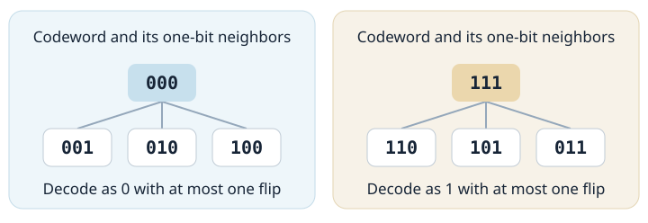
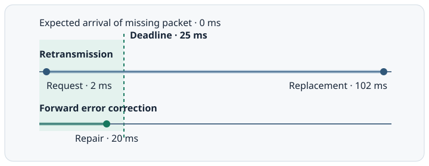

# 9. Errors, Losses, and Reliability

The sender put packets 6, 7, and 8 onto the network in that order. Packet 7 took the longer path from Chapter 8, so the receiver has seen 6 and 8. You're writing the receiver. Do you wait for 7, ask for it again, or give the application what you already have? Draw two versions of the trip, one in which 7 is still in flight and one in which a router dropped it. Up to now, what signal could your program use to tell those versions apart?

The number on packet 8 tells the program it has a gap. It has no way yet to tell how long the gap will last. Perhaps the application can use packet 8 right away. Perhaps it needs an ordered stream, in which case packet 8 has to wait in memory behind 7. A video call might give packet 7 a few milliseconds to turn up and then play the next frame. A file copy can afford to wait but has to get every byte right. Before you decide how to repair a failure, specify what the receiver has to deliver and when.

## Which bits would you believe?

Suppose packet 7 arrives, but the channel has changed one bit. Could the receiver tell by looking at the result? In class, the instructor tried this on English with `cxt`. You can spot a typo, and you can propose *cat*, *cot*, or *cut*. Which did the sender write? Now try `sore`. It's a word, so you may never even ask the question. If the sender is free to send any bit string of a given length, every received string has that same difficulty. The receiver needs some strings it can rule out in advance. [Lecture 10, lines 16193–16268.](../../assets/f26-subtitles.txt)

Let's design a dictionary with just two permitted strings, `00` and `11`. The sender can communicate one bit. A received `01` or `10` is evidence that something went wrong. Either invalid string is one flip away from both permitted strings, so the receiver has no basis to choose a repair. Both bits could also flip to produce the other permitted string, in which case the test passes.

Try it with `000` and `111`. If you know the channel flipped at most one bit, you can take a majority vote. For example, `010` is one flip from `000` and two from `111`. If two flips are possible, the very same `010` could have come from `111`. In detection mode you reject it. In one-error correction mode you map it to `000`. The guarantee you get depends on the channel assumption and on what you ask the decoder to do.

The number of positions where two equal-length strings differ is their **Hamming distance**. Each permitted string is a **codeword**. Let the nearest pair of distinct codewords be at distance *d*. A change in at most *d-1* positions can't get you from one codeword to another. Testing membership therefore detects every nonzero error of up to *d-1* flips. To correct up to *t* flips, each string within *t* flips of a codeword must identify it uniquely. If a string were within *t* of two codewords, you could get from one codeword to the other in at most *2t* flips. So *d* ≥ 2*t* + 1 is enough. It's also necessary. Take the closest pair and walk from one to the other, changing one differing position at a time. If their distance is at most *2t*, there is a string on that walk within *t* of both. [Lecture 10, lines 16315–16449.](../../assets/f26-subtitles.txt)

How far apart can you space the words before you run out of room? A student noticed that the dictionary limits how many different messages can be sent. That became a classroom poll. If you encode *m* information bits in *n* transmitted bits, you need 2m codewords, and your code rate is *m/n*. For one-error correction each word needs room for itself and its *n* one-bit neighbors. The regions must be disjoint, so 2m(*n* + 1) ≤ 2n. This is a packing bound. It tells you when you have too few bits for a design, without telling you how to build a code that fits. [Lecture 10, lines 16440–16654.](../../assets/f26-subtitles.txt)

## Can a single bit earn its place?

If all you want is to detect a single flip, use every even-parity string. Append a 0 to a payload with an even number of ones or a 1 to one with an odd number of ones. For example, `1011` becomes `10111`. The receiver XORs all five bits and expects 0. A single flip, including a flip of the check bit, changes the XOR to 1. Two flips cancel. Try flipping the first and third bits of `10111` and see why the result passes. [Lecture 10, lines 16767–16787.](../../assets/f26-subtitles.txt)

A packet checksum gives a receiver a compact consistency test over the fields it covers. The protection depends on the rule. If the check is the sum of some bytes modulo 256, adding one to a byte and subtracting one from another can leave the check unchanged. Even with a stronger check, an accepted packet is one that passed the test. The receiver can treat a detected bad packet as missing, provided packet boundaries and the identity of the missing data can be established from the rest of the stream. [Lecture 10, lines 16789–16814.](../../assets/f26-subtitles.txt)

**Design this.** A link flips each bit independently with probability 0.001. Each transmission attempt carries *N* bits including a 64-bit checksum. Treat the checksum as perfect and retry rejected packets. Ignore feedback costs and waiting. What fraction of all transmitted bits do you expect to deliver as useful payload? Choose a packet size. See if a fourfold increase in *N* always saves bandwidth.

*Adapted from [Quiz 1 2025, Q12–Q14, p. 7](../../assets/quiz1-2025.pdf#page=7).*

Worked reasoning

An attempt succeeds with probability 0.999N, since all *N* bits have to survive. Each attempt costs *N* bits and yields *N-64* useful bits if successful, for efficiency 0.999N × (*N* − 64) / *N*. A search over integer packet sizes gives a maximum at 287 bits, with efficiency about 0.583. The 64-bit expense dominates at small sizes. At large sizes the probability that the whole packet survives goes down. Both effects matter even though only the smaller packets spend a large share of their bits on the checksum.

## What can the sender learn from a gap?

Return to packets 6, 7, and 8. Suppose each packet names its place in the stream, and the receiver sends back the next number it needs. After 6 it says `ACK 7`. When 8 arrives it can store 8 and send another `ACK 7`. If 7 arrives, the receiver can now say `ACK 9`. The latter is a **cumulative acknowledgment**. It covers a whole prefix of the stream. If an earlier acknowledgment disappeared in the reverse direction, the later one can still tell the sender it is safe to stop holding those packets for repair. [Lecture 12, lines 17707–17847.](../../assets/f26-subtitles.txt)

Imagine that you sent 7 and then sent nothing more. Your clock runs for a while and no acknowledgment arrives. List three explanations. The data could have been dropped. It could be on its way. It could have reached the receiver, which sent an acknowledgment that got dropped or delayed. Now choose what your program does when a **retransmission timer** expires. Sending another copy both repairs a real loss and deals with a lost acknowledgment. It also risks putting a second copy of the data on the wire. The copies must carry the same data identity, so the receiver can acknowledge an already-received copy without delivering the same data twice. A sender also has to retain the outstanding data, or be able to recreate it, until it has sufficient evidence of receipt. [Lecture 12, lines 18254–18282 and 18679–18734.](../../assets/f26-subtitles.txt)

How long should you wait? A short timeout buys speed on actual losses, at the cost of retransmitting when the network is merely slow. At the other extreme, a long wait can leave a fast connection idle. A student asked what happens to the round-trip measurement when the sender has transmitted the same data twice. If the acknowledgment could be for either copy, measuring from the first send may make the trip look too long, and measuring from the second can make it look too short. TCP's timer algorithm avoids using ambiguous samples from retransmitted segments. [Lecture 12, lines 18795–18835.](../../assets/f26-subtitles.txt) [RFC 6298, §§2–3.](https://www.rfc-editor.org/rfc/rfc6298.html#section-3)

So far we've let the receiver report only the first gap. If it can also describe what arrived *beyond* that gap, a sender facing several holes can spend its next transmission on data the receiver still needs. A **selective acknowledgment** reports such ranges. Imagine numbering the bytes of a file. A receiver that expects byte 1000 and reports the range `[2000, 3000)` already has bytes 2000 through 2999. Before deciding whether to resend the intervening bytes, see what the evidence can actually establish. [Lecture 12, lines 17892–17918 and 18857–18963.](../../assets/f26-subtitles.txt)

**Network detective.** X has sent consecutive byte ranges through byte 14,999. Three receiver reports arrive at X in the order shown. Each report lists all the received ranges at the time it was made. What do the reports establish? Under what additional assumptions would you retransmit either gap?

| Report | Received byte ranges, with excluded right endpoints |
| --- | --- |
| First | `[0, 10000)`, `[11000, 12000)` |
| Second | `[0, 10000)`, `[11000, 13000)` |
| Third | `[0, 10000)`, `[11000, 13000)`, `[14000, 15000)` |

*Adapted from [Quiz 2 2024, Q13–Q14, pp. 10–12](../../assets/cs356-quiz2-2024.pdf#page=10). The ranges have been adapted for this trace.*

Worked reasoning

By the time of the third report, the receiver was still missing the bytes in `[10000, 11000)` and `[13000, 14000)`. The first hole persists across more evidence of later arrivals. A sender might prioritize it under an assumption that packets sent later rarely get this far ahead. If the forward path delivers data in send order whenever it delivers it at all, then arrival of a later range implies a drop in the earlier gap. If delay and reordering are unbounded, either range might still turn up. Even that last report is a snapshot. By the time it reaches the sender, the missing bytes could already be sitting in the receiver's buffer.

## Can you repair a packet before you can ask for it?

You're designing a live stream that has room for one equal-sized packet every 2 ms. The receiver has 25 ms to replace a packet after its expected arrival time. You can assume arrivals preserve their spacing except for one drop. The next arrival reveals the gap. A request and the return trip of the replacement together take 100 ms. What can you send in advance to help the receiver repair a packet in time?

Take ten originals. Number them and give their group a known layout. Send an eleventh packet whose payload is the bitwise XOR of the ten. If the receiver has nine originals and the repair packet, it can XOR those together. Each known value appears twice and cancels, leaving the missing one. The receiver must know which original is missing and can use a packet integrity check to turn a detected corruption into a known missing position. This is **forward error correction**, or FEC. Advance repair information travels in the forward direction along with the data. [RFC 6363, §1.](https://www.rfc-editor.org/rfc/rfc6363.html#section-1)

Worst case for the XOR scheme is when the first original is lost. Its group repair arrives ten slots later, after 20 ms. With retransmission, the next arrival reveals the gap after 2 ms and the repair follows one round trip later, after 102 ms. If the last original is lost, advance repair takes just one slot. There is one repair for every ten originals, so the link spends one eleventh of its slots on repair and at most ten elevenths on original data. Keep those denominators straight. The repair traffic is 10% of original traffic and about 9.1% of total traffic. [Quiz 1 2026, Q5–Q6, pp. 7–9.](../../assets/quiz1-2026.pdf#page=7)

**Break this.** Drop packets 1 and 2 in the same group. What does the receiver still know about them? What second repair packet could you add that would recover both in this specific case? Would your second repair cover *every* pair of losses?

Worked reasoning

The receiver can recover the XOR of packets 1 and 2 after canceling the eight originals it has. Many pairs have that same XOR. Add a second repair that XORs just the odd-numbered originals. Now the receiver can recover packet 1 from that repair, then packet 2 from the full-group repair. Two lost odd-numbered packets would leave the two equations with the same unknowns. That pair still defeats the design.

**Predict–simulate–explain.** Open the [repair timing lab](repair-lab.html). Start with the ten-original group and predict what happens when packets 1 and 2 disappear. Then try making the groups five originals long and dropping packets 5 and 6. Find a loss pattern where the smaller group spends more slots on repair but delivers fewer originals on time over the same wire budget. The [lab notes](lab.md) show how to count the slots and read the trace.

## Where does the repair belong?

A wireless link can check its frames and retry locally. That trip may be much shorter than asking a remote host to resend. What if the next router drops the newly repaired packet because its queue is full? Only the endpoints can verify that the data got all the way through. And if the application's contract is that an uploaded file reached durable storage, an acknowledgment from its peer's transport stack can come too early. The application may need to read back or otherwise verify the stored file and report its own result. Each layer can do the work it has enough information to do. [Lecture 12, lines 19059–19071 and 19244–19280.](../../assets/f26-subtitles.txt)

Ask what happens if every sender hits a full queue and immediately resends whatever fell out. A repair is another packet to carry. If senders keep offering more new data than the bottleneck can carry, the old packets compete with new ones for the same capacity. In class, this was the trouble with three fast senders sharing one slow exit. The retry rule may be perfectly sensible about *which* packet to send next and still demand far too many packets per second. [Lecture 13, lines 19442–19571.](../../assets/f26-subtitles.txt)

So far we've let the receiver stand for an entire machine. Bring two file-copy programs up on the same laptop, connect both to the same server, and send a repair for byte 1000. Which program is waiting for that byte? Before either copy can use our repair rule, the endpoints have to agree on which conversation the byte belongs to.
