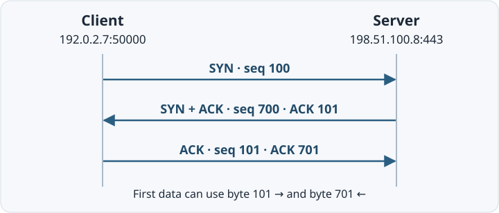
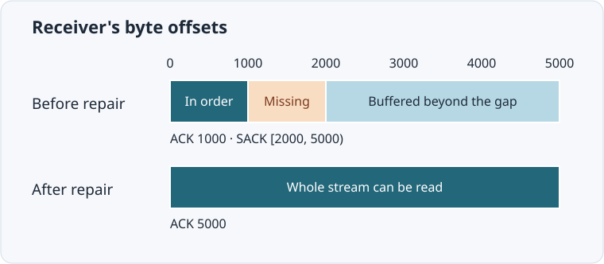

# 10. Transport Protocols and End-to-End Communication

Start both file copies from the same laptop. Each program opens a connection to the same server, which replies “OK” to one and “WAIT” to the other. Both replies arrive at the same network interface with the same destination IP address. What should the laptop look at before it wakes up a program?

Getting a reply to the right program is only the first part of the job. Suppose the server sends “OK” followed by the length of the file. Can a single read return the last byte of “OK” and the first byte of the length? The answer depends on what the **transport** promises its applications. A file copy needs every byte in place eventually. A live call has a deadline for each block of audio. We'll design the part they can share, then see where their needs diverge.

## Which conversation gets the reply?

We can give each end of a conversation a name inside its host. A **port** is a 16-bit number carried in the transport header. An IP packet identifies the destination host and indicates which transport should interpret its payload. The transport uses the addresses and ports to **demultiplex** incoming traffic, meaning it selects the local endpoint that should receive it. Port 443 is a convention for HTTPS. The number helps a client find the service, and the bytes exchanged at that endpoint determine which protocol actually runs there.

Picture a server at `198.51.100.8:443`. The two programs on `192.0.2.7` use local ports 50000 and 50001. If the server sorted all data by destination port, both conversations would land in the same bucket. If it sorted by the two IP addresses, they would still land together. An established TCP connection is identified by the pair of endpoints, each an IP address and a port. Within TCP that gives us a **four-tuple**. From the server's point of view the tuples differ in the client's port. From the client's point of view that difference appears in the destination port of each reply.

A **socket** is the program's handle to a communication endpoint. A server can bind a listening socket to an address and port, and accept a separate socket for each TCP connection. The listening socket remains available for new connections. Each accepted socket carries its own conversation, even though every conversation shares the server port. Which fields in the reply would you change if the two clients were on different machines and happened to choose the same port? [TCP, §§2 and 3.1.](https://www.rfc-editor.org/rfc/rfc9293.html#section-2)

## Should a read return a message or more bytes?

Give an application a way to send one payload to one destination port. Preserve the payload's boundary if it arrives and let the application decide whether to send another. This is close to **UDP**. A UDP send produces a datagram. An application that receives it gets the datagram as a unit, subject to the local receive API and buffer size. UDP provides a checksum mechanism, but no delivery, ordering, or duplicate suppression. A call can put a timestamp on each audio unit, make a playback decision at its deadline, and keep playing when a unit is missing. Its sender still needs to limit the traffic it offers to the shared network.

Now design a service for copying a file. The application would like to hand the transport more bytes as it reads them from disk. The receiver would like to read a continuous sequence and leave packet sizes, reordering, and retries to the transport. **TCP** provides such a reliable, ordered byte stream in each direction. A read can return a prefix of one write or bytes from several writes together. For example, if a program writes `CAT` and then `DOG`, packets carrying `CA`, `TDO`, and `G` can still produce the right stream, `CATDOG`. If those are two commands, add a delimiter or length field so that the application can reconstruct their boundaries.

**Design this.** Make a command format in which either command can contain any byte, including a newline. Assume the network may deliver a read of any positive length up to the size you request. What state must the parser retain between reads? Decide what it should do if the connection closes halfway through a command.

## How do both ends start counting?

If we numbered every stream starting at zero, a delayed packet from an earlier connection with the same tuple could look at home in a new one. A TCP endpoint instead chooses an initial sequence number and communicates it to its partner. Each direction has its own sequence space. The opening exchange must tell the client the server's number and tell the server that the client has heard it.

The client's SYN starts its sequence space at 100. The server's SYN-ACK starts the reverse sequence space at 700 and acknowledges the client's SYN with 101. The final ACK acknowledges the server's SYN with 701. A SYN occupies one position, so 101 and 701 are the first data sequence numbers in the two directions. The last ACK lets the server verify that the initiator received *this* server SYN. If an old SYN turns up when the client has no such connection open, sending a reply by itself gives the server no such evidence. Real sequence numbers are 32-bit and wrap around. Captures may display numbers relative to the first sequence number they observed. [TCP, §§3.3–3.5.](https://www.rfc-editor.org/rfc/rfc9293.html#section-3.3)

**What if?** The same client opens another connection from port 50001 while the first SYN is still in flight. Write down the source and destination addresses and ports of both server replies. If the second reply arrives first, which state does the client update? *Adapted from [Quiz 1 2024, Q1–Q2, pp. 1–2](../../assets/cs356-quiz1-2024.pdf#page=1). The competing connection is new.*

## What does an ACK promise?

With both starting numbers agreed, we can put Chapter 9's repair scheme to work on an actual stream. Imagine the sender divides a file into five 1000-byte segments and sends them without waiting between segments. For readability, count offsets from the first data byte in the trace. Write `[0, 1000)` for bytes 0 through 999. The receiver's **cumulative acknowledgment** carries the next byte it expects. ACK 1000 thus says that the complete prefix through byte 999 arrived. If ACK 1000 is lost, ACK 2000 can confirm the same prefix plus the next thousand bytes. An ACK concerns transport reception. If the file needs to be saved durably, the application must send its own confirmation of that event. [TCP, §3.4.](https://www.rfc-editor.org/rfc/rfc9293.html#section-3.4)

Now drop `[1000, 2000)` and let the receiver keep the subsequent segments. What can it say in one cumulative ACK each time? Work out the ACK after the missing segment eventually arrives as well.

Each new arrival beyond the gap leaves the cumulative ACK at 1000. If the endpoints have negotiated TCP's **selective acknowledgment** option, the receiver can also say it has a block such as `[2000, 5000)`. A student observed that a single prefix takes one boundary to describe, whereas gaps cost more boundaries. This is why the cumulative ACK remains useful even when the transport can report extra blocks. A sender can use the extra evidence to decide what to retransmit. It keeps the original bytes until they are cumulatively acknowledged. Once the repair arrives, ACK 5000 is enough to confirm the whole run. [TCP Selective Acknowledgment Options, §§3–5.](https://www.rfc-editor.org/rfc/rfc2018.html#section-3)

### Network detective. Read two snapshots

First the sender sees ACK 1000, SACK `[2000, 3000)`. Then it sees ACK 1000, SACK `[2000, 5000)`. It had sent the five 1000-byte segments in ascending order. Which bytes have definitely reached the receiver? What would you need to assume about ordering and delay to decide that a segment was lost? *Adapted from [Quiz 2 2024, Q13, p. 11](../../assets/cs356-quiz2-2024.pdf#page=11). The block endpoints were replaced.*

Worked reasoning

The reports confirm the prefix and the later block. At the time the second report was made, the receiver still needed byte 1000 to advance its cumulative ACK. If the path always delivers surviving segments in send order, the earlier missing segment must have been lost once later segments arrive. If packets can overtake each other, the sender can see exactly these reports while the missing segment is still on the way. Even after a true report was generated, additional data could have arrived before the report reached the sender.

## When should the sender try again?

When a segment falls out of the stream, the sender has evidence that could arrive either as a series of reports or as silence. In the previous figure, three later arrivals produce three ACKs repeating the same boundary after the initial ACK 1000. A classic TCP sender uses three duplicate ACKs as a signal to **fast retransmit**. Reordering can generate the same signal. In class, a student asked where such reordering would come from. One answer is a path change, if a later segment on a short path overtakes a segment still traveling along the old path. A fixed duplicate threshold trades time spent waiting for wasted retransmissions when the threshold is fooled. [TCP Congestion Control, §3.2.](https://www.rfc-editor.org/rfc/rfc5681.html#section-3.2)

Now suppose the *last* segment disappears. The receiver has no new evidence to report. The sender needs a **retransmission timeout** so it can make progress even if the ACK stream falls silent. TCP bases the timer on estimates of the round-trip time and its variation, subject to timer rules and backoff. Fast retransmit can shorten a recovery when later packets arrive, while the timer gives the sender another chance even when they never do. [Computing TCP's Retransmission Timer, §§2 and 5.](https://www.rfc-editor.org/rfc/rfc6298.html#section-5)

**Break this.** Remove the timeout. Find the shortest transmission that can now stall after one dropped segment, even if the network delivers everything the sender transmits afterward. Restore the timer and remove fast retransmit. Can recovery still work if the path eventually delivers a retransmission and its ACK and the sender keeps trying? Compare how long the gap in the figure can hold up the application in the two cases. *Adapted from [Final 2024, Q14–Q15, p. 8](../../assets/cs356-final-2024.pdf#page=8).*

## What if the receiver stops reading?

We can be getting ACKs while making no room at the receiver. The operating system might have received the bytes, but the program may be busy parsing a record it read earlier. If the sender treats every ACK as permission to send one more segment, it will eventually fill the receive buffer. Ask the receiver to advertise a **receive window** as well as an ACK. If it says ACK 2000, window 3000, the advertised right edge is offset 5000. The sender can send new bytes within that range, counting any it has already sent there.

For a simple trace with contiguous arrivals, imagine the receiver has 3000 bytes of free space and the application reads nothing while 1000 more bytes arrive. The next acknowledgment is 3000 and the available window is 2000. The right edge has stayed at 5000. If the application later reads 1500 bytes and the receiver advertises the newly available space, ACK 3000 and window 3500 put the right edge at 6500. That extra 1500 bytes of permission came from the application reading data. Receiving another segment by itself couldn't have moved the right edge. If the receiving application pauses long enough, the advertised window can reach zero. TCP uses probes when a window stays closed so that a lost window update cannot leave both sides waiting forever. [TCP, §3.8.6.](https://www.rfc-editor.org/rfc/rfc9293.html#section-3.8.6)

This **flow control** moves the backpressure all the way to the sender. Once the sender's own socket buffer fills, a blocking write may wait. A nonblocking program can return to other work and try again when the socket can take data. The receive window protects the receiving endpoint. A sender may have room to send at the receiver and still need to hold back because a link in between is shared. That is the congestion-control problem in the next chapter.

## Where should ordering stop?

Suppose one connection carries an image and a text caption. Give them a single TCP byte stream and put the caption after the image. Drop a segment in the image but deliver every byte of the caption. Can the caption reach the receiving application before that segment is repaired? TCP hands over a continuous prefix. The gap in the image blocks the caption even if the transport already has it. This is **head-of-line blocking** in a byte stream. Application-level multiplexing over a single TCP connection still has to wait for TCP to hand over the bytes.

You could open a separate connection for each object, giving each its own sequence space and recovery. What if you could keep one shared connection while giving the image and caption separate sequence spaces? **QUIC** runs over UDP and provides several independently ordered streams on one connection. If the lost packet carries only image data and the caption's data arrives, the caption stream can deliver it without waiting for the image. A QUIC packet can carry frames from multiple streams, and the connection shares congestion control. A loss that affects several streams or reduces the send rate can therefore still affect several objects. For traffic that expires quickly, an optional QUIC extension also supplies unreliable datagrams. [QUIC, §§2 and 13.](https://www.rfc-editor.org/rfc/rfc9000.html#section-2) [Unreliable Datagram Extension to QUIC, §5.](https://www.rfc-editor.org/rfc/rfc9221.html#section-5)

**Design this.** One call carries audio blocks with individual playback deadlines, chat messages that must appear in order, and an optional image whose original bytes must arrive. Assign them to transport abstractions. Say exactly where you need ordering. Then explain what should happen to a late audio block and which work can continue when an image packet is lost.

## Predict, run, explain

Use the [transport lab](transport-lab.html) to compare a gap, a detour, and a missing tail. Its two sender decisions are a duplicate-ACK threshold and a timer. Before running either test, write down the first tick on which the sender will retry and the first tick on which the receiver can release all five segments. Then vary the threshold and look for a workload in which faster retries cost extra transmissions. The [lab instructions](lab.md) explain the model and give a trace you can reproduce on paper.

Let the file copies run side by side again. Both receivers have plenty of buffer space, both advertise open windows, and both senders have more data ready. Halfway across the path they share a link that can carry only one file at the rate each sender would like. Where in the exchange we just designed would either sender learn to slow down?
