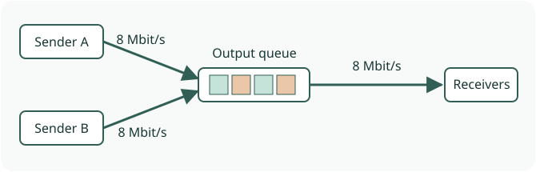

# 11. Congestion Control

Let the two file copies from Chapter 10 run. Each sender can deliver eight Mbit/s on its own, and each receiver advertises enough space to accept that rate. Halfway across their routes, though, the copies meet at a link that can carry eight Mbit/s in total. If you start both at full speed, where do the other eight megabits go during the first second? What information could reach either sender in time to change what happens during the second?

While both senders offer eight, eight more megabits arrive each second than the link can serve. A buffer can hold some of the excess. When it fills, newly arriving packets are dropped under a tail-drop policy. A student asked why we couldn't simply retransmit the lost packets. That tells you which bytes to send next, but the link can still deliver at most eight Mbit/s. If the senders continue adding new data at their old rates, the delivery backlog keeps growing. Recovering a missing packet therefore creates a second decision: which new transmission should give way to the repair? The class considered what happens if the sender gets even the first decision wrong. If packets wait so long that the sender mistakenly retransmits bytes already received, successful transmissions can use up capacity without delivering new data. Measure **goodput**, the rate of delivery of distinct useful data, to see that failure.

**Flow control** limits a sender to what its receiver can accept. **Congestion control** limits what the sender puts into the network while other senders are using it too. Chapter 8 gave a single operator tools to move traffic between paths. A sender on the public Internet usually has no list of the competing demands or even a map of the links. Before inventing a rule, list what it does see. It knows when it sent data, when an acknowledgment arrived, and which data the acknowledgment covers. How far can those observations take us?

## Can acknowledgments set the pace?

Add a second limit alongside the receive window. Call it the **congestion window**, or `cwnd`. The sender uses the smaller of the two limits and compares it with how much data it estimates is still in flight. In the simplest case, this is the data it has sent and has yet to have acknowledged. During recovery a sender also accounts separately for data it believes was lost. As acknowledgments free space in the window, the sender can send more. A reduction in the window may leave more data in flight than the new limit. The sender waits for the flight size to fall before sending again.

Set the window to two packets and send them back to back. The fast access link might pass them just a microsecond apart. Suppose the bottleneck needs 100 microseconds to transmit each. A receiver that immediately acknowledges each packet gets them roughly 100 microseconds apart. If the return path preserves that spacing, the acknowledgments release two new transmissions 100 microseconds apart. After the initial burst, the bottleneck's service has begun to set the sender's pace. This is **ACK-clocking**. If the return path collects acknowledgments in a queue and releases them close together, the sender can burst again. If the application has no data ready, an acknowledgment may release unused space. ACKs can tell the sender when there is room in the window it chose. They leave open how big that window ought to be.

**What if?** Keep `cwnd` at two and make the path a hundred times longer while holding the bottleneck rate fixed. The ACK spacing within each pair could stay the same. What happens to the time between pairs? How many packets should the sender be able to have outstanding before you expect a continuous stream at the bottleneck?

## How much data keeps a link busy?

Hold the window fixed for now. Assume one saturated sender with a large receive window, one bottleneck with capacity `C`, and an uncongested acknowledgment path. Work in equal-sized packets. Let `R₀` be the round-trip time with an empty queue, including the trip back. At a steady rate `r` and round-trip time `R`, the number in flight is `rR`. During the average lifetime of one packet from send to acknowledgment, roughly that many are sent. With a full window `W`, this gives `r = W/R`. If `Q` packets are waiting at the bottleneck in our continuous approximation, `R = R₀ + Q/C`.

The **bandwidth-delay product** is `C × R₀`. It counts how many packets can be outstanding while the link is busy and its queue is empty. For an eight-Mbit/s bottleneck, 1,000-byte packets, and a 100 ms empty-queue round trip, the link serves 1,000 packets per second and the bandwidth-delay product is 100 packets. Predict the rate and queue at three different windows.

| Window | Delivery rate | Waiting at bottleneck | Round-trip time |
| ---: | ---: | ---: | ---: |
| 50 packets | 500 packets/s | 0 packets | 100 ms |
| 100 packets | 1,000 packets/s | 0 packets | 100 ms |
| 150 packets | 1,000 packets/s | 50 packets | 150 ms |

Below 100 packets, the link spends part of its time idle as the sender waits for acknowledgments. Above 100, it is already busy, so any extra in-flight data waits upstream of the bottleneck. Substitute `r = C` into the steady-state equations and you get `Q = W − C × R₀`. This model assumes room in the queue. If the router can hold only 40 waiting packets, you cannot sustain that last row without exceeding the buffer. The model also freezes the window and looks after the startup burst. It lets you reason about where a controller might aim before asking how a real one reaches that point.

For two saturated senders with the same empty-queue RTT crossing the same single bottleneck, use the sum of their windows. Both share the same queuing delay in this model. If their total is 150 packets and each has a 75-packet window, each can deliver 500 packets per second. If one holds 50 and the other 100, the second delivers twice as much. An operator can read both windows in our table and spot the unequal split. Each sender sees only its own window and its own ACKs. What local rule could bring the rates closer together?

## Why give up half?

Suppose the only signal available is an indication of loss. You can start with a small window, increase it to see if the link can take more, and cut it when you encounter a drop. What cut would you choose? In class, a student suggested subtracting just enough to stop losing packets. For a single flow that knows exactly where the threshold is, that sounds attractive. Why would a second flow object?

Use the lecture's two-flow InstaPoll. Start windows at 10 and 20 packets. Both increase by one each round, and in this exercise both get a congestion signal when their total reaches 200. Think of a path that holds 100 packets in flight with an empty queue and has room for another 100 at the bottleneck. The two senders have the same RTT and react together. What are the two windows just before the first decrease? What happens to the gap if both subtract one? What if both halve?

| Event | Window A | Window B | Gap |
| --- | ---: | ---: | ---: |
| Start | 10 | 20 | 10 |
| First threshold | 95 | 105 | 10 |
| After halving | 47.5 | 52.5 | 5 |
| Second threshold | 97.5 | 102.5 | 5 |
| After halving | 48.75 | 51.25 | 2.5 |

Adding the same number leaves the difference unchanged. Subtracting the same number would also leave it unchanged. Multiplying by a number between zero and one shrinks it. **Additive increase, multiplicative decrease**, or **AIMD**, probes for extra capacity and gradually moves the two windows closer together. Their sum still rises and falls. If you plot the window pair as a point, increase moves it diagonally up and to the right, parallel to the line of equal windows. A simultaneous multiplicative decrease moves it toward the origin. The gap shrinks by the same factor at every such decrease. This is the argument for fairness under the poll's assumptions. A sender with a shorter RTT can increase more times per second. An overloaded router can drop from one flow and let the other continue. Try tracing two increases for A for every one increase for B and see what changes.

The sawtooth also tells you something about queues. In the simplified single-flow model, the window is approximately `C × R₀ + B` when a buffer that holds `B` packets fills. A halving leaves at least one bandwidth-delay product outstanding only if `B ≥ C × R₀`. A smaller buffer can leave the bottleneck temporarily idle after the reduction. A bigger buffer lets the sender build a longer queue before getting the signal. Run the same large transfer along with a stream of short requests and ask which of those measurements you would care about.

**What if?** A link serves 24 Mbit/s, the empty-queue RTT is 40 ms, and the buffer holds 80,000 bytes. Start just as the buffer fills and halve the window. Is there enough data outstanding to keep the link busy? The empty pipe holds 120,000 bytes, so the cut takes the sender from about 200,000 bytes to 100,000. Explain where the idle time comes from even though the sender has a whole file left to send. [Adapted from Quiz 2 2024, Q10–Q12, pp. 8–10.](../../assets/cs356-quiz2-2024.pdf#page=8)

A real TCP sender needs a rule for startup and another for loss recovery. TCP Reno's congestion avoidance uses additive growth, with reductions for congestion. In slow start the window can grow much faster, roughly doubling each RTT under prompt acknowledgments. In the loss detector from Chapter 10, duplicate acknowledgments can be triggered by reordering, as in Chapter 8's shuffle exercise. A sender looking only at those signals has to reason under uncertainty. [RFC 5681, §3.](https://www.rfc-editor.org/rfc/rfc5681#section-3)

## What else could the sender measure?

Loss tells us the buffer ran out of room in the model. A growing RTT may give earlier warning. If the empty-queue RTT stays fixed and only the bottleneck queue changes, an extra ten milliseconds means roughly `C × 10 ms` packets are waiting there. A packet may also take a new path or encounter a queue on the way back. Chapter 8's two-path example gave different delays even with both queues empty. Can you make a trace in which the RTT rises while the bottleneck queue gets shorter?

One way to design a controller is to maintain a model of the path. The original BBR description uses samples of the delivery rate to estimate bottleneck bandwidth and low RTT samples to estimate the round-trip time without queuing. The two estimates give it a target scale for how much to keep in flight, and a pacing rate helps spread transmissions over time. Measuring both quantities is itself a control problem. A sender that always holds back may never discover newly available bandwidth. One that always fills the queue may never see an empty-queue RTT. The algorithm has to vary its behavior to learn what its observations mean. [Cardwell et al., BBR.](https://research.google/pubs/bbr-congestion-based-congestion-control-2/)

**Network detective.** A flow reaches the same delivery rate throughout an experiment. Its RTT grows from 20 to 35 ms and then stays there. What would a queue-length trace at the bottleneck tell you? If it cannot be collected, what could you learn by briefly giving the queue time to drain and measuring RTT again? Identify one reason the test could be inconclusive.

## Can you grab bandwidth fast and give it up slowly?

### Break this. Reverse both operations

An engineer proposes **multiplicative increase, additive decrease**, or **MIAD**. Once per RTT, double the window if there was no loss and subtract one packet if there was loss, stopping the decrease at a window of one. Every application always has data. If overload occurs, assume every sender gets a loss signal and finds exactly the data it should retransmit. First trace a single sender. At one point its window is exactly large enough to fill the pipe and the buffer without a drop. What happens for the next several rounds? Then trace two unequal windows. Which operation changes the gap, and in which direction?

*Adapted from [Quiz 2, 2025, Q4, p. 3](../../assets/quiz2-2025.pdf#page=3). The window floor and starting point are specified here.*

Worked reasoning

For one flow with a 100-packet pipe and a 100-packet buffer, the threshold is 200 packets. A clean round at 200 leads to a 400-packet window. With a one-packet cut each round, it takes 200 loss rounds to get back to 200. In the steady-window model, the link stays busy throughout. Many bytes still require retransmission. The original quiz assumes perfect loss recovery, so a saturated link can deliver high goodput despite persistent loss. A full utilization counter alone would hide how wasteful the transmission attempts are. For two flows with windows above the floor, doubling doubles their gap and subtracting one from both leaves it alone. A smaller flow can reach the floor first, at which point the rule no longer subtracts equally. This does not supply the repeated contraction that made AIMD approach equality.

**Predict–simulate–explain.** Start with the poll's windows in the [congestion-window lab](window-lab.html). The simulated signal arrives when a round's total exceeds the pipe and buffer combined. Predict how far the windows go past 200 before backing off, then run both controllers. Use the trace to compare the largest gap, how many rounds signal overload, and how many leave the link underused. Reduce the buffer and predict what changes. The [lab instructions](lab.md) give a way to test a rule of your own.

### Design this. Use the topology you already know

A training cluster has four groups of four computers, with one switch per group. Each group switch connects to each of four core switches. Every link can send at 10 Gbit/s in each direction. The empty-queue RTT is 8 μs and each packet is 1,000 bytes. The computers communicate in pairs. At any moment every active computer sends to at most one other computer and receives only from its partner. Assume the routing team can install an assignment of routes with no two streams on the same directed link and can change it instantly as the pairs change. Derive a sending rate and a window for each stream. Which guarantee does your design depend on most, and how could you detect its failure? [Quiz 2, 2026, Q4, pp. 6–7.](../../assets/quiz2-2026.pdf#page=6)

Worked reasoning

Each stream with an exclusive route can pace at 10 Gbit/s. At that rate, an 8 μs empty-queue RTT gives 80,000 bits in flight, or ten packets. That is the nominal window in the ideal model with timely ACKs. Pacing helps against startup bursts, and headers, feedback timing, and operating margin matter in an implementation. The link-disjoint routing assumption is plausible for the pairing workload. Represent each inter-group directed demand as an edge from a source group to a destination group in a bipartite graph. Each group has at most four sending and four receiving endpoints. A maximum degree of four lets you color these edges with four colors so that each source and destination uses each color at most once. Assign each color a core switch. Chapter 19 returns to this construction and asks what happens when traffic patterns or hardware change. A transition that temporarily assigns two active streams the same output calls for coordination or feedback. Watch for a growing queue or a drop when routes change.

So far, the shared router has let packets arrive, wait, and sometimes drop. Suppose one sender ignores the congestion signal, or a short interactive request arrives behind a long transfer. What can the router do if it gets to choose which packet to transmit next?
