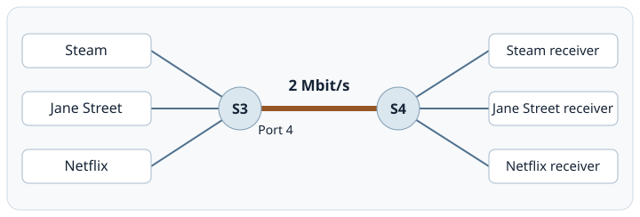
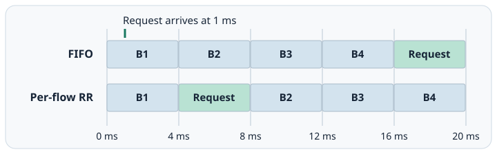
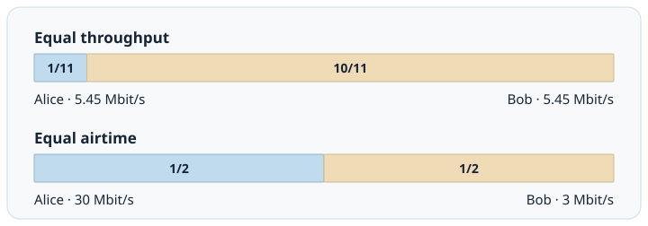

# 12. Queues, Scheduling, and Fairness

A router is halfway through sending a packet from a file copy when a small interactive request arrives. There are nine more file packets waiting. Even if the file sender reacts to congestion exactly as we hoped in Chapter 11, none of those nine packets disappears. When the router finishes its current transmission, does the request really have to go to the back of the line?

For now, look at one output. It sends at 2 Mbit/s, and packets already in service must finish before the next one can start. A 1,000-byte packet takes 4 ms to put on the link. If ten such packets' worth of work is ahead of the request, the request waits 40 ms before its own service starts. That wait is charged to the user, even when the user sends almost nothing.

## What is the buffer buying you?

The simplest output queue serves packets in arrival order, **first in, first out** (FIFO). If a packet would push the waiting data past the buffer limit, **tail drop** discards the new arrival. FIFO tells us which packet goes next. Tail drop tells us which arrival gets rejected. We can make those decisions independently. A student in class pointed out that for a stream of replaceable readings, the newest sample may be the most valuable. If storage fills, dropping the oldest *waiting* reading keeps the fresh one. Try that policy on a byte stream whose first missing piece holds up delivery of all the rest. [Lecture 17, lines 26645–26748.](../../assets/f26-subtitles.txt)

To see why it can be worth having a line at all, take a burst of six 1,000-byte packets at one instant and then no traffic for 100 ms. The 2 Mbit/s link can serve 25 of those packets in 100 ms, so the average offered rate is modest. If the transmitter can start one packet immediately and hold the other five, every packet gets through. With space for just two waiting, three packets get dropped and the link still spends most of the 100 ms idle. A buffer lets work from a busy moment spill into a quiet one. It also helps when the output changes rate. A wireless link may run slowly for a while, then get a chance to transmit fast. A queue can keep some work available for that chance. [Lecture 17, lines 26753–26865.](../../assets/f26-subtitles.txt)

Now have the sender keep the queue full. Each new packet admitted near the tail faces much the same wait as the previous one. A bigger buffer can absorb a bigger burst, and its full queue takes longer to drain. At a constant rate, a packet's wait is the bits of work ahead divided by bits per second. Count the remaining part of any packet already in service. Divide carefully. The buffer is often specified in bytes and the link in bits per second. A full 40,000-byte backlog at 2 Mbit/s takes **160 ms** to drain. That's just the service of the data ahead. Add the packet's own transmission and the rest of its trip separately if they're outside your given baseline. [Lecture 17, lines 26866–26916.](../../assets/f26-subtitles.txt)

### Design this. Set a delay budget

Three customers share the bottleneck shown below. The switch has 40,000 bytes of buffer memory in total. One of the customers, the game service Steam, sends 1,000-byte packets. A Steam packet's trip takes 7 ms excluding waiting at S3. Assume for this exercise that a scheduler can ensure that no more than ten packet-equivalents of work are ahead of an admitted Steam packet on this output, counting the unfinished part of any current transmission. How long can the trip take? If the budget is 27 ms, how much work can you let accumulate ahead? Would assigning Steam a small *own* queue guarantee that bound if someone else decides when it gets service?

*Adapted from [Quiz 2 2026, Question 1, pp. 1–2](../../assets/quiz2-2026.pdf#page=1). The original asks about each team's assignment code. This version supplies a bound on work ahead.*

Worked reasoning

Ten packet-equivalents ahead cost 40 ms. The trip can take 47 ms including the 7 ms outside S3's waiting time. For 27 ms total, there can be 20 ms or 5,000 bytes of service ahead. A cap on Steam's own storage is a bound on waiting only if the scheduler also puts a bound on work it can do for others before serving Steam. If Steam uses a common FIFO queue, count all packets ahead regardless of their sender.

## Who gets to skip the burst?

Imagine four bulk packets arriving at time zero, just before the transmitter starts the first. A single interactive packet arrives 1 ms later. They're all 1,000 bytes. Under FIFO, the interactive packet starts at 16 ms. It waited 15 ms. Give the two flows their own queues and cycle over nonempty queues, one packet at a time. The first bulk packet takes the link from 0 to 4 ms. If the next turn goes to the interactive flow, its packet starts at 4 ms and waits 3 ms. The other bulk packets are still there. We've changed who waits and how long. [Lecture 17, lines 26987–27154.](../../assets/f26-subtitles.txt)

If the interactive queue is empty when it comes up for service, skip it. A scheduler that keeps sending whenever there is eligible work is **work-conserving**. With both queues permanently backlogged, this round robin gives each flow half of the packet starts in the long run. With only one backlogged, that flow gets the whole link. A sparse flow can use much less than half over a long interval and still benefit from getting a turn soon after an arrival.

What if the bulk packets are 1,500 bytes and the interactive packets are 150 bytes? Alternate packets while both queues are full and look at how much of the wire each gets. The bulk flow takes ten times as many bits, so one turn per packet is a poor way to divide capacity evenly. Suppose you give each flow a byte allowance per visit and let it carry any leftover allowance to the next visit while backlogged. Send as many head packets as the allowance covers. When a queue empties, erase its leftover credit. This is the idea of **deficit round robin**. If both flows stay backlogged and get the same byte allowance each round, their total service after enough rounds is nearly equal in bytes. At the end of each visit, any unused allowance is smaller than the next packet. You can give one class a larger allowance to give it a larger long-run share. [RFC 8290, §4.2.](https://www.rfc-editor.org/rfc/rfc8290.html#section-4.2)

Before you choose an algorithm, decide what counts as a flow. In class the starting point was a set of source and destination addresses and transport ports. A switch can hash those fields into a fixed set of queues. If two flows land in the same queue, they can interfere again. And a sender that opens ten connections may get ten turns while another gets one. If the operator wants each subscriber to get one share, it needs a classifier for subscribers and a policy within each subscriber's share. If the important packets are a low-rate traffic class, strict priority can get them through quickly after the ongoing packet completes. A permanently backlogged priority class could leave the ordinary queue waiting forever. What restriction on the priority traffic would make that choice acceptable? [Lecture 17, lines 27063–27089 and 27167–27243.](../../assets/f26-subtitles.txt)

## How do you keep a queue from staying full?

A bulk sender may be happy if its file spends time in a queue as long as bytes keep coming out the other end. A person waiting for a response sees each new packet spend time at the tail. The term **bufferbloat** describes persistent excess delay when queues run deep under load. If you shrink the physical buffer to force a faster signal, you're also taking away storage that could absorb short bursts. What if the switch watched for a queue that *stays* backed up and signaled the senders before running out of memory?

That's the role of **active queue management** (AQM). A policy can drop a packet before the buffer fills or, when the transport supports explicit congestion notification (ECN), mark it to report congestion while still delivering it. For instance, a policy that measures how long recently dequeued packets waited can distinguish a queue that regularly drains from one that imposes a standing delay. The mark or drop helps when senders respond by slowing down. A sender that ignores the signal can keep a FIFO busy, and scheduling or policing is then a separate tool. The scheduler decides whose packet goes next. The queue management rule decides when to signal congestion or discard a packet. [RFC 7567, §§2–4.](https://www.rfc-editor.org/rfc/rfc7567.html) [RFC 8290, §§2–4.](https://www.rfc-editor.org/rfc/rfc8290.html)

A service provider can also move the waiting closer to the source. Say a subscriber is entitled to 250,000 bytes per second over the long run, with a short burst after idling. Add 250,000 tokens per second up to a cap of 5,000. Each byte sent consumes a token. Over any interval of length *T* seconds, at most 5,000 + 250,000*T* bytes can be paid for, assuming a full bucket at the start. A **shaper** can hold packets until enough tokens are available. A **policer** can discard traffic that fails the test as it arrives. Give the shaping queue finite storage, and specify its drop policy as well. Can two individually conforming customers still overrun the same downstream link? Add their allowed bursts and see what the downstream queue has to absorb. [Lecture 17, lines 27223–27314.](../../assets/f26-subtitles.txt) [RFC 2475, §2.3.3.](https://www.rfc-editor.org/rfc/rfc2475.html#section-2.3.3)

## What exactly are you dividing?

Keep the two competing senders, but put their queue at a Wi-Fi access point. Alice's phone can receive at 60 Mbit/s when the radio serves it. Bob's gets 6 Mbit/s. The radio can serve one at a time. Both phones have downloads waiting at the access point, and we'll ignore overhead and loss. If you give Alice a fraction *p* of the radio's time, she gets 60*p* Mbit/s. Bob gets 6(1 − *p*) Mbit/s. What do you want to make equal? [Lecture 21, lines 31918–32025.](../../assets/f26-subtitles.txt)

Equal *throughput* sets 60*p* = 6(1 − *p*). Alice gets 1/11 of the time, Bob gets 10/11, and each gets about 5.45 Mbit/s. In this model, that's also how you make the smaller of the two throughputs as large as possible. Give either client more airtime and the other's throughput becomes the smaller one and decreases. Equal *airtime* lets Alice achieve 30 Mbit/s and Bob 3 Mbit/s, 33 Mbit/s in total. If your only goal is to maximize total throughput, spend all the airtime on Alice. The result is 60 Mbit/s and Bob gets nothing. Which outcome meets a requirement that both clients must receive at least 4 Mbit/s? [Quiz 2 2026, Question 2, pp. 2–4.](../../assets/quiz2-2026.pdf#page=2)

**What if?** Bob moves closer and his rate rises to 12 Mbit/s. Who benefits under equal airtime? Who benefits under equal throughput? Suppose instead you alternate one same-size packet to Alice and one to Bob. How much airtime does Bob take at the new rate?

Worked reasoning

Under equal time, Bob goes from 3 to 6 Mbit/s, and Alice stays at 30 Mbit/s. Under equal throughput, solve 60*p* = 12(1 − *p*). Then *p* = 1/6, and both clients get 10 Mbit/s. At the new rate a packet takes five times as long to send to Bob as to Alice. Alternating same-size packets gives Bob five sixths of the airtime and serves the same number of bits to each client.

## Where does a fair scheduler have a choice?

We started with the whole waiting line visible to one scheduler. Open the switch case enough to see two input ports and two output ports. Imagine each input keeps a separate queue for each desired output. The fabric can move at most one packet from each input and at most one into each output per time slot. Each output transmits one packet per slot. If the fabric moves a packet into output 2 and that output is otherwise empty, what other packet could an output scheduler choose in its place?

Try a workload where input 1 has one flow to output 1, and input 2 has *k* flows to output 2. Let all the flows have packets ready. The fabric can move one packet along each of these two connections each slot. Assume equal-sized packets and suppose each input's queue for the selected output serves its flows equally. The sole flow to output 1 gets one packet per slot. Each flow to output 2 gets 1/*k*. The ratio between the fastest and slowest flows is *k*. If the problem puts no cap on *k*, equal service at each queue gives no finite ratio independent of the workload. An output queue cannot reallocate output 1's transmission opportunity to output 2. [Quiz 2 2026, Question 5, pp. 7–10.](../../assets/quiz2-2026.pdf#page=7) [Lecture 21, lines 32755–32874.](../../assets/f26-subtitles.txt)

**Break this.** Change the workload so both inputs contend for output 2. The fabric grants each input half the slots. Input 1 has one flow and input 2 has nine, all with data ready. How much does each flow get if the input queues serve their own flows equally? Can the fabric allocate its slots to give all ten equal service, assuming the ten flows' only bottleneck is output 2? What information would it need?

Worked reasoning

With half the fabric slots for each input, input 1's flow gets 1/2 packet per slot. The nine on the other input get 1/18 each. An even share would be 1/10 for each flow, which calls for one slot in ten for input 1 and nine for input 2. Dividing equally across backlogged inputs works at the input level. To divide across flows, the fabric scheduler needs to know or infer the active flows behind each fabric request and allocate opportunities accordingly.

The examples have treated transmission as a service time we could look up. That time was fixed on the wired link and different for two receivers sharing the radio. To understand why those rates differ, take a packet out of the queue and follow one of its bits onto the link.
