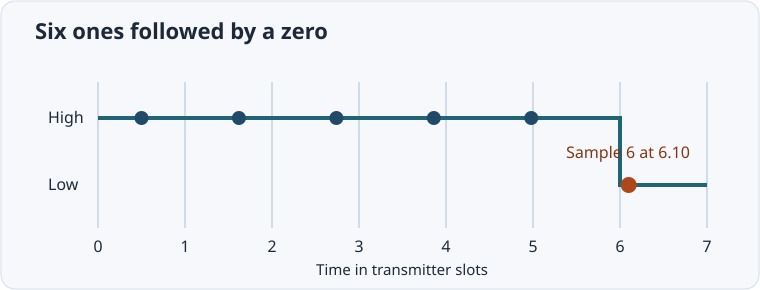
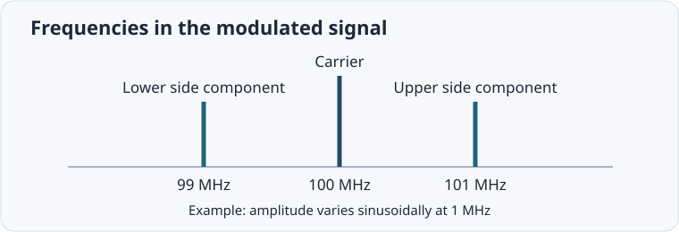

# 13. From Bits to Physical Signals

When we calculated how long a packet would occupy a link, we could divide its size by the rate printed on the box. Now suppose you're building what's inside the box. You hold a wire high for a one and low for a zero, with a new bit every microsecond. At the other end, the wire stays high for a while before it goes low. How many ones did you send?

Give the receiver a microsecond clock of its own. Suppose it starts in the middle of the first bit and its clock runs a little slow. Most of the early measurements will be right. After enough bits, it will measure on the wrong side of a boundary. The sender can keep the signal clean the entire time. You can repair a corrupted packet in Chapter 9 only after some receiver has assembled bits into a packet. How could we help that receiver determine *when* to measure? [Lecture 15, lines 23011–23060.](../../assets/f26-subtitles.txt)

## How long can you go without a timing clue?

Start with a wire and an ideal signal. In this form of **non-return-to-zero** (NRZ) encoding, a bit holds its voltage for its whole slot. A change gives the receiver a boundary it can use to check its clock. While the voltage stays flat, the only way to count the bit intervals is to trust that clock. Say the sender starts with six ones and then sends a zero. The receiver begins at time 0.5 measured in transmitter slots. Its first six sample times should be 0.5, 1.5, 2.5, and so on through 5.5. Instead, its clock ticks every 1.12 slots. What is the sixth sample time? Which bit does it hit?

At time 6.10 the sixth sample sees the zero. A student suggested measuring five times as often. That can help a receiver see a transition more precisely when there is one, but a long run at one voltage still has no internal time marks. At a guaranteed point in the signal the sender can provide an edge to help the receiver correct its timing. One design is a separate clock wire. Another inserts known symbols at suitable intervals, with rules for removing them. How much overhead would you accept to bound the longest time without an edge? [Lecture 15, lines 23264–23354.](../../assets/f26-subtitles.txt)

**Manchester encoding** provides a transition in the middle of each data bit. Choose a convention in which low to high represents zero and high to low represents one. Both kinds of bit now supply a timing clue. A student asked whether the receiver still needs its own clock to know where the half-bit belongs. It does. Given initial synchronization, it uses the frequent edges to keep its estimate aligned. The transmitter now has to support half-bit intervals and the associated faster transitions. We've bought the receiver a regular timing reference by asking the wire to carry transitions on a finer time scale. [Lecture 15, lines 23365–23422.](../../assets/f26-subtitles.txt)

**Break this.** An engineer promises to insert a one after every run of five zeros. The receiver knows to remove those inserted ones. Find a legal payload that can still produce a long flat NRZ signal. How could you make the rule give both voltages a chance to change?

## How many choices fit in a symbol?

A **symbol** is one choice from the signal states a receiver can distinguish during a symbol interval. **Baud** counts symbol intervals per second, including intervals that repeat the previous state. If you put four voltages on a wire, you can assign them to `00`, `01`, `10`, and `11`. At 1 million symbols per second, this carries 2 megabits per second before allowing for framing or error correction. With sixteen distinguishable states it would carry 4 megabits per second at the same symbol rate. Doubling the number of states adds one bit per symbol. [Lecture 15, lines 23675–23713.](../../assets/f26-subtitles.txt)

Keep the highest and lowest voltage fixed and add levels between them. Imagine the receiver measures a point just above the midpoint between two adjacent levels. It will choose one even if the transmitter sent the other and noise pushed the measurement across the threshold. The same disturbance that was harmless with two widely separated choices can break a sixteen-level design. Higher symbol rates have a different cost. If a wire behaves like a transmission line and the signal takes time to settle, an earlier symbol can affect a later measurement. The instructor described sending a clock signal that arrived as an unexpected rounded waveform. The diagram at the transmitting end was a square wave. The receiver had to work with the waveform the cable actually delivered. [Lecture 15, lines 23483–23557 and 23675–23713.](../../assets/f26-subtitles.txt)

**Predict, simulate, explain.** In the [signal lab](signal-lab.html), put two or four levels in the same voltage range and set the noise bound to 0.40 V. Before looking at the measurements, find the greatest noise amplitude under which a nearest-level decoder is guaranteed correct. Then switch to the clock example. Which errors persist if the signal voltages are exact? [Lab instructions.](lab.md)

## Why does a signal use a band of frequencies?

An unchanging sine wave at 100 MHz completes 100 million cycles per second. If you leave its amplitude, frequency, and phase fixed, it gives a receiver no new sequence of symbol choices. Now shape its amplitude with a waveform that changes with the symbols. What frequencies does the resulting signal use?

Fourier analysis represents a signal as a combination of sinusoids. If you multiply a 100 MHz tone by a 1 MHz tone, the product identity for cosines gives two components, at 99 and 101 MHz. If instead you add a steady offset to the 1 MHz modulating tone before multiplying, you have those two components and the 100 MHz carrier. A data waveform can have many components. Modulating a carrier moves the baseband spectrum around the carrier frequency. Pulse shaping governs how much of that spectrum occupies the band and how hard it is to suppress leakage outside. [Lecture 15, lines 24036–24087 and 24122–24203.](../../assets/f26-subtitles.txt)

A transmitter centered at 100 MHz and one centered at 200 MHz could use the same symbol rate and the same bandwidth. Shifting the center changes where in frequency the signal lives. The speed and shape of the changes determine how much space the signal needs around that center. A useful approximation in a family of similarly shaped signals is that a faster symbol rate calls for a wider band.

### Design this. What would you pay for?

Two licenses would let you transmit in 750–950 MHz and 2.7–3.0 GHz, respectively. Assume equal propagation and hardware characteristics across the two bands and equal achievable bits per second per hertz. Which license lets you deliver more bits per second? How much more? *Adapted from [Final 2024, Q2, p. 1](../../assets/cs356-final-2024.pdf#page=1). The spectral-efficiency assumption is made explicit.*

Worked reasoning

The first width is 200 MHz. The second width is 300 MHz after converting both endpoints to megahertz. The second permits 1.5 times the rate under the stated assumptions. In an actual design you would ask what signal quality, permitted power, and radio hardware you can obtain in each band.

## What does a better signal buy?

Say you can increase signal power, reduce the background noise, or buy more spectrum. How would you compare their effects? In the idealized band-limited channel with additive white Gaussian noise, let *B* be the width in hertz and *S/N* the ratio of received signal power to noise power in the band. The **Shannon capacity** is *C* = *B* log₂(1 + *S/N*) bits per second. For rates below this bound, the model allows codes that drive the error probability arbitrarily low as block length grows. A practical transmission has finite delay, finite coding blocks, and implementation choices to make. The levels we crowded together on the wire illustrated one way noise can erase a distinction. The bound asks a broader question: how many distinctions per second could survive the noise even with the best choice of signaling and code? [Lecture 15, lines 23675–23787.](../../assets/f26-subtitles.txt) [Shannon, “A Mathematical Theory of Communication,” §24.](https://people.math.harvard.edu/~ctm/home/text/others/shannon/entropy/entropy.pdf)

In 20 MHz at a linear SNR of 15 the model gives 80 Mb/s. Quadrupling the received signal power, with the same noise and bandwidth, produces an SNR of 60 and gives about 119 Mb/s. Doubling bandwidth at the original SNR gives 160 Mb/s *if* you can hold SNR fixed. With white noise and the same total signal power, a band twice as wide collects twice the noise power. Now SNR is 7.5 and the 40 MHz result is about 124 Mb/s. Whenever you move one control, ask which other quantities move with it.

**What if?** You move a radio farther from its receiver and have less received power. Give two changes that could help its symbol decisions. For each, name a cost. You could transmit more power, which uses energy and can create interference elsewhere, or choose a more robust signaling scheme, which can yield fewer useful bits per second. A directional antenna can concentrate energy toward a known receiver, at the cost of aiming it and keeping it aligned.

## How fast does the signal travel?

Copper links guide electrical signals. Their geometry can affect reflections, and signals can attenuate with distance. A twisted pair carrying a differential signal helps a receiver reject disturbances that affect the wires similarly. Glass fiber guides light. Multiple optical wavelengths can carry separate channels on one fiber. Fiber can combine high capacity with low attenuation over long distances, even though the signal in ordinary glass fiber travels at roughly 200,000 km/s. In air or vacuum, radio waves propagate close to 300,000 km/s. Moving the same data onto a different medium changes the propagation time and the rate the link can sustain by different amounts. [Lecture 15, lines 23513–23557, 24465–24475, and 24703–24719.](../../assets/f26-subtitles.txt)

A geostationary satellite looks fixed from the ground. At about 35,786 km above the equator, the four legs of an ideal ground–satellite–ground round trip span at least about 143,000 km. Divide by 300,000 km/s to get about 477 ms of propagation alone. A lower orbit can sharply reduce the up-and-down distance. A low satellite also moves across the sky as seen from the ground. Continuous service may need satellites to hand users off as they enter and leave view. The time an application measures includes the rest of the path, queues, and processing. Satellite links also share spectrum and coverage capacity among terminals, with reuse and received signal strength depending on beam geometry. [Lecture 15, lines 24635–24748.](../../assets/f26-subtitles.txt) [European Space Agency, “Orbits.”](https://www.esa.int/Applications/Telecommunications_Integrated_Applications/Orbits)

### What if? Put the server at the far end

Assume two paths between the same endpoints. The terrestrial path is 5,000 km of fiber and can serve 1 Gb/s. The path through a low Earth orbit constellation spans 5,700 km through air and space and can serve 50 Mb/s. Ignore queues, processing, and parallel work. Use the rates and speeds above. Which path gets a 1,000-byte message that fits in one packet to its destination first? What about a 100 MB transfer? What would you measure before moving the server? *Adapted from [Quiz 3 2025, Q1, p. 1](../../assets/quiz3-2025.pdf#page=1). The numbers are new. Find the transfer size at which your answer changes.*

Worked reasoning

The assumed one-way propagation times are 25 ms on fiber and 19 ms in air and space. For a 1,000-byte packet the serialization times are 0.008 ms and 0.16 ms, so the space route is quicker. At 100 MB the serialization term is 0.8 seconds on terrestrial fiber and 16 seconds on the satellite path. The crossover in this model comes when 6 ms equals the extra serialization time on the lower-rate path, at about 39 kB. Check the actual route lengths, sustained rates under competing load, tail latency, and whether the application requires several sequential round trips. In the classroom example, a small trading message and a high-rate rendered video represented different workloads even if both cared about latency.

## What happens when two radios transmit?

Draw a transmitter and a receiver. Put a second transmitter beside them in the drawing. If they send in overlapping bands at the same time and both reach the receiver strongly, the receiver has to distinguish one signal in the presence of the other. Both could have worked in isolation. Far enough apart, or with well-separated directional beams, a pair of links can sometimes reuse the same band. What matters is how much of each signal arrives at each receiver. [Lecture 16, lines 24808–24933.](../../assets/f26-subtitles.txt)

**Design this.** A satellite operator wants to share a 20 MHz band with terrestrial equipment. What measurements would tell you where simultaneous transmissions are feasible? Ask about received powers at each kind of receiver, the occupied bandwidth and leakage, and where the beams overlap. Where simultaneous reception fails, try giving each system time or frequency of its own. What throughput does that cost when only one system has data ready? The next chapter designs a rule for making that decision as traffic arrives. *Adapted from [Quiz 2 2024, p. 3](../../assets/cs356-quiz2-2024.pdf#page=3). The measurement tasks are new.*
