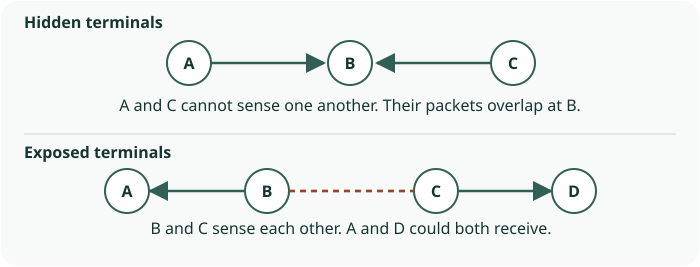

# 14. Sharing a Wireless Medium

Put a radio halfway down a corridor. One phone at each end can reach it. The first phone is sending a packet when the second phone gets a packet to send. The second phone listens and hears silence. What would you tell it to do?

The first phone wants its packet decoded in the middle of the corridor. The second phone is making its decision at the far end. It only needs to detect that somebody occupies the channel, which can require less power than decoding the packet. Even so, if the phones are far enough apart or there is enough attenuation between them, each can miss the other's signal. The middle radio hears both. Recall Chapter 13's receiver. A signal that is easy to decode in isolation can become difficult to distinguish when a second signal arrives in the same band. The two phones can obey exactly the same listening rule and still ruin each other's transmissions. A student in class described almost this exact corridor.

The corridor has **hidden terminals**. Each sender lacks information about interference at the intended receiver. Now draw A, B, C, and D in a row, with B sending to A and C wanting to send to D. Suppose B and C can hear each other but each signal is too weak at the other's receiver to interfere. C may hear B and give up a transmission that would have worked. That is the **exposed terminal** problem. Whether two transmissions can coexist depends on the desired signal and total interference at *each receiver*. Whether two transmitters hear each other is a different measurement. If you make carrier sensing more sensitive, which mistake can you reduce, and which can you make more common?

The phones need a rule for sharing the air, a job called **medium access control** (MAC). If listening in the corridor supplies too little information, perhaps we can arrange things so that neither phone ever has to listen before sending.

## Could you divide up the band once?

A student suggested assigning each device a frequency when it joins. A practical link needs a range of frequencies around a carrier. Given a one-GHz block to divide and 20 MHz per assignment, there is room for 50 assignments before guard bands and other overhead. Which band does the 51st device get? What if 49 devices are silent most of the day? A device that has data could use more of the band if you were willing to take assignments back. The question then becomes how to ask for spectrum and how quickly you can reassign it. In class, someone also asked how a new device would know where to make its first request. A permanent time slot instead of a frequency band has similar trouble when device activity changes. A dynamic scheduler can redistribute idle slots, as long as it learns who is waiting in time to use them.

**Design this.** The 50 radios get a common control channel for requests. Just after a power outage, all of them come back and ask for a slot. Can the controller use the schedule it has yet to make to separate those requests? Give new arrivals a way to get their requests through. Estimate how the time to accommodate the first request and the last request would change if twice as many radios woke up together. In class this was the problem of raising hands. Everyone can raise a hand in a classroom without drowning out another student. Two radios using the same request slot can collide.

## Who goes first after it gets quiet?

Listen before speaking. If the channel sounds busy, wait. When it becomes quiet, send. This is **carrier sensing**. The instruction is fine when only one radio is waiting. Now let two radios both have packets ready at the instant the channel clears. If they both follow the same timing rule, they can step on each other and try again together. In class, two people meeting in a hallway illustrated the symmetry. Both step the same way to get out of each other's path, then both reverse and meet again. What independent decision could let one go first?

Try a slotted rule. Each waiting transmitter independently attempts with probability *p* in each slot. In this model one attempt succeeds and multiple attempts collide. With two waiting radios, the chance of success in a slot is 2*p*(1 − *p*). At *p* = 1/3 it is 4/9. Both can draw the same decision many times, so a positive probability of success per slot gives no fixed deadline. The chance of no successful transmission in *k* independent slots is (5/9)*k*. A symmetric rule gives both radios the same chance of getting through next and still allows either to wait a long time. The lecture made the same distinction with a lottery.

With *n* backlogged radios, exactly one will attempt with probability *np*(1 − *p*)*n*−1. At *p* = 1/2, ten contenders succeed in only about one slot in a hundred. Try *p* = 1/10 instead. For these ten radios, about 39 percent of slots succeed, about 35 percent are idle, and the rest collide. For fixed *n*, you can maximize the success probability by choosing *p* = 1/*n*. What should you do when a radio has no idea how many others are waiting? Shrink the attempt probability after repeated collisions, as Chapter 11's sender reduced how much it was willing to have in flight after signs of overload. A poor choice in either direction wastes airtime. [Quiz 2, 2024, Q8, p. 8.](../../assets/cs356-quiz2-2024.pdf#page=8)

A radio may have trouble hearing a collision while it is transmitting. Its own signal can swamp the weaker incoming signal. Wait for an acknowledgment from the receiver, then consider trying again if none arrives. Interference, link errors, and a lost acknowledgment can all give the transmitter the same observation. In the basic 802.11 contention algorithm, a station chooses a random backoff from a window that grows after failures, and it pauses the countdown while it senses a busy medium. This mechanism is called **carrier sense multiple access with collision avoidance** (CSMA/CA). Our fixed-probability slots isolate the effect of contenders choosing independently. The practical backoff has memory. [Bianchi, IEEE 802.11 distributed coordination function, §II.](https://ieeexplore.ieee.org/document/840210/)

**Predict–simulate–explain.** In the [contention lab](contention-lab.html), run 1,000 slots with ten saturated radios at *p* = 1/2 and then at *p* = 1/10. Predict which produces the most idle slots and which produces the most collisions. Search over *p* to find the busiest useful schedule in this model. Now change the number of radios but keep the old *p*. Which cost grows? If you change the lab to charge several times as much airtime for a collision as an idle slot, see whether your best *p* changes.

## Can the middle radio settle it?

Give the intended receiver a voice. In the corridor, phone A sends a short **request to send** (RTS). B responds with **clear to send** (CTS). Phone C may have missed A's request, but it can hear B's response. If it hears the reservation, it waits through the announced duration while A sends the data. Two requests can still collide at B. With this exchange a collision may waste just a request instead of a large data frame. Every successful reservation also costs control airtime and waiting intervals. Which sizes of data packets and which kinds of interference make that worth paying for? Test a no-handshake policy with small packets, then a policy with a handshake on long frames. [Bianchi, §II.](https://ieeexplore.ieee.org/document/840210/)

**Network detective.** B records a burst of undecodable receptions while A and C each record several missing ACKs. Neither station records a busy channel before sending. What timestamps would you align to test the corridor explanation? What would you expect an observer near B to see that an observer near A misses? Propose a second hypothesis, such as a change in the background interference, and a measurement that distinguishes it from A and C overlapping.

Now imagine a controller that can tell every radio which frequency range to use in each time slot. An access point can do this for the data it has in its own outgoing queues. To schedule incoming data it needs an indication of which devices have packets and their deadlines or backlog. For spatial reuse it also needs a model or measurements of which simultaneous transmissions the receivers can decode. And it needs the radios to hear and obey the assignment. A student brought up turning on a phone hotspot in the same band. The original access point's schedule tells the hotspot nothing about what to do. One approach combines coordination inside the group with contention or shared rules for gaining access to the band. An operator coordinating a set of neighboring cellular sites can plan reuse across its cells, perhaps assigning different resources where transmissions would otherwise interfere and using the same resources again at a safe distance.

### Design this. Write tomorrow's schedule today

A controller sends everyone a schedule for the next *T* seconds. It grants both times and bands. Assume the instructions reach every device and clocks are aligned. Construct one workload on which advance scheduling beats local contention in both throughput and delay, and one on which it wastes time or makes packets wait. Say which information the controller needs to obtain before the schedule starts. What happens if you cut *T* in half and have to broadcast twice as often?

*Adapted from [Quiz 2, 2025, Q1, p. 1](../../assets/quiz2-2025.pdf#page=1). The comparison between two values of T is new.*

Worked reasoning

Regular, predictable traffic that fills its slots can avoid collisions without reserving much idle time. Put each slot shortly after the matching data becomes ready and the sender avoids waiting through contention. Sporadic traffic arriving just after the schedule is written may have to wait for the next schedule, while reservations for silent radios go unused. Shorter horizons can use fresher demand measurements, but they also leave less airtime between control exchanges. Count both request airtime and schedule airtime in your design.

## When can two transmissions use the same air?

Stand two communicating pairs on opposite sides of a wall. Each desired signal has power 1,000 times the noise at its receiver. The undesired signal from across the wall has power equal to the noise. You can give each pair its own time, split the frequency band, or allow both to use the full band at once. Decide what you would try first. [Quiz 2, 2024, scenario 1 and Q2, pp. 2–4.](../../assets/cs356-quiz2-2024.pdf#page=2)

For simultaneous transmissions the signal-to-interference-plus-noise ratio is 1,000/(1 + 1) = 500 at both receivers. Using Chapter 13's capacity model, each simultaneous pair can sustain roughly *B* log₂(501). Compare that with *B* log₂(1001) for one pair getting the entire band. If the two pairs alternate in time, only one of them gets that capacity at any instant. The concurrent links each give up some rate and together deliver more than the alternating links. That gain is **spatial reuse**. Now change the senders and receivers so that both wanted transmissions go through the wall and are directed to a single receiver. Estimate how the signal strengths compare there. If you assume a receiver that decodes just one same-band packet and treats the other as interference, do you still expect reuse to help? Can you give both senders opportunities by separating them in time or frequency? [Quiz 2, 2024, Q3, p. 5.](../../assets/cs356-quiz2-2024.pdf#page=5)

A graph can capture the simple version of the problem. Make a vertex for each possible transmission. Connect vertices for pairs that cannot work together. A set with no edges inside it is a candidate for reuse. Before making this your scheduler, try three transmitters. Suppose at one receiver either of the two unwanted signals alone is weak enough to tolerate, but their sum is too strong. The graph can mark every pair compatible and still schedule a failed triple. A network built around measured interference should test whole sets where this approximation breaks. A directional beam can shift the answer by increasing desired power and reducing energy sent toward other receivers. Movement, reflections, and imperfect aiming can shift it again.

## What should the access point charge for a packet?

Chapter 12 asked you to give Alice and Bob equal service. At their access point, Alice can receive data at 60 Mbit/s and Bob at 6 Mbit/s. A packet of 1,500 bytes takes 0.2 ms to send to Alice and 2 ms to send to Bob, before counting overhead. Suppose every packet has that size and the access point alternates one packet each. It gives Bob ten times as much airtime as Alice. If we alternate equal stretches of airtime instead, we give Alice ten times the throughput. Choose which quantity to charge to each queue.

In Chapter 12, deficit round robin charged each queue for the bytes it sent. Suppose we kept the accounting in microseconds instead. Credit each backlogged phone with an equal airtime allowance per round, carry unused credit forward, and deduct the estimated transmit time of each packet. That gives Bob a larger charge per equal-sized packet, so his next packet waits while Alice can send more than one. When packets have different rates or sizes, use the time estimate for each packet. If a frame has to be retried, decide whether that repeated airtime is charged to its owner. Think through what your decision means for another station that can use the time productively. In a real system, account for the portions of the overhead included in your definition of service and update the estimates as rates change.

### What if? Give Bob a minimum

Both have data ready and the access point serves one phone at a time. Bob needs at least 4 Mbit/s to play a video. With rates of 60 and 6 Mbit/s, how much airtime should you give him if you also want the largest aggregate throughput? If Bob moves closer and his rate rises to 12 Mbit/s, how much can Alice gain under that policy? What would Alice gain instead under equal airtime?

*The two rates and the mobility question come from [Quiz 2, 2026, Q2, pp. 2–3](../../assets/quiz2-2026.pdf#page=2). The four-Mbit/s minimum is new.*

Worked reasoning

At 6 Mbit/s, give Bob 2/3 of the time for his minimum. The rest gets Alice 20 Mbit/s. Giving Bob more time would reduce the total because Alice makes more use of each unit of airtime. At 12 Mbit/s Bob only needs 1/3 of the time, so Alice reaches 40 Mbit/s. If both always get equal airtime, Alice stays at 30 Mbit/s in both cases. The change in Bob's rate matters to Alice only through the allocation rule or other effects on the shared channel that were excluded from this model.

We decided which pairs of radios could use the air at the same time, then found rules for choosing among them. Now bring the problem inside a switch. Instead of interference in a shared band, suppose two inputs contend for the same output, and others can use separate outputs simultaneously. What information would let the switch arrange the most transfers in the next slot?
