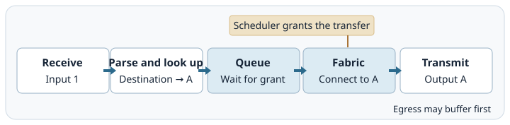
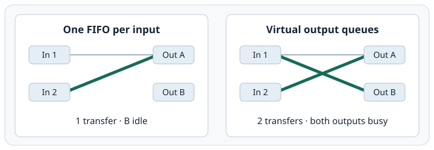

# 15. Inside a High-Speed Switch

Bring the scheduling problem from the radio into a switch. Two packets are waiting at input 1, the first for output A and the second for output B. Input 2 has just one packet, also for A. Both outputs are free. You can move one packet out of each input and into each output at a time. What would you move now? Where should the other packets wait?

In Chapter 12 we stood at one output and looked back at a waiting line. This time, the first thing to decide is which packets the fabric can bring to that line. A switch may know where every packet needs to go and still leave a usable output idle.

## What happens after a port receives a packet?

On a full-duplex port, reception and transmission can proceed independently. Draw them on opposite sides of the switch even if they use the same connector. The receive circuitry turns the incoming signal into bits. The ingress pipeline parses the headers it cares about and uses fields such as the destination address to look up a forwarding decision. It may also update a header or record a counter. In our example, the pipeline has determined the output before putting the packet on an input queue. The packet waits until a scheduler tells the **switching fabric** which input and output to connect. On the far side, the egress circuitry transmits it when the outbound link is ready.

In class, the instructor opened a TCP connection from one process on a laptop to another on the same laptop. The transfer never needed a wire, and the experiment still used substantial kernel CPU time. The particular throughput depended on that laptop and software path. Try to identify the work the benchmark was paying for. A general-purpose implementation can copy or reference data, fetch instructions, parse the header, access a table, update state, and move queue descriptors. A specialized pipeline assigns independent circuits to stages and can process different packets at different stages at once. The point of a pipeline is to accept a new packet before the previous one has completed all its work.

At 100 Gbit/s, a sequence of 100-byte units gives you 8 ns between units on one port, ignoring wire overhead. A 16-port switch could face sixteen such arrivals every 8 ns. That arithmetic suggests several designs. You could distribute parsing across ports, divide it between stages, and limit the operations any one stage may perform. That last choice is why a programmable forwarding pipeline may let you add a custom header, match its fields, and update counters while placing tight bounds on memory accesses and computation. A CPU still has a job for tasks like computing routing tables, where the work responds to changes in the network and needn't run at the same cadence as packet forwarding.

## Which transfers can happen together?

Imagine a grid of horizontal input wires and vertical output wires. A controllable switch at each crossing can connect that row and column. That's a **crossbar**. In our unicast model, turn on only one crosspoint per input and one per output during a slot. Although several crosspoints lead to A, they all connect to the same output wire. Closing two of them would give two inputs the wire during the same slot. Two sends from one input would require that input to supply two units at once.

Now erase the crosspoints that have no packets ready. List the inputs on the left and the outputs on the right, and draw an edge wherever an input can send a pending packet to an output. A feasible choice is a **matching** in this bipartite graph. In a matching, no two selected edges share a port. This drawing describes the work waiting *now*. A crosspoint can exist in the hardware and be missing from today's request graph.

Start with one FIFO per input. Only the head of each queue can request passage. In our snapshot both visible requests point at A. Choose one and B sits idle even though input 1 is holding data for B. That's **head-of-line blocking**. A queue enforcing a single order has tied two unrelated output opportunities together. Choosing the best matching among visible heads cannot make the packet behind a head eligible.

Give each input a separate FIFO for each output. At input 1, the packet for B can now request B while the older packet requests A. These are **virtual output queues**, named for the output they feed even though they live at the inputs. What's the largest matching now? Select input 1 to B and input 2 to A. A single input can have requests on multiple edges, but the scheduler still grants at most one.

Suppose a scheduler instead grants input 1 to A as soon as it sees the edge, then looks for more edges to add. Can it add either remaining edge? Neither can fit alongside the first. That choice is **maximal**, meaning nothing can be added to it. The two-edge choice is **maximum**, meaning it has as many edges as any matching for that slot. A fast greedy scheduler may stop at the first kind of answer. Also consider what happens when a maximum-size scheduler repeatedly breaks ties the same way. A packet can stay queued while the switch keeps picking other packets. To seek good service over many slots, a scheduler can weigh a request by queue length or age, or rotate priorities. At the 100 Gbit/s port we priced earlier, a clever tie-breaker earns its keep only if the circuitry can produce grants as fast as packets need them. [McKeown et al., *Achieving 100% Throughput in an Input-Queued Switch*, §§I–II.](https://web.stanford.edu/class/cs244/papers/mckeown02.pdf)

**Predict–simulate–explain.** In the [crossbar lab](switch-lab.html), run the opening snapshot with one FIFO per input and then with virtual output queues. Try greedy and maximum-size scheduling. Predict which output is idle in the first slot, and identify the first missing edge or rejected grant that explains it. The [lab notes](lab.md) give a second three-input example you can reproduce before changing the scheduler.

## How much memory traffic buys one trip through the switch?

Suppose every arriving byte travels through one shared memory. Each byte is written once and read once. If the *N* input ports and *N* output ports can each run at *R* bits per second, filling and draining all of them at line rate costs *NR* bits per second of writes and *NR* of reads. A memory interface that counts both has to carry at least **2NR** of packet traffic, before bookkeeping. For sixteen 100 Gbit/s ports that is 3.2 Tbit/s across the memory interface even though at most 1.6 Tbit/s leaves the switch.

One fabric-and-buffer design spreads this load across the inputs. Each input can write at *R* and read at *R* if granted. At crossbar speed equal to port speed, a single input's buffering system now needs service for at most 2*R* in aggregate. All the input buffers collectively still perform the work. Separate queue names for each output don't require separate memory chips. The logical queues at an input can share packet storage. If you reserve a separate fixed physical bank for each queue, what happens when nearly all packets at that input want one output? One bank can fill while space in the others sits idle.

Could all the waiting happen on the output side instead? In one external slot, all *N* inputs can receive a unit for output A. An output-only design that moves every accepted arrival immediately must bring up to *N* units to A in that slot, although A can transmit only one. Plan for *N* writes and, if it transmits, one read at that output's queueing system. That entails a faster fabric or multiple transfer paths, and enough memory bandwidth where the arrivals concentrate. With a crossbar moving at line rate and at most one transfer per output per slot, persistent *new* backlog cannot accumulate at an initially empty, always-ready output. The congestion we just created has to wait upstream of it. If the transmitter slows or pauses, that premise changes. Count competing arrivals at each stage before drawing the buffer in one place or the other.

## Design this. Fill every input and leave fifteen outputs idle

Take the quiz's 16-port switch. One slot lasts 1 μs, and each input, output and selected fabric edge handles at most one 100-byte unit per slot. Begin with empty output queues.

1. Choose a destination for the traffic at each input that attains maximum total egress bandwidth. What is it in bytes per second?
2. Keep every input backlogged and choose destinations that attain the least total egress bandwidth possible if the scheduler always makes at least one feasible transfer. What grows if each input keeps receiving one unit per slot?
3. Now double the fabric speed and allow two independent matchings per external slot. Keep the same arrivals and egress rates. Where does the queue grow if the scheduler uses both matches whenever it can?

*Adapted from [Quiz 2 2025, Q12–Q15, pp. 6–7](../../assets/quiz2-2025.pdf#page=6). Part 3 adds fabric speedup.*

Worked reasoning

Give the inputs distinct destinations. The fabric can transfer sixteen units per slot, and the output links can send all sixteen. The maximum is 1.6 × 109 bytes/s. The least is 108 bytes/s when all inputs target just one output. Only one of the sixteen arrivals' worth of work can move through the fabric per slot. The remaining work accumulates at the inputs. The input backlog grows by fifteen units per slot. Starting empty, the output drains its one arrival per slot, up to a one-unit boundary effect depending on the slot convention.

With two fabric transfers into that output per external slot, one can depart and the other can join the output queue. With unbounded buffers and sustained arrivals, the input backlog now grows by fourteen units per slot and the output backlog by one. The sum still grows by fifteen. You can change where the packets wait, but the rate at which they leave is still limited by one output link.

In Chapter 12 we asked whether treating flows equally inside each queue guaranteed equal end-to-end service. The fabric explains why it doesn't. It grants edges in a graph of port pairs. A grant to an input queue with ten flows looks like a grant to one with a single flow unless you give the scheduler more information. A faster scheduler or different weights can alter which packet receives a grant. They cannot make an output transmit above its line rate. [Quiz 2 2026, Question 5, pp. 7–10.](../../assets/quiz2-2026.pdf#page=7)

Our packet has finally left the switch. The operator could read the header fields needed to get it there. Depending on what the sender put on the wire, the operator might be able to read the contents too. What would the two endpoints have to change to keep those contents private across all the switches on the path?
