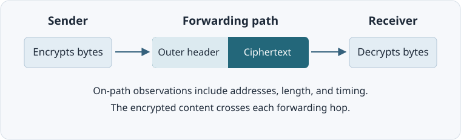

# 16. Encryption and Secrecy

At the output of the switch we built in Chapter 15, the next packet happens to be carrying a customer's message to a bank. The switch has to read enough of the header to choose an output. Does doing that job entitle its operator to read the message? Imagine you're the customer, about to send your password. Which bytes could your laptop conceal all the way to the bank, and which must remain visible for the packet to get there?

Start by giving an observer a copy of everything on one link. That is a **passive** observer. Later we will give an intermediary the ability to change what crosses the link. It matters which of these two problems you are solving. If the browser and the bank transform the password at the ends of the path, the inner bytes can be ciphertext throughout the trip. Routers can still see the outer IP addresses needed for forwarding. An observer may also see packet lengths and timing. If two activity patterns produce different traffic, the observer may learn something from that difference even when it cannot read either conversation. In class, the discussion of onion routing raised the question of what one relay sees and what someone observing more than one link could infer. Write down the observation you want your design to protect before deciding what to encrypt.

**Design this.** An appointment site sends one of two messages. The first is 20 bytes long and the second is 200 bytes long. Suppose your encryption adds the same fixed number of bytes to either message, and either fits in one packet. What does an observer learn without reading a single byte of the message? How could you give both messages the same visible length, and what would that cost?

## What could a ciphertext tell you?

Try the smallest useful case. Alice wants to send one bit to Bob. They already share a secret bit chosen uniformly at random. If the secret bit is zero, Alice sends the original bit. If it is one, she flips it. Bob applies the same rule to the received bit. Flipping twice gives him the original. If the observer sees a zero, Alice might have sent a zero with key zero, or a one with key one. Those keys were equally likely before Alice chose what to send. The observation has given the observer no reason to revise whatever it believed about the message.

For a longer message, choose a uniformly random secret pad of the same length, independent of the message. Use each bit of the pad once. Alice computes the bitwise exclusive OR of message and pad. Bob takes the exclusive OR of ciphertext and pad to undo it. For any fixed ciphertext and any candidate plaintext of that length, exactly one pad maps the candidate to that ciphertext. For three bits, each ciphertext therefore has probability 1/8 for *every* three-bit plaintext. If one candidate was already twice as likely as another, it stays twice as likely. The ciphertext leaves those odds alone. This is **perfect secrecy** for messages of the fixed length in the model. The argument does not depend on how much computation the observer can do.

| Operation | Three-bit value |
| --- | --- |
| Message | `101` |
| Secret pad | `011` |
| Message XOR pad | `110` |
| Ciphertext XOR pad | `101` |

Use the [pad lab](pad-lab.html) to try several possible plaintexts for the same ciphertext. Predict which pad goes with each one, then ask whether the calculation gives you any evidence about the original message. Compare the table for uniform pads with the one for biased pads. [Lab instructions.](lab.md)

## Why use each pad only once?

A fresh pad for every message sounds expensive. Suppose Alice and Bob save the first pad for a second transmission. Bob can still undo both encryptions, so a test that only checks delivery would pass. What could an observer do with the two ciphertexts together? The first is the first message XOR the pad, and the second is the second message XOR the same pad. XOR the two ciphertexts. Each pad bit appears twice and cancels. The result says exactly where the original messages agreed and where they differed. For example, if the two three-bit ciphertexts were `110` and `010`, the observer learns that the first message bit differs and the two remaining bits match. That is useful evidence even if neither message has been identified.

**What if?** Both endpoints can securely store a terabyte of independently uniform pad bits. How many bytes can they exchange with perfect secrecy if both directions draw from that store? What bookkeeping would keep two simultaneous sessions from using the same bits, including after either machine restarts?

Even with that bookkeeping, the pad must arrive at both endpoints before they communicate, and sending another terabyte uses up another terabyte of key material. If you already had a private channel with that capacity whenever you wanted it, you could send the data through it. A more practical goal is to get a confidential conversation from a much shorter secret and accept a guarantee formulated in terms of what an observer can compute.

## When is a reversible operation a cipher?

You start with a block of 128 bits and a secret key. The recipient will have the same key. For any fixed key, the encryption must map different blocks to different outputs. If two inputs produce the same output, the recipient cannot know which input to return.

**AES** is a standardized block cipher. Its block size is 128 bits and the key may be 128, 192, or 256 bits. It views the block as a state and repeatedly transforms it. There are substitutions of individual byte values, rearrangements of bytes, mixing within columns, and XOR with round-key material derived from the key. Each operation preserves the information the decryptor needs. A substitution can be undone if each input maps to a different output. A rearrangement can be reversed if every byte keeps a place in the result. The operations also need to work together as a cipher. Moving all the bytes one place to the right is reversible and trivially predictable. Reversibility only establishes that decryption is possible. [NIST FIPS 197, §§3 and 5.](https://csrc.nist.gov/pubs/fips/197/final)

### Break this. Does a new step preserve the block?

A colleague proposes adding a step to every full AES round. For the fixed 128-bit constant, assume some bits are one and some are zero. Decide which of the following can be undone for every possible state. For each one that fails, give two inputs that collide. For each one that works, state the inverse.

- Interpret the block as an unsigned integer and divide it by two, rounding down.
- XOR it with the constant.
- Replace the integer *x* with 2¹²⁸ − 1 − *x*.
- Take its bitwise OR with the constant.
- Take its bitwise AND with the constant.

*Adapted from [Quiz 2 2025, Q2–Q3, pp. 1–2](../../assets/quiz2-2025.pdf#page=1). The witnesses and inverses are requested explicitly here.*

Worked reasoning

Division maps 0 and 1 to the same integer. OR forces a bit to one wherever the constant has a one. AND forces a bit to zero wherever the constant has a zero. For either operation, pick two states differing only in a position whose value will be forced. Once the states merge, later operations see the same input and cannot separate them. XOR with the constant is its own inverse. So is the subtraction, which flips every bit. Those two steps pass the reversibility test. Determining security would require a different argument.

## What goes around the block cipher?

Our reversible map takes exactly one block as input. To send a file, the obvious first design is to cut it into blocks and apply that map to each in turn. Keep the key fixed and any two identical plaintext blocks will produce identical ciphertext blocks. The lecture used an image of the Linux penguin to motivate the problem. If you encrypt each equal-size block independently, large regions with repeated blocks can leave visible structure behind. To see the weakness without an image, imagine an observer can request an encryption of one of two equally long candidate blocks and then receives an encryption of one unknown candidate under the same key. If encryption is deterministic, equality can identify which one was sent. Give the candidates different lengths and an unpadded encryption could disclose the answer even if each encryption uses fresh randomness. A useful indistinguishability game therefore asks about *equal-length* candidates. [Adapted from Quiz 2 2026, Q3(b), p. 6.](../../assets/quiz2-2026.pdf#page=6)

A network protocol needs to specify how the cipher is used across messages and what it promises. In a computational secrecy guarantee, an observer with realistically bounded computational resources should have negligible advantage over guessing in the specified experiment. A **nonce** can let a protocol encrypt successive records under one key with distinct inputs. The protocol must respect the rules of the chosen construction, such as never repeating a nonce with the same key when uniqueness is required.

Give the intermediary the ability to change packets. A valid one-time-pad ciphertext can be changed into another ciphertext that decrypts to a changed message. Bob has no test in this scheme that distinguishes the two. **Authenticated encryption** gives the decryptor such a test. It produces ciphertext and authentication information, and decryption returns a verified plaintext or failure. It may also authenticate associated data that remain visible. A protocol further needs rules for freshness. A previously valid record stays valid cryptographically unless the protocol tracks whether it belongs at that point in the conversation. [Authenticated Encryption Interface, §§2–3.](https://www.rfc-editor.org/rfc/rfc5116.html#section-2)

## How can strangers agree on a key?

Alice has never met Bob and has no shared symmetric secret with him. Imagine Bob could hand out something that anyone can use to lock a box, while only Bob has what opens it. Alice could lock a freshly generated secret for Bob, and then both could use keys derived from it to protect the rest of the exchange. This is one use of **public-key encryption**. The public key is for senders. The corresponding private key stays with the recipient. For a classroom example, the instructor showed a public key to the room and asked what the students could safely do with it. Publishing it lets them use it. Their earlier observation also gives them independent evidence about whose key it was.

RSA uses modular arithmetic. Multiplication and exponentiation take place among remainders modulo a product *n* of two distinct primes. The public exponent *e* and private exponent *d* are chosen so applying one exponent and then the other recovers the original residue. One way to arrange this is to make *ed* leave remainder 1 modulo the totient of *n*, which is (*p* − 1)(*q* − 1). For residues coprime to *n*, Euler's theorem shows why raising a message to *ed* recovers it. The same property holds for the other residues by checking the result separately modulo each prime.

For a hand calculation use *p* = 3, *q* = 11, *n* = 33, *e* = 3, and *d* = 7. The totient is 20 and 3 × 7 = 21. For message 4, 4³ mod 33 is 31. The receiver can calculate 31⁷ mod 33 by treating 31 as −2, which yields remainder 4. These tiny numbers expose the arithmetic. Actual RSA encryption uses a specified scheme that encodes the message with randomized padding, such as RSA-OAEP. Knowing the factorization lets you compute the private exponent. Multiplying large primes is easy compared with the known methods of factoring their product. [PKCS #1, §§3, 5 and 7.1.](https://www.rfc-editor.org/rfc/rfc8017.html#section-7.1)

There is another way to arrange a shared secret. In **Diffie–Hellman** key agreement, each side publishes a value made from a private exponent. By combining its own private exponent with the other's public value, each side obtains the same result. A key derivation function turns the resulting shared secret and context into session keys. With fresh ephemeral private values, the parties can arrange for later compromise of a long-term authentication key to leave old session keys protected, assuming the ephemeral secrets have been erased. TLS 1.3 can authenticate an ephemeral key exchange and use symmetric authenticated encryption for the resulting connection. [TLS 1.3, §§2 and 7.](https://www.rfc-editor.org/rfc/rfc8446.html#section-2)

## Whose key is it?

Return to the bank. The browser has a public key in front of it and the string naming the bank beside it. If it received both over the same path, did the string prove anything about the key? An intermediary could supply a different key and attach the same label. The browser would then be doing correct encryption for whoever owned that private key. A similar question arises when the browser receives a public value for a key agreement. It needs evidence that the value belongs to a specific conversation with the right peer.

**Network detective.** You have a trace showing that a client and a server established an encrypted channel. What extra evidence would let you say the client spoke to the intended bank? Think of what a trusted directory could attest, and what the server must demonstrate about the key during *this* conversation. The next chapter builds that evidence from signatures and certificates.
