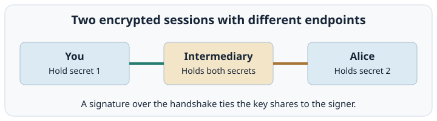
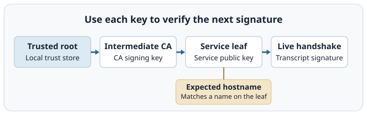
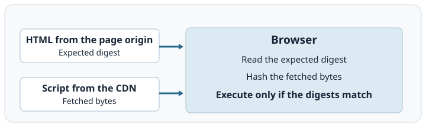

# 17. Authentication, Identity, and Trust

A stranger sends you a public key and says, “I'm Alice. Send me a challenge.” You pick a fresh random value and get back a valid signature over it. The signature verifies with the key the stranger supplied. What did you learn about the person on the other side? Would you use that key to send a message you intended only for the Alice you know? [Quiz 2 2026, Question 3(a), pp. 4–5.](../../assets/quiz2-2026.pdf#page=4)

Chapter 16 gave the endpoints a way to encrypt traffic once they can share a secret. Imagine your program establishes such a channel and receives an encrypted reply that quotes its message back. That is good evidence that the peer could read what you sent. How could it tell whether the endpoint is Alice? Start by writing down one fact about Alice that the program knew *before* that first reply came back.

## What did the signature prove?

A **digital signature** ties a message to a signing key. Someone holding the private key uses it to sign. A verifier needs the message, the signature, and the matching public key. The verifier can check the signature without gaining the ability to sign different messages. This gives our verifier a way to ask for evidence about the *current* exchange. Pick a fresh, unpredictable challenge, known as a **nonce**, and check a signature on that value. An old response to a different challenge won't verify. In the opening exchange, the evidence tells you that someone with access to the corresponding signing key signed your fresh challenge. Anyone can make a new key pair and claim that the public half belongs to Alice.

A student pushed the example further. What if the stranger relays your challenge to the real Alice and forwards her response back to you? Suppose you already know Alice's real public key. This time the signature verifies under that key. Yet Alice may have no idea which connection you expect to protect. She may have signed the challenge over a separate connection. If the rest of your exchange used a key negotiated with the stranger, the signature on the nonce has left that key untouched. Have the signer sign evidence that includes the proposed key exchange, the roles, and the relevant conversation so far. Then check the signature against the conversation *you* saw.

Imagine a person in the middle of an unauthenticated key exchange. They can establish one secret with you and another secret with Alice. Both sides will see encryption working, and the intermediary is a legitimate endpoint of each encrypted channel. If Alice signs her view of the handshake with a key you already associate with her, passing along her signature doesn't fix the changed key shares. You and Alice would be verifying different conversations. If the intermediary simply forwards the genuine handshake without changing it, the endpoints can still establish a secret with each other. A relay that can observe packets doesn't thereby learn the secret.

**What if?** You already have a copy of Alice's public key from a meeting in person. Which parts of the design would you keep? You can still need fresh evidence that the present exchange includes Alice. The meeting supplies the binding of name to key. A signature tied to the exchange supplies evidence that the corresponding private key participated in it.

## Who says this key belongs to that name?

Suppose you're opening `https://www.example.com`. Your browser has the name it expects because you selected that URL. A DNS lookup gives it an address at which to try the connection. How can it check that the key it receives is authorized for the expected name? It can't have a current copy of every site's public key. It can come with a shorter list of public keys it trusts to certify other keys.

A **certificate authority**, or CA, signs a statement that binds a public key to a name. The signed fields include the validity interval and can restrict what the key may be used for. In a common arrangement, the server presents a leaf certificate for its name and an intermediate CA certificate. The browser works toward a **trust anchor** it already has through its own or the operating system's trust configuration. A root's appearance in a message from the server cannot put it in that trust store. Root keys can sign a small number of intermediate certificates and stay offline between those operations. An intermediate can issue and renew leaf certificates without using the root key each time.

Trace the browser's decision backwards from the claim it wants to make: the peer on this connection is authorized to speak for the hostname in the URL. Three different pieces of evidence have to agree.

1. Build a path to a configured trust anchor. Verify the certificate signatures, dates and applicable constraints. An intermediate needs authority to issue a certificate on that path, and the leaf needs to be usable for server authentication.
2. Check the leaf's presented identities against the name you expected from the URL. For a DNS hostname, look for a matching DNS identifier in the certificate's subject alternative names. A certificate that chains to an accepted root for `other.example` leaves the `www.example.com` check unsatisfied.
3. Check that the peer in this connection can use the certified key. In a certificate-authenticated TLS 1.3 handshake, the server sends a **CertificateVerify** signature over a context and the handshake transcript hash. That transcript includes the messages by which the client and server negotiated the connection and exchanged key shares. The **Finished** message separately uses a key derived from the handshake to check the transcript and confirm the shared secret. A copied certificate by itself cannot supply the server signature for a fresh handshake. [RFC 5280, §6.](https://www.rfc-editor.org/rfc/rfc5280.html#section-6) [RFC 9525, §§4 and 6.](https://www.rfc-editor.org/rfc/rfc9525.html) [RFC 9846, §§4.5.2–4.5.3.](https://www.rfc-editor.org/rfc/rfc9846.html#section-4.5.2)

Where did the CA get its evidence? A domain-validation service can ask an applicant to publish a particular value at a location under the requested hostname or place a particular record in DNS. It can look up the result itself. That is evidence of control at validation time. Moving a site to a new server might change the answer to DNS without changing the name at all. The new server still needs an appropriate certificate and access to its matching private key. Consider how much the CA is relying on the path it uses to observe the challenge. At verification time, the browser can check the existing signatures without asking the root to sign again or be online. Revocation information and trust-store changes have their own distribution paths. If a CA key is compromised, clients need ways to stop trusting the affected certificates. [Let's Encrypt, *Challenge Types*.](https://letsencrypt.org/docs/challenge-types/)

**Network detective.** A browser reports a name mismatch. The leaf certificate chains to a trusted root and is within its validity period. Which name should you ask the browser to show you? Compare the URL, the identities listed in the certificate, and the destination address returned by DNS. If a shared host serves the wrong certificate at the right address, which of those comparisons catches the failure? Could a different certificate for the right name still fail a different check?

## What happens to a recorded session?

Suppose a client sends a session secret encrypted directly to a server's long-term public key. If a person records the handshake and later obtains the server's long-term private key, they can recover that session secret. To limit this exposure, use fresh **ephemeral** key shares for the key agreement and use the long-term key to sign the exchange. After use, erase the temporary private values and session secrets. The later disclosure of the signing key alone doesn't recover the session secret from a recording. This property is **forward secrecy** with respect to the long-term key. A compromised signing key may still let someone impersonate the server in a future connection while the key remains trusted. In the two cases, which key did the past session use to derive its secret, and which one will the next session use to verify a signature? [RFC 9846, Appendix F.1.](https://www.rfc-editor.org/rfc/rfc9846.html#appendix-F.1)

### Design this. What can each endpoint be sure of?

Alice and Bob want confidential messages that each can verify as coming from the other. Consider two channels. The first delivers messages between those two endpoints and allows other people to listen. The second also allows someone to intercept and modify messages and to pose as either endpoint. Now vary what the endpoints start with. Neither may know a key for the other, Alice may already know Bob's public key, or both may know each other's public keys. For each combination, what can they build without adding another source of trust?

*Adapted from [Final 2024, Q4, p. 2](../../assets/cs356-final-2024.pdf#page=2). The delivery-only channel explicitly supplies the endpoint identity assumption.*

Worked reasoning

| What they already know | Channel delivers between the intended peers | Channel permits active impersonation |
| --- | --- | --- |
| Neither has a trusted key for the other | A key agreement can give them a secret. The channel assumption supplies the assurance about who is at each end. | A key agreement alone gives no basis to verify the named peer. |
| Alice knows Bob's public key | They can agree on a secret under the same channel assumption. | Bob can authenticate himself to Alice by signing the exchange. Bob still needs evidence about Alice's identity. |
| Each knows the other's public key | They can agree on a secret. | Both can sign their roles and the exchange under the expected keys, then confirm the secret. |

On the first channel, the key agreement still relies on the cryptographic assumption that a listener cannot derive the shared secret from public messages. On the second channel, a single trusted key gives *one-way* named authentication. Even if Bob can tell that a message came from the peer that completed the handshake, he cannot put Alice's name on that peer without an additional fact.

## Can the browser trust the script as well as the connection?

In class, the instructor loaded the course schedule and showed that the HTML came from a university server while some JavaScript came from a content delivery network, or CDN. The CDN can serve copies of a file near readers. The browser can verify the CDN's TLS connection and still receive a legitimate response containing a version of the script that the course page didn't expect. The JavaScript runs in the page's context. How could the page author give the browser a way to check those exact bytes?

A **cryptographic hash** maps a file to a fixed-length digest. The computation is public. Since there are more possible files than digests, collisions exist. The useful assumption is that finding a different file with the same digest as a given approved file is computationally infeasible. You can hash two copies to check whether they agree, as the lecture suggested. First ask where you got the reference digest. If a party can change both the file and your expected digest, it can compute a digest of its own file.

With **Subresource Integrity** (SRI), the author puts an expected digest in the HTML script element's `integrity` attribute. The browser obtains that metadata from the page and the bytes from the CDN. It hashes the fetched bytes and checks the result before executing the script. A cross-origin script load with integrity metadata also needs an eligible response under the browser's cross-origin rules. A mismatch can mean the CDN delivered a different version, even when the delivery was honest and the TLS connection valid. To update the script, the author needs to publish new approved bytes and their expected digest. [Final 2024, Q3, p. 2.](../../assets/cs356-final-2024.pdf#page=2) [W3C, *Subresource Integrity*, §3.](https://www.w3.org/TR/2016/REC-SRI-20160623/#framework)

**Break this.** A page pins a script's digest. Which of these changes could let unexpected bytes run with the check in place? The CDN replaces the script. The page origin replaces the script URL and expected digest together. The CDN serves a byte-for-byte copy from a different edge. What extra evidence would a user need to tell a planned page update from a compromise of the page origin?

Worked reasoning

Replacing the script alone leaves the original digest in place, so different bytes normally fail the check. A byte-for-byte copy has the same digest at any edge. An origin able to replace the HTML can declare a different script and its matching digest. The integrity check enforces the page author's choice of bytes. The user's question about who approved that choice calls for trust in an external reference, such as a separately authenticated release statement.

The browser now has a way to verify a server's identity and a way to verify the bytes of a separately fetched object. Put both checks back in a real page load. Before the browser can compute a script's digest, it has to get the HTML, discover the script URL, and connect to a server that can answer. Which of those steps can start in parallel, and which ones are still waiting for information?
