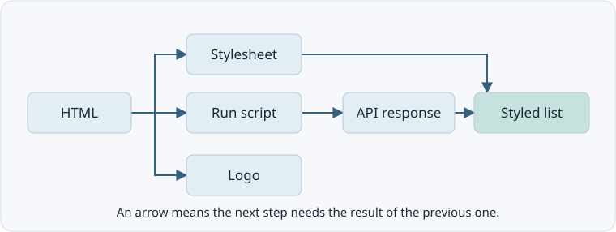

# 18. What Happens When You Open a Website?

You open a transit website to check the next bus. The browser shows a logo and an empty departures panel. A second later, the times appear. At the next stop you try again, and this time the panel fills almost immediately. Which work did the browser have to repeat? Which work might it have been able to skip?

We will follow `https://arrivals.example/` on one particular afternoon. The page contains a logo and a stylesheet, and it names a short JavaScript program. The program fetches the current departures. Call the page *ready* when the styled list of departures is visible. A slow logo can affect the appearance of the page, but it need not hold up that list. Keep this outcome in mind when deciding which part of the load to speed up.

## What has to work before the browser can ask?

Start with a laptop on a new Wi-Fi network. It has just joined the access point, completed the link's authentication, and can exchange link-layer frames. It has no IPv4 address for this link. The application cannot invent an address and assume all other hosts will know how to reply. In the classroom packet capture, link authentication came first, then the laptop asked for configuration using DHCP.

In our example a **DHCP** client broadcasts a discovery message from IPv4 address `0.0.0.0` and UDP source port 68 to `255.255.255.255` and destination port 67. A server offers a configuration, the client requests it, and the server acknowledges the lease. Assume the laptop gets `192.0.2.10/24`, default gateway `192.0.2.1`, and recursive DNS resolver `198.51.100.53`. The wireless access point offers the local link. The gateway forwards packets beyond it. One box can fill both roles, and a DHCP server can be a different machine again. [DHCP, §3.1.](https://www.rfc-editor.org/rfc/rfc2131.html#section-3.1)

The resolver is outside the laptop's subnet. Before sending a frame to it, the host's route lookup selects the gateway as the next hop. The laptop needs the gateway's link-layer address, so it uses **ARP** on the local link. The gateway's address ends up in the frame's local forwarding information while the resolver's IP address stays in the IP header. At the gateway, the packet can be put in a different frame for the next hop. IP routers decrement the TTL. In this example there is no address translation, so the endpoint IP addresses remain the same along the path.

**What if?** Put the resolver at `192.0.2.53` on the same local subnet instead. Which IP address would the laptop ask for with ARP? When it later sends a packet to the distant web server, which next hop would it use then?

## Which names and numbers matter?

The browser wants to contact `arrivals.example`. Assume a plain IPv4 DNS lookup through the configured recursive resolver. The laptop has no cached answer and the resolver has to obtain one. It returns `203.0.113.8` for the name. The browser connects to that IP address on TCP port 443. The name stays with the request. It is the identity the browser will check during TLS, and HTTP carries the requested authority so the server can distinguish sites even if they share the same address.

For this load, choose HTTP/2 over a fresh TCP connection with a full TLS 1.3 handshake, no resumption or early data. First the TCP SYN, SYN+ACK, and ACK open the connection from Chapter 10. In the model the client can send its TLS ClientHello along with the final TCP ACK, so TCP adds one round trip before the client can start TLS. The TLS exchange derives session keys and authenticates the server for the requested name. After receiving and verifying the server's handshake flight, the client sends its final handshake message and can send the request. We allocate one round trip to that TLS step. Other protocol choices produce different timelines. HTTP/3 runs over QUIC, where transport and cryptographic setup are integrated. [TLS 1.3, §2.](https://www.rfc-editor.org/rfc/rfc8446.html#section-2)

The browser sends a request for the root path `/`. Trace those bytes outward. HTTP says what resource the browser wants. TLS protects that request inside records. TCP carries the bytes and their positions in the stream. IP contains the addresses used for routing. A frame sends the packet over the local link. A packet capture at the laptop can show the TCP handshake, sizes, and times. The browser can show the decrypted HTTP request and response because it is one endpoint of the TLS connection. Comparing those views was the point of moving back and forth between Wireshark and the browser in the lecture.

## Why didn't the first response contain the page?

The response to `/` contains HTML. The browser parses it into a document it can render and update. It discovers the URLs of `/site.css`, `/logo.svg`, and `/departures.js`. These are separate resources. The browser can start fetching them as it discovers them. Suppose it already has the complete HTML by the time it starts all three, for easy arithmetic. The stylesheet supplies the rules for rendering the styled list. The logo can download alongside the other work. When the downloaded program begins running, it requests `/api/departures`. Only when that response comes back can the script fill in the list.

In class, a student pointed out that starting a program can give it time for work that does not fit into the original download. Here that work is another network exchange. A slow stylesheet can delay rendering, and a slow program can delay discovering the next URL. Even an infinitely fast link would leave the time for those sequential round trips and the browser's own work. HTTP/2 can multiplex requests over one connection. The dependencies apply even when the browser and server can work on several streams concurrently.

There is one more dependency the browser cannot see. The address returned by DNS could belong to a service front end. That process can terminate TLS, serve a stored copy of the stylesheet, and route the API request to a backend that gets current bus times. The browser sees the delay until the first byte of the API response, which includes network travel time and the work on the server side. For the moment, leave that internal work inside the time we assign to the API response.

### Design this. Give the browser enough to start

The course quiz uses a social feed. HTML discloses a program and basic layout resources. The program must run before requesting the first ten posts. Assume the browser can issue multiple requests in one round trip, the server sends responses in request order on one TCP connection, and nothing is cached. Which object would you request as soon as you learn about it? Under what size and timing assumptions should it be sent before the layout resources? Then redesign the HTML so it gives the browser the information needed to start the posts request sooner. *Adapted from [Quiz 3 2025, Q6, pp. 5–6](../../assets/quiz3-2025.pdf#page=5). The assumptions question and redesign are new.*

## Which part of the wait is on the critical path?

Give each operation a time in one model. Start the clock with the laptop beginning to join. Wi-Fi setup takes 25 ms, DHCP 20 ms, and ARP 2 ms. DNS takes 30 ms including the recursive resolver's work. The server is one 40 ms round trip away. TCP takes 40 ms and TLS takes another 40 ms. The HTML response is complete 45 ms after the first HTTP request. At this point the timestamp is 202 ms. This is an invented trace with illustrative timings.

| Work | Starts at | Ends at |
| --- | ---: | ---: |
| Link setup, DHCP, and ARP | 0 ms | 47 ms |
| DNS | 47 ms | 77 ms |
| TCP and TLS | 77 ms | 157 ms |
| HTML request | 157 ms | 202 ms |
| CSS request | 202 ms | 246 ms |
| Logo request | 202 ms | 262 ms |
| Script request | 202 ms | 250 ms |
| Script executes and issues API request | 250 ms | 255 ms |
| Departures response | 255 ms | 310 ms |

Treat the resource rows as concurrently scheduled network work, with fixed completion times that already include response processing and transfer. The CSS is done at 246 ms. The script and its API dependency determine when the styled list can appear, at 310 ms if rendering time beyond the table is negligible. Cutting the logo's transfer time in half does not move that timestamp. Making the API return 20 ms sooner does, under these timings. If you make one path through the dependency graph short enough, another path can determine when the list appears.

Now make a second navigation to the same URL from the same network. Define *warm* precisely. The Wi-Fi link, lease, and gateway's ARP entry are still usable. The host has a valid DNS result and the browser has the same authenticated HTTP/2 connection open. The HTTP cache has fresh copies of the logo, stylesheet, and script. The HTML and API results must still be fetched because we set them to `Cache-Control: no-store`. No service worker is involved. Then the browser has the HTML at 45 ms, uses the cached assets as they are discovered, runs the script by 50 ms, and gets the list at 105 ms. Here *warm* describes several separate pieces of state with separate lifetimes. [HTTP Caching, §§4–5.](https://www.rfc-editor.org/rfc/rfc9111.html#section-4)

A cache entry can also be stale but have a validator such as an ETag. A server response of 304 can permit reuse of the stored bytes, leaving the round trip for validation in the dependency chain. Reusing a connection saves handshakes even when every object must be fetched again. A valid DNS entry helps establish a new connection, and when the browser can use an existing connection in this example it avoids looking up the address in the first place. [HTTP Caching, §4.3.](https://www.rfc-editor.org/rfc/rfc9111.html#section-4.3)

### Network detective. The screenshot is the same

Two passengers both report, “I've been waiting a quarter of a second and I still can't see the departures.” In load A the browser has drawn the page shell and the API request remains open. In load B the browser has yet to complete the TLS handshake for the document. What packet and browser observations would separate the two? Which tests would tell you about the name lookup, reachability of the server, and work inside the page?

Try removing one warm assumption at a time in the [page-load lab](load-lab.html). Find three ways to make the same API request start later. Before running the model, predict whether each change will show up as a new row in a browser waterfall or as a new wait inside an existing request. Then use the [lab instructions](lab.md) to compare a real browser waterfall with the model.

## Why can the browser run bytes from another machine?

In the lecture, inspecting the rendered page showed elements the server had never sent as part of the original HTML. The script had changed the document. A browser gives this code access to controlled interfaces such as a document tree and functions that request resources. The **same-origin policy** restricts readable access across origins, normally defined by scheme, host, and port. Browsers also use process isolation and operating-system sandboxing to restrict what their web-content processes can do. These are different boundaries. One governs which web documents and data can interact, and another limits the privileges of the code executing on the host. [HTML Living Standard, §7.1.](https://html.spec.whatwg.org/multipage/browsers.html#origins)

Take care over who supplies the departures program. A script embedded by the page can run with access to that page's document even when the script was fetched from a different host. Suppose the page's own trusted HTML pins the expected cryptographic digest of that script using **Subresource Integrity** and fetches it under conditions that allow the check. The browser verifies the downloaded bytes before executing them. Serving exactly the expected version saves the transit site from delivering every script byte itself. The pinned digest can reject unexpected bytes from the script host, while the authenticity of that digest depends on how the browser obtained the HTML containing it. [Final 2024, Q3, p. 2.](../../assets/cs356-final-2024.pdf#page=2) [W3C Subresource Integrity.](https://www.w3.org/TR/SRI/)

Return to the passenger at the second stop. Suppose the script started on time and the API request left the laptop at 50 ms, just as predicted, yet the list still took a second to appear. The browser can tell you that it waited for the first byte. It can't tell you whether the front end spent that second waiting for another machine. To follow that request any farther, we'll have to go inside the data center.
