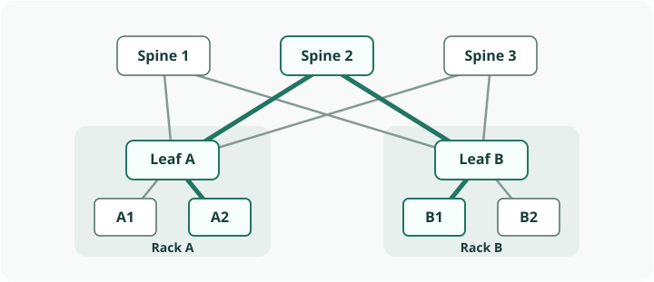
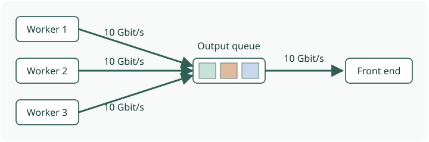

# 19. Data Centers and Cloud Networks

The passenger from Chapter 18 waited a second for the next bus. You can now see the front end's logs: the request arrived on time, and the front end asked three machines for upcoming departures on the routes serving that stop. Two came back quickly. The third answered almost a second later. Where would you look next?

Start at the slow worker. How much time elapsed on its own clock between receiving the request and handing the reply to the network? Compare that interval with the front end's round trip. A worker that finished in a millisecond leaves almost the entire second to account for elsewhere. Suppose it did finish promptly, and its reply shared a link with the other two. You've met the bottleneck from Chapter 11 again. This time you can decide where the machines go, which switches they use, and how the program asks them to send.

## How far does the request travel inside the building?

The lecture started with a picture of a building that looked more like a factory than a cloud. The machines go into racks. A switch at the top of a rack often connects the servers in that rack. A request to a server in the same rack can stay on that switch. A request to another rack has to cross an uplink and enter the destination rack. Now place the front end, its three timetable services, and a storage service. Putting them together can remove traffic from the uplinks. What happens if their one rack switch or power supply fails? You can spread replicas across racks to reduce shared failure risk, trading some locality for access to a replica after a failure.

Why put any of this in the same building? Several things are easier to share there, including power, cooling, maintenance, storage, and short high-capacity links. If the transit service sees holiday traffic surge, it can rent more compute for that spike and release it after demand recedes. In class a student imagined needing a thousand computers for a day. A public cloud pools equipment so workloads with different peaks can use it at different times. An organization can also operate a private cloud and keep control of the underlying equipment or place it under a dedicated operator. Either model needs a plan for the cases where many workloads peak together or a failed machine takes some service with it. A storage service can replicate data and take over replacement of failed disks. What deployment would prevent both replicas from disappearing when one rack loses power?

Some computations benefit from putting their machines close to one another. In class, students compared a social feed built from everyone's posts with copying all posts to every phone so it could build its own. If *n* users each publish a fixed amount, sending every post to every phone takes a number of deliveries proportional to *n*². A service can rank and filter closer to where it stores the data, using only some of it to build each response. There are distributed designs between those two choices, for example storing data on multiple cooperating services and exchanging summaries or subscriptions. The design question is how much data must move and how often each operation waits for it.

## What if the uplink is always busy?

Start with a tree. Each rack switch has one uplink and two servers below it. If the two servers each send 10 Gbit/s to another rack and the uplink also carries 10 Gbit/s, only half the offered load can get out. If both destinations are local and distinct, their packets need no uplink. Up the tree, switches can end up serving whole groups of competing racks. One direct answer is to buy bigger and faster switches toward the root. Can we use more of the same kind of switch instead?

Replace a single upper switch with several. Every rack switch is now a **leaf** with a link to every **spine**. For traffic between distinct racks, go up to one spine and back down to the destination leaf. With three spines we now have three paths of the same hop count. Losing a spine leaves two alternatives after forwarding adapts. This is a small **Clos** fabric. A fat-tree design uses multiple paths and more aggregate capacity where a tree would funnel many links into one. At larger scales operators can assemble additional stages of switches. For example, the early generations in Google's Jupiter paper used Clos fabrics and centralized control to build a fabric out of smaller switches. [Singh et al., Jupiter Rising.](https://research.google/pubs/jupiter-rising-a-decade-of-clos-topologies-and-centralized-control-in-googles-datacenter-network-2/)

Count the links crossing the boundary of a rack. If four 10-Gbit/s server ports have only two 10-Gbit/s uplinks, the rack's downlink capacity is twice its uplink capacity. The rack is **oversubscribed** two to one across that boundary. You may accept this design if servers mostly communicate within the rack or most are idle. Four equally fast uplinks let the four servers send their entire aggregate rate out of the rack in principle. Now send all four streams to the same destination server. Its one 10-Gbit/s port becomes the bottleneck even if every stream uses a different spine. When a design advertises capacity, ask which traffic matrix it promises to carry.

**Break this.** Buy four uplinks per rack to support arbitrary pairings among four servers per rack. Before you test a workload, unplug one uplink. Construct a pairing your network could have carried before the failure that it cannot carry at full rate afterward. Identify the boundary where a capacity argument proves your case.

## Which spine should carry the next packet?

Think back to Chapter 8. Send each packet through the next spine in rotation and a single large transfer can put packets into all the paths. In exchange, the receiver might get several later packets while a packet on a busier spine is still queued. Ordered delivery has to wait, and the loss detector in the final exam treats three duplicate acknowledgments as evidence that a packet is missing. Some transports and receivers can be engineered to tolerate more reordering, but have to account for the cost of waiting and buffering. [Final 2024, Q7–Q9, p. 5.](../../assets/cs356-final-2024.pdf#page=5)

Now hash the flow's stable header fields and give every packet in that flow the same spine. This is the per-flow ECMP split from Chapter 8. Ten thousand small flows can give similar counts of flows on each path. But if two of those flows carry most of the bytes, the placement of just those two can dominate the utilization counters. With an ideal independent uniform hash and three spines, the second transfer has a one-in-three chance to pick the same spine as the first. If the two use the same source and destination leaf, both then use the same two fabric links. Contrast three large transfers of 8 Gbit/s with 300 small flows of 80 Mbit/s. The offered rate is the same. Could you expect the same spread across three 10-Gbit/s paths? In class, the distinction was between how many flows are short and how many bytes are in long flows.

A controller can identify large flows and reassign them. What should it measure? Current congestion could fade before the reassignment reaches the switches, as in Chapter 8. Moving the flow immediately may make the first packet on its new path overtake packets from the old one. One option is to switch paths during a gap between bursts, choosing a gap large enough that the old packets should already have arrived. What would you do if the flow sends continuously or the old route is failing? Give the operator a way to notice a worse outcome after the move.

**Network detective.** Your trace shows two large rack-to-rack transfers carrying only about 5 Gbit/s each. The peer spines report almost no load. Propose a way to distinguish a collision on one common spine link from a bottleneck on a source NIC or destination NIC. Which port counters should go up after moving just one flow? Which graphs would make you suspect the limit is the rate at which a CPU can generate or process packets? The lecture demonstrated a useful control experiment by sending from a computer to itself over its loopback interface. Individual packets still needed processing despite never traversing a physical cable.

## What if everyone answers at once?

Return to the departures service. It sends requests to three workers, and each sends back a reply at 10 Gbit/s for 20 μs. Suppose their replies arrive together at the link to the front end, which can serve 10 Gbit/s. For 20 μs the output has 20 Gbit/s more work arriving than it can do. That amounts to 50,000 bytes of extra data in the fluid model. With a 32 kB buffer and no other traffic, how much cannot fit? If the workers send at different times, how much of the problem goes away? The aggregate traffic over a whole second might look unremarkable on the monitoring dashboard.

This is an **incast** workload. When replies synchronize, the output queue can overflow even with plenty of unused fabric elsewhere. If a small reply loses its last packet, the sender may have no later packets to elicit the duplicate ACKs needed for fast retransmission. Recovery can then wait for a loss timer. The front end still waits for the slowest reply if its answer depends on all three. To shorten that tail, you could pace worker replies, cap the number of requests outstanding, or give the receiver a way to grant transmission credits. All three depend on who can see what is about to arrive. Can the workers pace themselves if they do not know how many other workers were asked? [Vasudevan et al., Safe and Effective Fine-grained TCP Retransmissions, §§1–2.](https://www.cs.cmu.edu/~dga/papers/incast-sigcomm2009.pdf)

A training job can produce related timing effects. Suppose four workers each compute an update on a different batch, then all need the sum before continuing. They could send all updates to one worker and have it send the result to everyone. Or they could exchange and combine partial results in rounds. This is an example of a **collective communication** operation. Each schedule creates a different traffic matrix at each stage, and a delayed transfer can hold up the next round. When you know which phase comes next, you can arrange routes and start times in advance. When several independent jobs share the same fabric, their phases may coincide. Chapter 11's feedback logic still has work to do.

### Design this. Route pairs, then change the workload

Use the cluster from Chapter 11. Four racks contain four servers each. Each rack has a link to each of four spines. All the links run at 10 Gbit/s in each direction. At most one stream leaves and at most one stream enters each server. Can you route a set of paired servers so no two streams use the same directed link at the same time? First pick any example pairing that uses at least three rack switches. Color the streams according to the spine you plan to use. Now let A1, B1, and C1 send to D1 at the same time. Which part of your argument has changed? Find the maximum aggregate incoming rate that D1's link can serve. [Quiz 2, 2026, Q4, pp. 6–7.](../../assets/quiz2-2026.pdf#page=6)

Worked reasoning

Draw a copy of every rack on the source side and again on the destination side. Each cross-rack stream is an edge, with parallel edges allowed. An upstream rack port to a particular spine can carry one stream at full rate, and the corresponding downstream port at a destination rack can carry one. The color therefore cannot repeat among edges at either copy of a rack. Every vertex has degree at most four. One way to see why four colors suffice is to add dummy edges until every vertex has degree four, which is possible because each side has the same total deficit. In a regular bipartite graph, any group of sources has at least as many neighboring destinations as sources. Count the edges leaving the group and compare with how many each destination can receive. Hall's theorem gives a matching covering both sides. Remove it, repeat for the remaining edges, and then discard the dummy edges. The four matchings can each use one spine. Within a rack, local streams can stay on the rack switch.

The three streams to D1 violate the one-stream-per-receiver assumption. They might still use different spine-to-rack links. D1's one port can only deliver 10 Gbit/s total, so no route assignment can deliver 10 Gbit/s to D1 for each stream. A schedule or a congestion controller now has to divide a shared resource. If D1 always has to wait for the last reply, compare how quickly the final byte arrives under paced and unpaced sending with the same total capacity.

## What can one tenant do to another?

Imagine the timetable service shares machines and switches with a training job. The provider gets to decide which controls to build into the hosts and which to build into the fabric. One property is **reachability isolation**. If two tenants choose the same private IP address, the network still has to send each packet to the right virtual network. Include a tenant or virtual-network identifier in the forwarding context, and constrain the traffic that can cross between contexts. A network firewall can limit which peers may reach a service even if application code has its own access checks. In class, a student asked whether traffic inside a data center could relax encryption. What threats would disappear when you move inside? Which processes or machines are still trusted to see or change the packets? Make the decision by naming those parties and the protections each layer gives.

Another property is **performance isolation**. The timetable service can still see longer delays if it shares a physical queue with the training job. Separate virtual networks may use the same link. To make the timetable service predictable you could reserve a rate, shape the job's bursts, or choose a distinct queue for short requests. Chapter 12's scheduling choices let you say which traffic gets service when both want it. What happens to the reservation if a failed uplink cuts the remaining capacity in half? Check that the provider's promise fits through the surviving cut.

## Which work should move closer to the passenger?

The lecture asked how you would locate a data center. Students suggested proximity to customers. The class added power, land, and proximity to interconnection sites. Chapter 13's propagation estimate gives you a way to test a claim about where the response came from. If a server 2,000 km away were reached by a straight fiber route and the reply came straight back along it, propagation alone would take about 20 ms. A min-RTT markedly smaller than that suggests the responding endpoint is closer, or that your route assumptions need revision. The endpoint that answers a probe might be a front end or a nearby edge node. Its RTT cannot locate every backend it happens to use.

### What if? The same machines are spread across cities

You can put the same total compute and storage in one site or spread it across cities. Consider a tightly synchronized model training job, an interactive game rendered on a server, a live final thousands want to watch, and a recording requested a few dozen times over several years. For each, identify which costs dominate and decide where you would put the work or data. What changes if one city contributes all the demand for the recording, or if running the game requires machines that only a few cities can support?

*Adapted from [Final 2024, Q1, p. 1](../../assets/cs356-final-2024.pdf#page=1). The follow-up workloads are new.*

Worked reasoning

The training workers frequently exchange large updates, so putting them on a fast, nearby fabric can save every synchronized step time. The game reacts to a player's next command, so the propagation time to the rendering machine is paid throughout the session. Holding a copy of the live final near viewers can avoid carrying each viewer's identical data across long-haul links. A rarely requested recording may make sense in central storage because few requests can repay the cost of copies at many sites. If requests are concentrated in a city, putting a shared copy there can pay even if the object is globally unpopular. The same total compute divided into small sites can also leave a single site without enough capacity for a task that needs many machines together.

The departures list needed live replies from backend services. The site's logo has been the same all week. If the two cost different amounts to reproduce and go stale at different times, should the browser have to fetch both from the same place?
