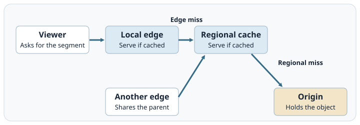
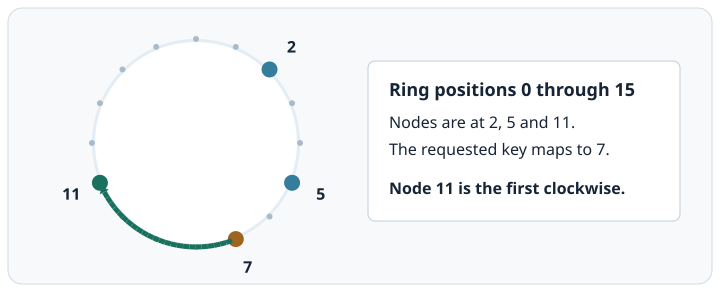

# 20. Content Delivery and the Edge

Think of the transit site's logo, which stayed the same all week while the departures changed each minute. Now give the data center something much larger that requests can share: the opening segment of a new show. A hundred viewers on one access network ask for exactly those bytes. Every response crosses the same long-haul link on its way to them. You have space for one segment at a server inside that access network. Or you could use the space for a lecture video somebody there might watch next month. When should you move either object, and how will a viewer find the copy?

## How much of the trip can you buy once?

Give the opening segment a size of 8 MB. Count only payload crossing the upstream link. A hundred individual origin responses send 800 MB over it. Send one copy to the edge and let the edge serve all hundred viewers, and the upstream link carries 8 MB. The local network still carries a response to each viewer. The edge trades storage and local serving capacity for 792 MB less upstream traffic. For one request in that region, proactively copying the segment breaks even in upstream bytes and can help that first viewer. For zero requests, the copy uses both upstream traffic and storage without serving anyone.

The byte count tells the access operator what it saves. To see what the viewer might save, compare the trip to the edge with the shortest possible trip to the origin. Over 2,000 km of fiber running at about 200,000 km/s, a bare round trip takes 20 ms. A real route may be longer and its packets may queue. A nearby copy can cut the waiting before the first byte, and serving many local viewers can keep the shared upstream link from becoming their throughput bottleneck. Ask where the slowest link lies. Moving the copy inside the provider helps that provider avoid carrying repeated data over a long interconnection route. It won't make a viewer's slow home Wi-Fi faster.

A **content delivery network**, or CDN, operates serving sites near groups of users. Some distribute objects in advance, especially when demand is predictable. An **on-demand cache** can fetch after the first request and serve subsequent ones locally while the copy stays usable. For a video provider and an access network, putting equipment inside the access network can serve both interests. The provider can serve that audience with fewer long-haul transfers, and the access operator can bring the traffic in without repeatedly loading its external links. Someone still supplies rack space, power, connectivity and operations. Netflix's Open Connect appliances are an example of deployment inside partner ISP networks. [Netflix Open Connect.](https://openconnect.netflix.com/en/)

Set up a regional cache above several small edges. A miss sends the edge to that cache, which can fetch from the origin if it also misses. A regional hit avoids an origin transfer but still pays for the trip between edge and region. A user redirected to a nearer site might therefore get a slower response if that edge sends the request across the network for a copy. If a hundred requests for the same cold object arrive together, let one upstream fetch do the work and have the others wait for its result. If the fetch fails, those requests still need an answer. What retry policy keeps the waiters from starting a hundred new fetches together?

## What should occupy the next byte of cache?

Suppose your edge has 8 MB of space. A clip takes all 8 MB and has five likely requests here before this copy expires. An icon takes 1 MB and has twenty likely requests. Assume complete transfers, a reliable origin, one proactive fill per object, and the same upstream link for every transfer. If you store the clip, you avoid four upstream responses net of its fill, or 32 MB. If you store the icon, you avoid nineteen responses or 19 MB. How does the decision change if your first priority is the number of requests served locally? The two policies optimize different outcomes. A third policy might ask how much total traffic several small objects save when they fit where the big one would go.

Now replace the forecasts with observations. One simple rule admits objects on a miss and evicts the **least recently used** when it needs room. That works when recent demand predicts future demand. Try a burst of one-off large downloads interspersed with requests for the site icon. A single admission can evict the icon. If visitors regularly ask for both, the cache can make a long trip for nearly every request. You could wait for a second request before admitting a large object, reserve some space for repeatedly used small objects, or choose an eviction policy based on anticipated savings. Measure both miss count and upstream bytes. A cache aimed at quick page starts may care whether the first object the browser needs is among those misses.

**Predict–simulate–explain.** In the [edge cache lab](edge-lab.html), give an 8 MB cache the trace `i a i b i c i`. Each `i` is a 1 MB icon and each of `a`, `b`, and `c` is a different 8 MB video segment. Predict the hits for admission on first and second request. Then use the same cache sizes on a trace where one segment suddenly becomes popular. Which assumption about reuse does each policy make? The [lab notes](lab.md) show how to vary the trace and expiration.

## How do you know a stored response still answers the question?

Now the producer replaces the opening segment, but the player still asks for the same URL. The edge has the old bytes. How long is it permitted to serve them? An HTTP response can give shared caches freshness instructions, such as a maximum age for reuse. Before an eligible response ages out, the cache can reuse it even if the origin has changed. This is a permission to use a previously stored response for an interval. A cache can revalidate a stale copy by sending the origin a conditional request, for example with `If-None-Match` and the saved entity tag. A suitable `304 Not Modified` response lets it keep the stored body. That saves a body transfer but still costs a request and a reply on the upstream path. An origin can require revalidation, disallow storage, or arrange to invalidate managed copies on a change. Which objects would you allow a cache to serve during loss of contact with the origin? [RFC 9111, §§4–5.](https://www.rfc-editor.org/rfc/rfc9111.html#section-4) [RFC 9110, §§13.1.2 and 15.4.5.](https://www.rfc-editor.org/rfc/rfc9110.html#section-13.1.2)

Alternatively, give each version a different URL. Have the current page or a manifest tell the player which version to request. Old cached bytes can remain usable for viewers who still want that version. The question of freshness moves to the manifest. Which user's display changes first after the origin publishes a new manifest, a user whose cache is still allowed to reuse the previous manifest or one who has to fetch it now?

### Design this. Place the pieces of a social feed

The feed has a common logo and icons, recently viral videos, videos with several hundred views, and direct messages. Rank them by how easily a shared edge can deliver them. Then decide whether ranking by *bytes saved* would move any of them. What premise would make a video with a few hundred views particularly suitable for a single edge?

*Adapted from [Quiz 3 2025, Q7, p. 7](../../assets/quiz3-2025.pdf#page=7). The second metric and location question are new.*

Worked reasoning

Start with small public assets that nearly every visitor needs. Follow with viral media, other public media, and private messages. The assets and public media have reusable bytes. Viral videos can deliver much larger upstream-byte savings than icons because each avoided fetch is large. A less popular video whose viewers all attend the same school or live in the same neighborhood may be an excellent candidate for that one edge. A direct message needs requester authorization, has little reuse across unrelated viewers, and is tied to the application's update and delivery rules. Serving private data near a user can still be useful if you have a placement and access-control design for that job.

## How does the request find the copy?

One name now has several possible serving sites. Choose which site should receive a request. Is it near by measured round-trip time? Does it have the object, or enough space and network capacity to fetch it? Then choose how to get the user's packets to that site.

| Where you choose | What you change | What the choice can see |
| --- | --- | --- |
| Application | Return an HTTP redirect or put a regional hostname in the page or manifest. | The object, request context, and whatever inventory or load the application knows. A redirect adds another exchange. |
| DNS | Answer a hostname lookup with an address appropriate to the requester or resolver. | The name and hints about where the lookup comes from. Recursive caching can keep an answer in use even when the preferred server changes. |
| Routing | Advertise routes to the same service address from multiple sites, using **anycast**. | Routes and routing policy. The selected path may reach a different geographic site than the one that would answer fastest. |

In class, a demonstration from several VPN exits returned different DNS addresses for the same name at some services and the same answer at others. Changing the name resolution result is one way to change where users go. The same address can also route to multiple sites. If a trace contains only a destination address, what additional observation would establish which site handled the request? An identifier added by the serving edge, or operator-side request logs, could help. [RFC 4786, §§2 and 4.](https://www.rfc-editor.org/rfc/rfc4786.html)

The class also got a poll about how to encode a regional choice. Suppose the choices are `west.media.example` and `east.media.example`, or a single hostname with paths beginning `/west/` and `/east/`. Which parts of the URL does the browser use for DNS before it connects? Different hostnames can steer the *initial* connection by DNS. Paths go to the already-selected HTTP server. That server can read them and act as a proxy or redirect the client. Those designs place the decision in different components.

## When should the edge do the work itself?

A cloud game receives a player's input and returns rendered video. The important trip repeats each time the player acts. A nearby machine can reduce the travel time of both the input and the new frames, but it needs a GPU, the current game state and enough capacity to send video. A shared cache cannot guess the next frame for a player's specific input. A large model training job faces a different trip. Workers may repeatedly exchange updates with one another, so their distance to one another can matter more than their distance to the eventual users. Popular public video benefits from placing reusable bytes near large groups of viewers. For a lecture with very few viewers scattered around the world, start from a centrally stored copy and let demand determine whether a cache should retain it. [Final 2024, Q1, p. 1.](../../assets/cs356-final-2024.pdf#page=1)

**What if?** A low-Earth-orbit path to one central site is faster round trip than your alternatives but has much less available throughput. Assume 30 ms RTT and 5 Mbit/s on that path, and 50 ms RTT and 100 Mbit/s on a terrestrial path. Choose a path for game inputs that require a tiny reply and a deadline of 40 ms. Now choose for a 20 Mbit/s rendered-video stream. Assume the given rates are sustained and omit processing time. Which part of the reasoning changes for a game with a large startup download before its first input? [Adapted from Quiz 3 2025, Q1, p. 1.](../../assets/quiz3-2025.pdf#page=1)

Worked reasoning

The tiny exchange can fit the 40 ms budget over the 30 ms path if serialization and other delays fit in the remaining time. A 20 Mbit/s rendered stream exceeds the 5 Mbit/s path's capacity even when round trips are short. The terrestrial path can carry the stream under the given throughput assumption. The user's action-to-frame deadline, if there is one, still has to be checked separately. A large startup download has a bulk transfer cost that the tiny-message calculation omitted. You can evaluate different paths for startup and for the interactive phase.

## What if you ask the network for the object itself?

Chapter 17's script had two names of a kind. The URL told the browser where and how to ask, and the digest told it which bytes to accept. Suppose you already know a trusted digest for the video segment. Ask any copy holder for the object with that digest. Rename the downloaded file and the digest stays the same. Change the bytes and you ordinarily get a new digest. A **content address** identifies a version without telling you where it is. The player still needs a trusted publisher's manifest to learn the digest of the version it wants now.

For an overlay running on existing IP, you can distribute the lookup across participating machines. Turn digests into positions on a ring, assign a position to each participating node, and make the next node clockwise responsible for a key. That node could store a copy or store a pointer to one. Each node knows a successor, so a lookup can begin at a reachable node and walk the ring. Chord adds shortcuts and gets logarithmic lookup cost under its assumptions, instead of traversing each successor in turn. If a node disappears, someone has to repair the ring and recover any entries that were kept only there. Geographic proximity is a separate choice. The next node in key order could be on another continent. [Stoica et al., *Chord*, §4.](https://pdos.csail.mit.edu/archive/6.824-2007/papers/stoica-chord.pdf)

Now move the naming operation into the forwarding layer. In **Named Data Networking** (NDN), a consumer can send an Interest for a name rather than a packet destined to an already chosen host. A forwarder can return matching cached Data, forward the Interest using a table of name prefixes, or combine it with a pending Interest for the same data. It records incoming interfaces so returned Data can go back to the consumers that asked. NDN supports hierarchical names and signed Data. A digest can identify a specific version, but name-based forwarding needn't use bare file hashes. The architecture lets a network answer from a suitable nearby copy and asks more of the network itself, including name forwarding, pending request state and decisions about caching. The overlay can instead keep those responsibilities entirely in the participating machines. [Zhang et al., *Named Data Networking*, §§II–III.](https://named-data.net/wp-content/uploads/2014/04/tr-ndn-0019-ndn.pdf)

## Which replica is really independent?

You have several edges and a cache hierarchy. A user in one region can play the segments everybody watched yesterday but gets an error on a new upload. Users elsewhere can play the upload. Ask for one working and one failing request, the serving site each reached, and whether each site already held the object. A warm cache may still answer while the path it uses for new content is broken. Two sites with separate storage might share an upstream path, a DNS service or a regional cache. Which dependency could make both fail at the same time? In the next chapter the transit site's logo still loads while the departures panel stays empty. What would you compare first to tell a cache that is masking a failure from a backend that is simply running late?
