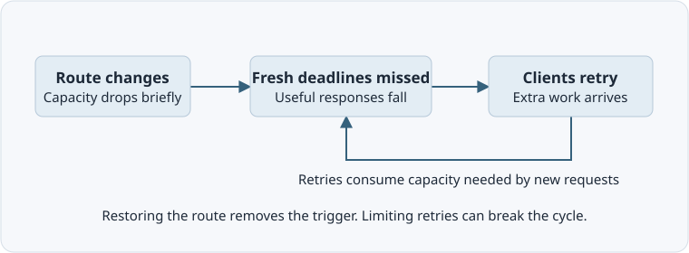

# 21. When Networks Fail

At 20:03, the transit website from Chapter 18 starts missing its one-second response target. The logo still appears. The front end's health check still answers. Users of one access network are hit first, but within a few minutes the complaints come from elsewhere too. The routing dashboard says a link went down at 20:03. The application dashboard says the departures service had more traffic than it could handle.

Suppose you are the person on call. You can ask for one more measurement before deciding whom to wake. What observation would help you decide whether the reported link failure is a cause, an effect, or another name for the symptom? In the last lecture, the class played this as an investigation. The instructor supplied an observation. Students asked for measurements that ought to differ depending on what actually broke. We will do the same with a fictional incident.

## What does “link down” tell you?

Make the first question precise. Did the link lose its physical signal, or did a routing process stop hearing from its neighbor? We can examine events at both ends of the same link. A loss-of-signal alarm is evidence about the medium. A missed hello is evidence about the delivery of a small control message. Both conditions can lead to a withdrawn route, and a withdrawal can redirect traffic while every cable remains intact.

At your request, the two operators line up their interface logs. Neither reports a loss of signal. The first switch generated its hellos on schedule, but its transmit queue filled and dropped several of them. At the other end, three hello intervals passed in silence and the switch declared its neighbor down. The revealing detail is in the byte counters: some data packets crossed the link in those very intervals. Those observations are consistent with the class hypothesis that control packets were waiting behind bursts of evening traffic. They narrow the explanation further than the coincidence between link events and peak load.

You want to know whether the queue caused the withdrawal. Replay the buffered trace on two equivalent simulator instances. Preserve the same offered traffic and hello schedule. Give control packets a small protected service budget in one run. Observe the queue drops, received hellos, and adjacency transitions in both. Then repeat with a physical outage. If the first change prevents withdrawals under congestion but both configurations detect the physical outage, you have learned something about the particular causal path and something about the cost of the fix. If you only doubled the detector's threshold, the number of declarations might fall for many kinds of short disturbances. It would also take longer to declare a real failure.

### Predict, simulate, explain. Find three timestamps

In the course quiz a bidirectional link between S0 and S2 goes down at 3,000 ms. S9 previously reaches the destination at S2 through S8, S3, and S0. A surviving route exists through S3 and S6. Your program receives no direct notification. In a simulator trace, find the true failure time, the first time a forwarding entry actually changes its next hop for this destination, and the first successful end-to-end delivery after the failure. Explain why those timestamps can differ. If an update rewrites an entry with the same next hop, what will a packet do differently? *Adapted from [Quiz 1 2026, Q1–Q2, pp. 1–4](../../assets/quiz1-2026.pdf#page=1). The successful-delivery comparison is new.*

A different course quiz starts a burst at different times relative to the program's measurement timer. If a program evaluates load every 500 ms and acts at its first observation, a burst starting just before a check can produce an almost immediate response. A burst starting just after a check can wait almost 500 ms. A plot of response delay against burst start time slopes down and then jumps after each check. A fixed transport or installation delay would raise the curve. Looking only at average reaction time hides the timer's role and the worst gap. [Quiz 2 2026, Q6, pp. 10–11.](../../assets/quiz2-2026.pdf#page=10)

## Did losing a route stop every packet?

Return to the outage. After a withdrawal, the two routers along the old and new paths may receive updates in different orders. Suppose A just switched its route to point through B, and B still points back to A. A packet can loop until its TTL expires. If A instead continues sending to a withdrawn or failed next hop with no usable forwarding path, packets can disappear into a **black hole**. The routers can converge later. You would miss the event if you only looked at the table they had after recovery.

Probe from a group that fails and another that succeeds. Send both to the same service name and record what IP address each group obtains, then measure a connection to a chosen common endpoint with the intended server name. Compare routes for that destination from the relevant operators, if available. A routing snapshot demonstrates what one vantage point selected. A packet capture demonstrates what one direction did at one observation point. Missing responses to traceroute can also reflect how a router handles probes. Put those results beside each other before deciding which AS stopped delivering. Chapter 7 followed a real event in which a newly announced more-specific prefix attracted traffic even though the correct covering route was still present.

Later in this incident, two affected access networks can resolve the same address, finish a TLS handshake, and receive the page shell. Both still wait on the departures response. The route has stabilized. The front end says requests are arriving. What would you measure now? A health check that only asks the front end to answer for itself can stay green while a dependency is failing. Ask whether a request that exercises the departures service gets through and which dependency takes the time. In class, the students proposed comparing affected and healthy services that run on the same machine to test a hardware explanation. The same idea applies here. Compare one operation that uses the suspect dependency and one that does not, from the same point.

## What is the service counting?

The departures service reports twice as many requests as usual. This could reflect new users, retries from the same users, or a flood unrelated to the original demand. A **distributed denial-of-service** incident can present as high traffic from many sources. Diversity of source addresses by itself does not establish that explanation. A transit disruption can also send many real riders to the same endpoint. When possible, distinguish first attempts from repeat attempts using request identifiers and trusted observations inside the infrastructure. Count successful responses within the deadline alongside packets and requests per second. From the user's point of view, one useful response matters more than four attempts.

Defensive filtering or rate limiting has to happen at a place that can still carry and inspect the traffic. If the inbound link is full, dropping at the application after traffic has crossed that link may protect server work while leaving legitimate packets unable to reach it. An upstream filter can save that capacity when it can identify unwanted traffic with acceptable collateral losses. An application admission limit can protect expensive processing when the link itself has room. In both cases, measure how many legitimate requests succeed and whose requests are being rejected. The people harmed by a filter can be the same people who started calling when the outage began.

## Why does the incident last after the trigger goes away?

The engineering team lines up three measurements. When the route changed, the backend temporarily lost capacity it could use. Waiting requests crossed their deadlines. Clients retried before the first attempts stopped consuming work. Then the route recovered, but the service was still handling many abandoned or duplicate attempts. Some of the additional attempts delayed new work long enough to cause more retries.

A **metastable failure** has a trigger and a sustaining effect. Picture a small service that can finish 100 attempts per interval and gets 70 fresh requests. An impaired route drops effective capacity to 40 for two intervals. For this teaching model, each fresh request that misses its deadline causes two redundant attempts the next interval. The server processes retries before fresh work, up to a total of 90 retries offered each interval. A completed redundant attempt consumes capacity without contributing a useful response before a deadline. Before reading the fourth row of the table, predict how many fresh requests will finish in the first interval with all 100 units of capacity back. The number depends on what happened during the *preceding* interval.

| Interval | Capacity | Fresh attempts | Retry attempts offered | Fresh responses in time |
| --- | ---: | ---: | ---: | ---: |
| Healthy | 100 | 70 | 0 | 70 |
| First impaired interval | 40 | 70 | 0 | 40 |
| Second impaired interval | 40 | 70 | 60 | 0 |
| Capacity restored | 100 | 70 | 90 | 10 |
| Next interval | 100 | 70 | 90 | 10 |
| Retry budget of 30 applied | 100 | 70 | 30 | 70 |

At restored capacity, the 10 useful responses leave 60 deadlines missed. Doubling 60 can refill the 90-attempt retry cap for the next interval. This is a stable bad outcome alongside the healthy outcome at the same fresh demand and capacity. In a real system, retries can be helpful and can finish work that would otherwise be lost. The harmful part here is the self-sustaining load. If the operator only restores the route or rolls back the initiating deployment, the duplicate work can remain. A rollback can also leave state behind, such as queued work, clients in backoff, or caches that need to refill. Recovery depends on which state is still driving the feedback. [Huang et al., “Metastable Failures in the Wild,” §§2–3.](https://www.usenix.org/conference/osdi22/presentation/huang-lexiang)

**Design this.** Choose where you would put a retry budget and how you'd enforce it across many independent clients. Give a request an end-to-end deadline, limit how much retry work can run, and consider spreading retries out in time. Decide how to tell when it is safe to relax the temporary limit. An abandoned operation that can change state may need an idempotency key so that a repeated attempt does not apply the operation twice. Compare your design against a transient loss in an otherwise healthy system. How many of those useful retry opportunities does your budget preserve?

## Can you diagnose the incident from partial evidence?

Open the [incident lab](incident-lab.html). You get a report that useful responses dropped shortly after a route event. Ask for one observation at a time. Write down two plausible stories and say what each measurement should look like under both. Follow the incident through recovery before proposing a fix. Your incident report should include the earliest evidence of the trigger, the mechanism that kept useful responses low, one explanation the evidence weakens, and the limits of the evidence. [Lab instructions.](lab.md)

**What if?** The outage is currently affecting one group. Over the next minute your tentative fix can cause requests to move to a backup with room for only half the failing group's usual traffic. What can you measure at the backup before acting? What traffic would you move first, what would make you stop, and how would you tell whether the intervention improved delivery for both groups? Pick what counts as recovery before the graphs start moving.

## Operate an autonomous system with other teams

Now carry those decisions into the course's existing [NetworkArena multi-team competition](../../network_arena/docs/course/assignments-flow.md). Your team runs one autonomous system on a shared map. Other teams run the networks around yours. Traffic and customers respond to what those networks can deliver and to the arrangements the operators make. You have equipment costs or a budget to consider, and interconnection decisions can change your performance and your relationships in subsequent rounds. In class, students debated what spending rules made an equipment budget a meaningful constraint across worlds. The staff used a practice round before counting results.

Start with a claim about which customers you can serve well and what you need from neighboring ASes. Decide what your network can promise about bandwidth, delay, or resilience under the allowed conditions. Choose what to buy, what to exchange, and which counters would tell you the promise is at risk. Use what you built in the earlier individual labs to test routing correctness and recovery, queues and congestion, and delivery under a changed workload. Before each round, record what you expect a real competing team to change and what observation could disconfirm that expectation. After the round, review delivered traffic against the service promises, the cost of serving that traffic, who moved to a different network, and what was happening when service degraded. Defend one change for the next round using an observation that separates two explanations.

An instructor running the competition needs the course simulator, the tournament configuration, and multiple independently run student teams. A single team can rehearse its forwarding and monitoring and improve its response to controlled failure. The strategic exercise happens when each team makes its own interconnection, equipment, and service decisions and then sees the others respond. Preserve a practice round, team submissions, shared measurements, and repeated rounds with a chance to revise. Use the actual course configuration for scoring and prices. The [NetworkArena course documentation](../../network_arena/docs/course/cs356.md) and [operator notes](../../network_arena/README.md) describe the platform.

During the first round, a link on your route to a profitable customer stops carrying packets. Your own switch declares it down and the other team's switch still shows it as up. Which measurement will you ask that team for, and what will you do differently depending on the answer?
